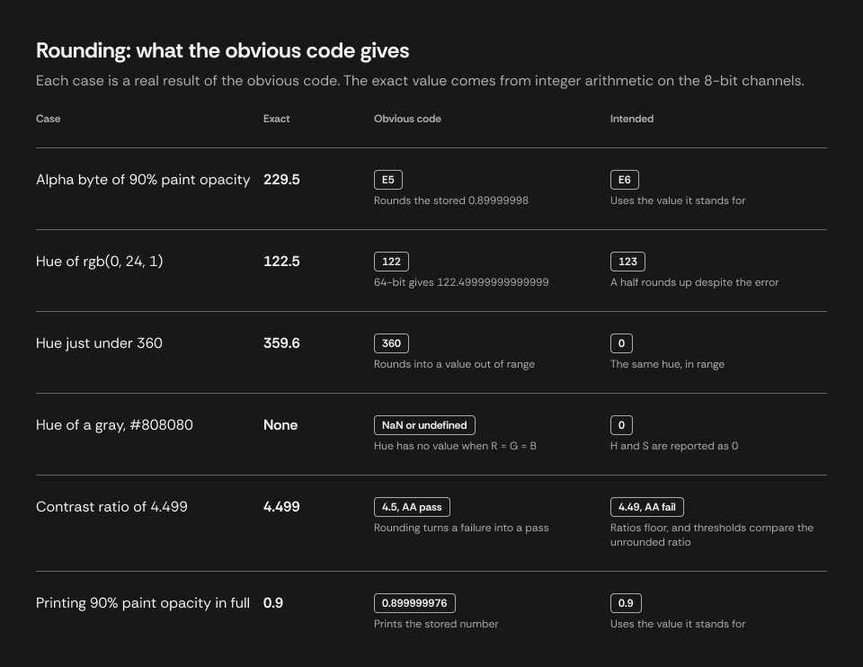
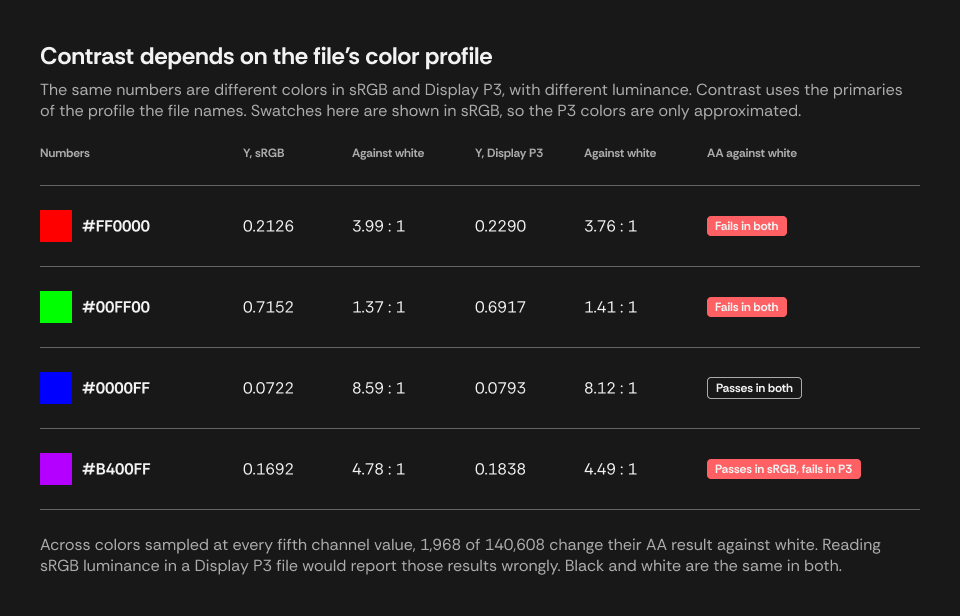

# Case Study: Exact Color Values in Figma

A design tool stores a color in a way that isn't quite what the person typed. This case study follows one concrete problem: **given what Figma's plugin API returns, show the exact values someone entered, in HEX, RGB, HSL, and HSB, with correct rounding.**

It picks up where [How Colors Work](./how-colors-work-from-light-to-implementation.md) leaves off. That document explains color spaces, quantization, and the HSL and HSB formulas, independently of any tool. Here those general ideas meet one implementation, and everything specific to Figma or to the [culori](https://culorijs.org/) 4.0.2 library is kept in this file. These are observed behaviors, measured on the dates given, and not guarantees from Figma or culori.

## Contents

- [The problem: 0.9 comes back as 0.8999999761581421](#the-problem-09-comes-back-as-08999999761581421)
- [Why plain rounding fails: exact halves](#why-plain-rounding-fails-exact-halves)
- [How far the error travels: noise through the formulas](#how-far-the-error-travels-noise-through-the-formulas)
- [Removing the noise: recovering the stored value](#removing-the-noise-recovering-the-stored-value)
- [What the numbers mean: color profiles](#what-the-numbers-mean-color-profiles)
- [Doing the conversions: notes on culori](#doing-the-conversions-notes-on-culori)
- [Measurements](#measurements)
- [References](#references)

## The problem: 0.9 comes back as 0.8999999761581421

A [solid fill](https://developers.figma.com/docs/plugins/api/Paint/) holds channels `{r, g, b}` from 0 to 1, with alpha held separately as the paint's `opacity`. All are stored in 32 bits, so 0.9 reads back as 0.8999999761581421. Writing a channel outside 0 to 1 is an error, and channels are not limited to multiples of 1/255 ([measurements](#figma-storage)).

Two kinds of opacity exist. Paint opacity belongs to the fill. Layer opacity belongs to a node and affects everything beneath it in the tree, so it changes what a viewer sees without changing the fill. [Section 7 of the main document](./how-colors-work-from-light-to-implementation.md#7-what-happens-when-colors-are-layered-alpha-and-compositing) explains why neither one can tell you the color actually seen.

At first the storage looks harmless. Section 6 of the main document shows that a 32-bit float distinguishes every 8-bit value, so `round(x * 255)` recovers any byte. But that rule fails where people least expect it: the alpha byte of 90% opacity should be `E6`, and it comes out as `E5`.



The obvious code isn't careless. Each case comes from a real property of the numbers, and the rest of this document works through them.

## Why plain rounding fails: exact halves

`0.9 * 255` is exactly 229.5, which rounds up to 230, or `E6`. The stored 0.8999999761581421 gives 229.49999..., which rounds down. The problem appears only because the true value lies exactly on a half.

That might sound rare. It isn't, because the formulas are ratios of small integers. Across all 16,777,216 8-bit colors there are 250,752 hues, 92,160 HSL saturations, and 135,936 HSB saturations that lie exactly on a half at integer precision. For example, `rgb(0, 24, 1)` has a hue of exactly 122.5, while 64-bit arithmetic produces 122.49999999999999, and plain half up gives 122 rather than 123.

Alpha has its own halves. `a * 255` lies on a half only at a = 0.1, 0.3, 0.5, 0.7, and 0.9, which are among the opacities people use most.

Figma's color picker rounds such a hue up: `#001801` displays H 123. That is one observed color rather than a documented rule ([not measured](#not-measured)), but it matches half up, the direction in [CSS Color 4](https://www.w3.org/TR/css-color-4/#rgb-functions).

## How far the error travels: noise through the formulas

A stored 32-bit value carries an error of up to about 3e-8. Formulas that divide by a small difference amplify it, as hue divides by `max - min` and HSL saturation by `1 - |2L - 1|`. Measured over every 8-bit color, the error in a computed H, S, L, or B reaches:

| Input | Largest error in a computed value |
|---|---|
| 32-bit channels | 1.14e-4 |
| 64-bit channels (k/255 exactly) | 7.1e-13 |

The natural fix is a tolerance. A method that absorbs error has to treat a number as a half when it is within the noise, but not when it is merely close. At integer precision, the closest any 8-bit color's value comes to a half without being one is 0.00198, so there is a window between 1.14e-4 and 0.00198 where a tolerance could work.

The window is narrow, and it closes as display precision rises. A tolerance of 3 or 4 decimals on stored numbers does give correct integers for every 8-bit color, but 2 and 5 decimals both fail, every tolerance tried fails at 2-decimal precision, and full-precision output still prints the noise ([measurements](#rounding-methods-h-s-l-and-b)). So rather than tolerate the noise, it is better to remove it.

## Removing the noise: recovering the stored value

Storage is a many-to-one function, but the values people enter are a small set: 8-bit channels, and opacities typed with few decimals. Inverting the function for that set removes the noise instead of tolerating it:

```
k = round(255 * stored)
d = round(10000 * stored) / 10000
if float32(k / 255) == stored                      use k / 255
else if stored is alpha, and float32(d) == stored  use d
else                                               use stored
```

Then compute in 64-bit, and apply half up with a tolerance of 1e-9, wide enough for the 7.1e-13 that remains, and far narrower than the 0.00198 gap. Full-precision output then gives the entered value, `0.9`, rather than the stored `0.899999976`. Over every 8-bit color and every display precision tried, this leaves no wrong numbers ([measurements](#rounding-methods-h-s-l-and-b)).

For a color that is not 8-bit, nothing is recovered and the stored number is used. Its noise then changes a displayed digit only at a half, which such a color has no particular reason to land on.

The tolerance belongs only to displayed values. [Contrast takes no tolerance](./how-colors-work-from-light-to-implementation.md#13-where-implementations-take-over), because WCAG says computed ratios are not rounded.

## What the numbers mean: color profiles

Recovering the numbers doesn't settle what color they are. A file names [its color profile](https://help.figma.com/hc/en-us/articles/360039825114): sRGB, Display P3, or Legacy for files created before color management. Figma documents that a Legacy file renders in the user's preferred profile, or in sRGB where none is set. Converting a file's profile changes the stored values and keeps the appearance, while assigning one keeps the values and changes the appearance. A plugin can [read the profile](https://developers.figma.com/docs/plugins/api/DocumentNode/) but not change it.

HEX, RGB, HSL, and HSB are unaffected, since they only restate the numbers. Contrast is affected, because luminance needs the primaries:



A plugin showing contrast should therefore read the document profile and use the matching weights.

## Doing the conversions: notes on culori

culori's `hsl` and `hsv` modes use values from 0 to 1 for S, L, and V. For an achromatic color it omits `h` rather than setting it, and sets `s` to 0. Its `lrgb` is the linear sRGB mode, and it uses a threshold of 0.04045. Because the transfer function is shared, its output is also the linear form of Display P3 numbers.

`wcagLuminance` and `wcagContrast` read through the `lrgb` mode and ignore alpha. A color's mode says which space its channels are in, so tagging them `p3` gives Display P3 luminance. That route passes through XYZ and linear sRGB, which has two effects:

- Y stays within 4.9e-5 of the published weights. Of 140,608 sampled colors, 5 get a different AA result against white than those weights give.
- White comes out at Y = 0.9999999999999999, so white on black is 20.999999999999996, which floors to 20.99. A gray is the same color in both spaces, so tagging grays `rgb` gives exactly 21.

culori supports Lab, LCH, OKLab, and OKLCH. Its [list of color spaces](https://culorijs.org/color-spaces/) has no HCT or CMYK.

**Registering modes.** culori holds a table of the color modes it knows, and a mode's definition contains its conversions. Registering, by calling `useMode(modeHsl)`, adds an entry to that table. The main `culori` entry registers every mode when imported, so a bundler has to keep them all. The `culori/fn` entry registers none, so only the modes actually imported reach the bundle. Using a mode that isn't registered does not fail in one consistent way: `converter('hsl')` on an unregistered mode returned `undefined` in our test, while `wcagLuminance` without `lrgb`, or a color tagged `p3` without `p3` registered, threw. These dependencies are easy to miss, because they are internal to the function that needs them.

## Measurements

Figma measurements were taken on 2026-11-03 and the storage table was repeated on 2026-11-04, with Figma's plugin API. The sweeps cover all 16,777,216 8-bit colors, against exact integer arithmetic on the channels. The rounding sweeps use five outputs per color (H, HSL S, L, HSB S, B), and use `Math.fround` of k/255 as the model of Figma's storage, which the first table confirms.

### Figma storage

Written to a temporary rectangle and read back.

| Written | Read | Result |
|---|---|---|
| Paint opacity 0.9 | 0.8999999761581421 | The 32-bit form |
| Paint opacity i/1000, all 1001 values | | All the 32-bit form |
| Paint opacity k/255, all 256 values | | All the 32-bit form |
| Layer opacity 0.9 | 0.8999999761581421 | The 32-bit form |
| k/255 in each single channel, all 256 values | | All the 32-bit form |
| Gray, k/255 in all channels, all 256 values | | All the 32-bit form, except k = 234 |
| Gray, 234/255 in all channels | 0.9188234806060791, about 234.3/255 | Repeatable across files and days; cause unknown |
| `figma.util.solidPaint("#1A2B3CE6")` | Opacity 0.9019607901573181 once stored | Alpha from HEX is k/255, not 0.9 |
| Channel 1.0000001, 1.5, or -0.0001 | | Validation error |
| `#C04040` exported as PNG from an sRGB file, tagged Display P3 | Pixels 192, 64, 64 | The same numbers with a different tag, so no conversion |

The gray at 234 still rounds to `EA`, and its integer HSL and HSB match those of 234/255. Its full-precision channel is 0.918823481 rather than 0.917647059. Separately, 5 of the 21 channels in one file's color variables were not multiples of 1/255, such as about 243.48/255.

### Rounding methods, H, S, L, and B

Count of wrong numbers among 83,886,080 per precision. The tolerance means first rounding to that many decimal places beyond the displayed precision, at the output's scale, and then applying half up. The integer and 1-decimal columns used culori's conversions, and the 2-decimal column the formulas in the main document, so the no-tolerance rows depend a little on the order of operations.

| Input | Tolerance | Integer | 1 decimal | 2 decimals |
|---|---|---|---|---|
| 64-bit | None | 72,136 | 64,658 | 36,608 |
| 32-bit | None | 195,957 | 147,029 | 108,177 |
| 32-bit | 2 decimals | 123,150 | 125,406 | 130,983 |
| 32-bit | 3 decimals | 0 | 0 | 1,050 |
| 32-bit | 4 decimals | 0 | 1,740 | 59,523 |
| 32-bit | 5 decimals | 2,964 | 82,683 | 101,490 |
| Recovered | 9 decimals, absolute | 0 | 0 | 0 |

### Alpha

Entered as i/10000, all 10,001 values, stored in 32 bits, against exact integer arithmetic.

| Output | No handling | Recovered |
|---|---|---|
| Byte (`a * 255`) | 2 wrong (0.7 and 0.9) | 0 |
| Percent, integer | 48 wrong | 0 |

All 256 k/255 entries gave the right byte under each method.

### Display P3

Computed from the formulas in the main document. Of colors sampled at every fifth channel value, 1,968 of 140,608 change their AA result against white between sRGB and Display P3 weights.

Measured in a Figma file changed to Display P3 by assigning, with an instance pasted beforehand from an sRGB file:

| Checked | Result |
|---|---|
| Document color profile | Reads `DISPLAY_P3` |
| A fill on the instance | Keeps its numbers: 42, 140, 252 |
| Remote variables on the instance | Keep their numbers, such as 255, 96, 99 |
| Storage of channels and opacity | As in the sRGB table above, including gray at 234 |
| Default PNG export of `#C04040` | Pixels 192, 64, 64, tagged Display P3 |
| PNG export of `#C04040`, chosen as sRGB | Pixels 192, 64, 64, tagged sRGB. A conversion would give 208, 49, 58, so this changes the tag only |

### Tone at a target contrast

At a target of 3, with channels sampled at every third value, neither direction failed to reach the target for any color.

### Not measured

- A value entered through Figma's interface rather than the API. Surveyed variables were all valid 32-bit values, but opacity typed as a percentage in the color picker was not directly observed.
- An instance pasted into a file already in Display P3, and a file changed by converting rather than assigning.
- Whether Figma reports a change of profile to a running plugin.
- That Figma's color picker shows a Display P3 file's stored numbers, which its help page implies.
- How Figma's interface rounds an exact half in general. One color was checked: `#001801`, whose hue is exactly 122.5, shows as H 123, S 100, L 5, A 100% in the color picker.
- Other Figma clients.

## References

- [Manage color profiles in design files](https://help.figma.com/hc/en-us/articles/360039825114), Figma Help. Profiles, Legacy files, and converting against assigning.
- [DocumentNode](https://developers.figma.com/docs/plugins/api/DocumentNode/) and [Paint](https://developers.figma.com/docs/plugins/api/Paint/), Figma Plugin API. The document color profile, and how a solid fill holds color and opacity.
- [Color spaces](https://culorijs.org/color-spaces/) and [API](https://culorijs.org/api/), culori.
- [How Colors Work: From Light to Implementation](./how-colors-work-from-light-to-implementation.md). The general treatment, with its own references.
