# How Colors Work: From Color Spaces to Implementation

How color values are represented, converted, and rounded, stated mathematically and independently
of any library. Notes on [culori](https://culorijs.org/) 4.0.2 and on Figma follow each topic where
they help. Sources are linked where they are used, and collected under [References](#13-references).

## Contents

1. [Vocabulary](#1-vocabulary)
2. [Numeric representations](#2-numeric-representations)
3. [Channels and alpha](#3-channels-and-alpha)
4. [Discretization and rounding](#4-discretization-and-rounding)
5. [Linearization](#5-linearization)
6. [Color spaces and gamut](#6-color-spaces-and-gamut)
7. [RGB, HSL, and HSB](#7-rgb-hsl-and-hsb)
8. [Luminance and contrast](#8-luminance-and-contrast)
9. [Finding a tone at a target contrast](#9-finding-a-tone-at-a-target-contrast)
10. [Writing values for reuse](#10-writing-values-for-reuse)
11. [Other models](#11-other-models)
12. [Measurements](#12-measurements)
13. [References](#13-references)

## 1. Vocabulary

These terms are often used interchangeably, but they answer different questions.

| Term | Question it answers | Examples |
|---|---|---|
| Color space | Which physical color do these numbers mean? Fixed by primaries, a white point, and a transfer function. | sRGB, Display P3 |
| Color model | How is a color in that space parameterized? | RGB, HSL, HSB, CMYK |
| Encoding | How are the numbers written down? | `#1A2B3C`, 0 to 1 floats, 0 to 255 integers |

HSL and HSB are not color spaces. They rearrange the RGB numbers of some space, so H 210, S 40, L 17
means different colors in sRGB and in Display P3. Moving between models is exact arithmetic. Moving
between spaces changes the numbers to preserve the physical color.
[culori's list of color spaces](https://culorijs.org/color-spaces/) is a quick survey of both kinds, and
[CSS Color 4](https://www.w3.org/TR/css-color-4/) defines most of them precisely.

## 2. Numeric representations

| Representation | Values | Resolution | Typical use |
|---|---|---|---|
| 8-bit integer | 0 to 255 | 1/255, about 0.39% of the range | HEX, RGB |
| 32-bit float | 24-bit significand | Near 1, a spacing of 2^-24 and an error of at most 2^-25, about 3e-8 | GPUs, and Figma's storage |
| 64-bit float | 53-bit significand | Near 1, an error of at most 2^-53, about 1e-16 | JavaScript arithmetic |
| Decimal text | Fixed digits | Set by the format | Displayed and copied values |

A 32-bit float distinguishes every 8-bit value, and its error on the 0 to 255 scale is at most about
8e-6, so `round(x * 255)` recovers the byte. Most decimals, and most values k/255, have no exact
binary form in either width. In JavaScript,
[`Math.fround`](https://developer.mozilla.org/en-US/docs/Web/JavaScript/Reference/Global_Objects/Math/fround)
gives the 32-bit form of a number, and
[Goldberg's paper](https://docs.oracle.com/cd/E19957-01/806-3568/ncg_goldberg.html) is the standard
account of this arithmetic.

**Figma:** a [solid fill](https://developers.figma.com/docs/plugins/api/Paint/) holds channels `{r, g, b}`
from 0 to 1, with alpha held separately as the paint's `opacity`. All are stored in 32 bits, so 0.9 reads
back as 0.8999999761581421. Writing a channel outside 0 to 1 is an error, and channels are not limited to
multiples of 1/255 ([measurements](#figma-storage)).

## 3. Channels and alpha

Alpha is coverage, not a color channel. It says how much of the color is laid over what is behind
it, so a translucent color has no single appearance:

```
C_out = alpha * C_source + (1 - alpha) * C_backdrop
```

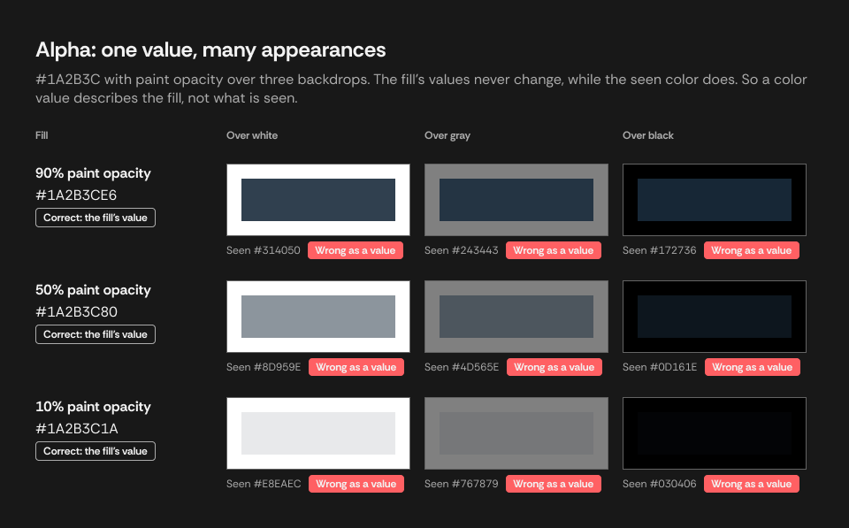

With **straight** alpha, channels hold the color independently of alpha. **Premultiplied** alpha stores
`alpha * C` instead, which suits compositing but loses channel precision at low alpha.

Contrast formulas take opaque colors. For a translucent color the result depends on the backdrop, so a
ratio computed from the channels alone describes the color at full opacity.

**Figma:** paint opacity belongs to the fill. Layer opacity belongs to a node and affects everything
beneath it in the tree, so it changes what a viewer sees without changing the fill.

## 4. Discretization and rounding

### Quantization

Writing a continuous value in finite digits is quantization. For a channel x from 0 to 1:

```
k = round(255 * x)        quantize, x to an 8-bit value
x' = k / 255              reconstruct
|x - x'| <= 1 / 510       worst-case error
```

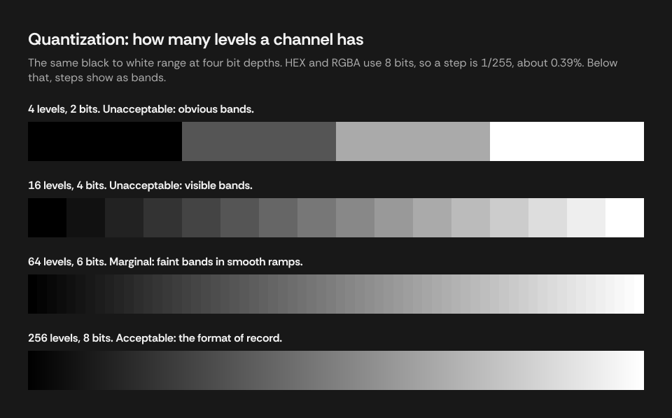

Quantization is lossy, so each number should be computed from the exact value rather than from another
rounded number.

### Display precision

The integer HSL grid has 360 x 101 x 101 = 3,672,360 points, against 16,777,216 8-bit RGB colors, so
integers cannot round-trip as a matter of counting. Measured over every 8-bit color, converted to the
display precision and back:

| Decimals | HSL, colors changed | Largest channel error | HSB, colors changed | Largest channel error |
|---|---|---|---|---|
| 0 | 15,001,678 | 5 | 14,732,503 | 3 |
| 1 | 0 | 0 | 0 | 0 |
| 2 | 0 | 0 | 0 | 0 |

Integer HSL and HSB are therefore for reading, while HEX and RGB integers hold an 8-bit color exactly.
Color pickers commonly show integers, as Figma's does.

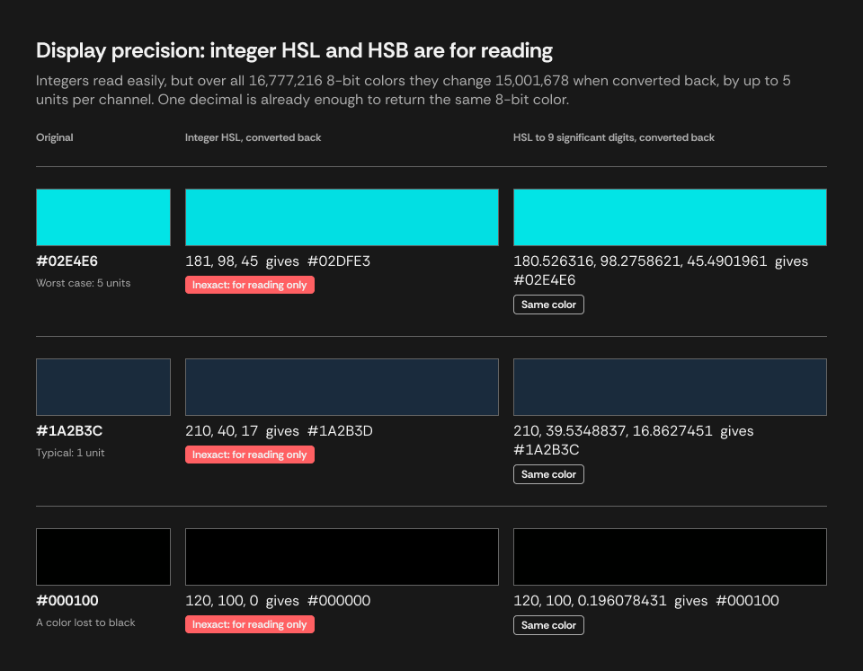

### Rounding modes

| Mode | 2.5 | 3.5 | -2.5 | Suits |
|---|---|---|---|---|
| Half up | 3 | 4 | -2 | Displaying a value |
| Half even | 2 | 4 | -2 | Summing many rounded values, where it avoids bias |
| Floor | 2 | 3 | -3 | Reporting against a threshold, so that a failure never rounds into a pass |

Half up is the rule in [CSS Color 4](https://www.w3.org/TR/css-color-4/#the-hsl-notation), as "rounded
towards +∞", and Figma's color picker rounds a hue of exactly 122.5 up to 123.
[`toFixed`](https://developer.mozilla.org/en-US/docs/Web/JavaScript/Reference/Global_Objects/Number/toFixed)
follows neither mode, because it rounds the stored binary value, so a number that looks like a half can go
either way.

For non-negative values, half up is `floor(x + 0.5)` in exact arithmetic. In floating-point arithmetic
that expression is not enough, as the next two sections show.

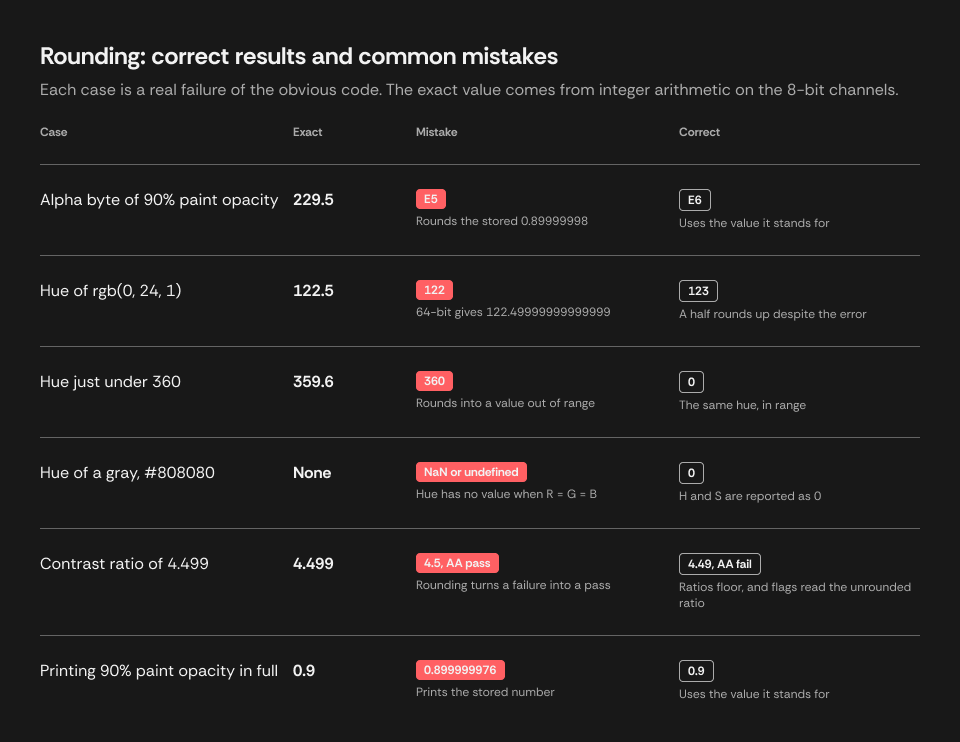

### Exact halves are common

Exact halves are ordinary results of these formulas. Across all 16,777,216 8-bit colors there are
250,752 hues, 92,160 HSL saturations, and 135,936 HSB saturations that lie exactly on a half at integer
precision. For example, `rgb(0, 24, 1)` has a hue of exactly 122.5, while 64-bit arithmetic produces
122.49999999999999, and plain half up gives 122 rather than 123.

Alpha has its own halves. `a * 255` lies on a half only at a = 0.1, 0.3, 0.5, 0.7, and 0.9.

### Noise and how it grows

A stored 32-bit value carries an error of up to about 3e-8. Formulas that divide by a small difference
amplify it, as hue divides by `max - min` and HSL saturation by `1 - |2L - 1|`. Measured over every
8-bit color, the error in a computed H, S, L, or B reaches:

| Input | Largest error in a computed value |
|---|---|
| 32-bit channels | 1.14e-4 |
| 64-bit channels (k/255 exactly) | 7.1e-13 |

A method that absorbs error has to treat a number as a half when it is within the noise, but not
when it is merely close. At integer precision, the closest any 8-bit color's value comes to a half
without being one is 0.00198. A tolerance of 3 or 4 decimals on stored numbers does give correct integers
for every 8-bit color, but 5 decimals and 2 decimals both fail, every tolerance tried fails at 2-decimal
precision, and full-precision output still prints the noise ([measurements](#rounding-methods-h-s-l-and-b)).

### Recovering the stored value

Storage is a many-to-one function, but the values people enter are a small set. Inverting it for that
set removes the noise instead of tolerating it:

```
k = round(255 * stored)
d = round(10000 * stored) / 10000
if float32(k / 255) == stored                      use k / 255
else if stored is alpha, and float32(d) == stored  use d
else                                               use stored
```

Then compute in 64-bit, and apply half up with a tolerance of 1e-9, wide enough for the 7.1e-13 that
remains, and far narrower than the 0.00198 gap. Full-precision output then gives the entered value, `0.9`,
rather than the stored `0.899999976`.

For a color that is not 8-bit, nothing is recovered and the stored number is used. Its noise then
changes a displayed digit only at a half, which such a color has no particular reason to land on.

**Contrast takes no tolerance.** [WCAG's guidance](https://www.w3.org/WAI/WCAG22/Understanding/contrast-minimum.html)
is that computed values should not be rounded, and that 4.499:1 does not meet 4.5:1. Flooring a ratio
already errs low, and a tolerance could lift 4.49999 to 4.5 and turn a failure into a pass. A ratio that
floating-point error puts just under a two-decimal boundary reads one hundredth low, which is the safe
direction.

## 5. Linearization

RGB values in sRGB are encoded nonlinearly, to spend precision where vision is most sensitive. Light
adds and mixes in linear values, so luminance and any conversion between spaces need decoding first.

```
decode:  c_lin = c / 12.92                       if c <= 0.04045
         c_lin = ((c + 0.055) / 1.055) ^ 2.4     otherwise

encode:  c = 12.92 * c_lin                       if c_lin <= 0.0031308
         c = 1.055 * c_lin ^ (1 / 2.4) - 0.055   otherwise
```

The straight segment near black avoids an infinite slope. The curve is close to an overall gamma of
2.2, but is not one. It is also why mid-gray is not half the light: an encoded 0.5 decodes to 0.214.

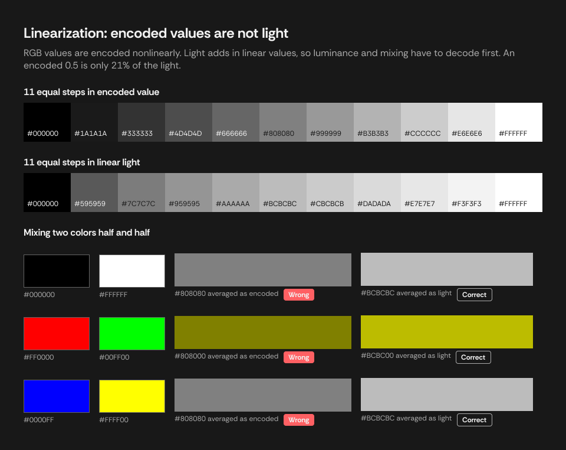

[WCAG](https://www.w3.org/TR/WCAG22/#dfn-relative-luminance) gave a threshold of 0.03928 until May 2021,
and now gives 0.04045 ([issue 360](https://github.com/w3c/wcag/issues/360)). They give identical results
for every 8-bit value, because no k/255 falls between them. For other values they differ by at most 7.6e-7.

[Display P3](https://www.w3.org/TR/css-color-4/#predefined-display-p3) uses this same transfer function,
so the same decoding applies.

**culori:** `lrgb` is its linear sRGB mode, and it uses 0.04045. Because the transfer function is
shared, its output is also the linear form of Display P3 numbers.

## 6. Color spaces and gamut

A linear RGB space maps to the device-independent CIE XYZ by a matrix fixed by its primaries and white
point. Both of these use the D65 white point:

```
sRGB to XYZ                              Display P3 to XYZ
| 0.4124564  0.3575761  0.1804375 |      | 0.4865709  0.2656677  0.1982173 |
| 0.2126729  0.7151522  0.0721750 |      | 0.2289746  0.6917385  0.0792869 |
| 0.0193339  0.1191920  0.9503041 |      | 0.0000000  0.0451134  1.0439444 |
```

The middle row gives Y, the luminance. CSS Color 4 publishes
[sample code](https://www.w3.org/TR/css-color-4/#color-conversion-code) for these conversions. To convert
between spaces:

```
encoded A -> decode -> linear A -> matrix A -> XYZ -> inverse matrix B -> linear B -> encode -> encoded B
```

Display P3 has a wider gamut than sRGB, so converting a saturated P3 color into sRGB gives channels
outside 0 to 1, which must be clipped or gamut-mapped, and either one changes the color.

The space decides what the numbers mean, so `#FF0000` is a different red in sRGB and in Display P3. It
bears on each kind of value differently:

| Value | Depends on the space? | Why |
|---|---|---|
| HEX, RGB | No | They are the numbers themselves |
| HSL, HSB | No | They rearrange the numbers |
| Luminance, contrast | Yes | They measure light, so they need the primaries |
| White and black | No | Y is 1 and 0 in both spaces |

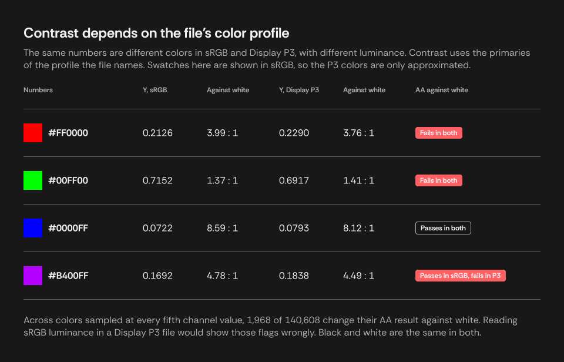

**Figma:** a file names [its color profile](https://help.figma.com/hc/en-us/articles/360039825114): sRGB,
Display P3, or Legacy for files created before color management. Figma documents that a Legacy file renders
in the user's preferred profile, or in sRGB where none is set. Converting a file's profile changes the stored
values and keeps the appearance, while assigning one keeps the values and changes the appearance. A plugin
can [read the profile](https://developers.figma.com/docs/plugins/api/DocumentNode/) but not change it.

## 7. RGB, HSL, and HSB

HSL and HSB (also called HSV) describe the RGB cube by hue and two other axes. CSS Color 4
[defines HSL](https://www.w3.org/TR/css-color-4/#the-hsl-notation), with
[sample code](https://www.w3.org/TR/css-color-4/#hsl-to-rgb), and CSS has no HSB. Both start from these,
with channels from 0 to 1:

```
M = max(R, G, B)     m = min(R, G, B)     C = M - m
```

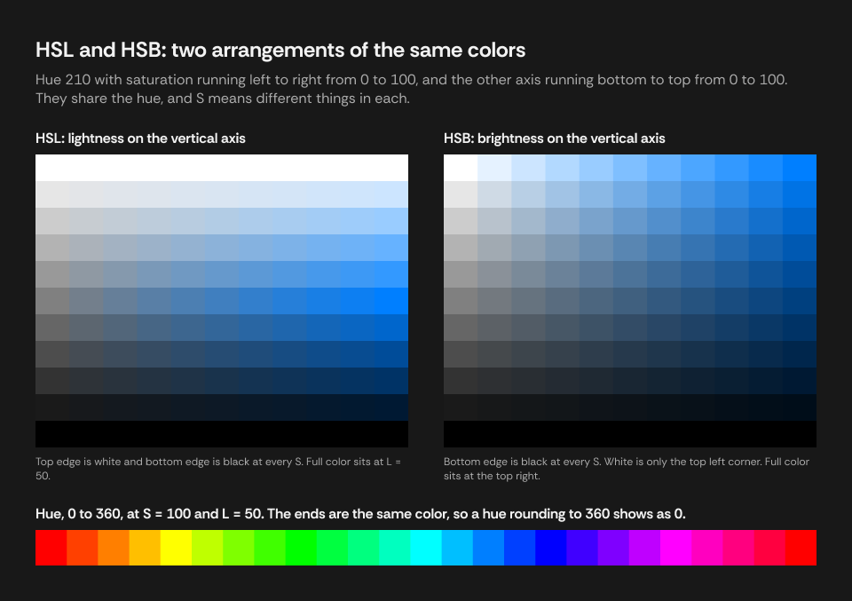

### Hue

The position around the cube's edge, in degrees, and shared by both models:

```
H = undefined                            if C = 0
H = 60 * (((G - B) / C) mod 6)           if M = R
H = 60 * ((B - R) / C + 2)               if M = G
H = 60 * ((R - G) / C + 4)               if M = B
```

Where C = 0 the color is achromatic and has no hue, so a displayed value needs a convention, usually 0.
Since 360 and 0 are the same hue, a hue of 359.6 rounds to 360 and should display as 0.

### Saturation and lightness or brightness

```
HSL:  L = (M + m) / 2
      S = 0                        if C = 0
      S = C / (1 - |2L - 1|)       otherwise

HSB:  B = M
      S = 0                        if M = 0
      S = C / M                    otherwise
```

The two saturations are different quantities. Pure red is S = 100 in both, while a pale pink can be
S = 100 in HSL and S = 10 in HSB.

### Back to RGB

```
HSL:  a = S * min(L, 1 - L)
      f(n) = L - a * max(-1, min(k - 3, 9 - k, 1))     where k = (n + H / 30) mod 12
      (R, G, B) = (f(0), f(8), f(4))

HSB:  f(n) = B - B * S * max(0, min(k, 4 - k, 1))      where k = (n + H / 60) mod 6
      (R, G, B) = (f(5), f(3), f(1))
```

### Directly between HSL and HSB

```
B = L + S_l * min(L, 1 - L)
S_b = 0 if B = 0, else 2 * (1 - L / B)

L = B * (1 - S_b / 2)
S_l = 0 if L is 0 or 1, else (B - L) / min(L, 1 - L)
```

### Worked example

`#1A2B3C` at 90% opacity:

| Step | Exact | Integer | 9 significant digits |
|---|---|---|---|
| Channels | 26/255, 43/255, 60/255 | `26, 43, 60` | `0.101960784, 0.168627451, 0.235294118` |
| M, m, C | 60/255, 26/255, 34/255 | | |
| H (M = B) | 60 * ((26 - 43) / 34 + 4) = 210 | `210` | `210` |
| L | 86/510 = 16.8627...% | `17` | `16.8627451` |
| S, HSL | 34/86 = 39.5348...% | `40` | `39.5348837` |
| S, HSB | 34/60 = 56.6666...% | `57` | `56.6666667` |
| B | 60/255 = 23.5294...% | `24` | `23.5294118` |
| Alpha byte | 0.9 * 255 = 229.5, half up | `E6` | |

### HSL lightness is not perceived lightness

HSL and HSB are geometric rearrangements with no model of vision. Yellow and blue both have L = 50%,
but their luminances are 0.93 and 0.07. Decisions about legibility therefore use luminance rather
than L. CSS Color 4 lists this among [HSL's disadvantages](https://www.w3.org/TR/css-color-4/#disadvantage-hsl),
and [Ottosson's Oklab post](https://bottosson.github.io/posts/oklab/) shows the same unevenness in HSV.

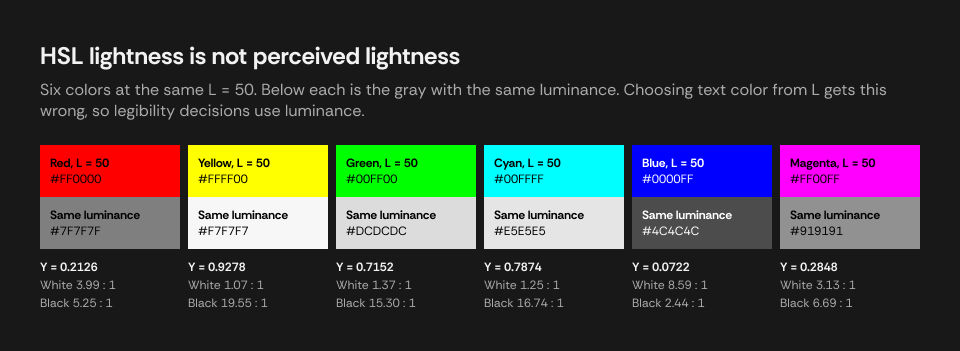

**culori:** `hsl` and `hsv` modes, with values from 0 to 1 for S, L, and V. For an achromatic color
it omits `h` rather than setting it, and sets `s` to 0.

## 8. Luminance and contrast

```
Y = w_r * R_lin + w_g * G_lin + w_b * B_lin

ratio = (Y_lighter + 0.05) / (Y_darker + 0.05)
```

The weights are the middle row of the space's matrix, reflecting how bright each primary is:

| Space | w_r | w_g | w_b |
|---|---|---|---|
| sRGB | 0.2126 | 0.7152 | 0.0722 |
| Display P3 | 0.2289746 | 0.6917385 | 0.0792869 |

[WCAG defines relative luminance](https://www.w3.org/TR/WCAG22/#dfn-relative-luminance) for "any point
in a colorspace" and gives the formula for sRGB as a note. A comment in
[issue 360](https://github.com/w3c/wcag/issues/360) says that a space such as Display P3 should use its own
chromaticities and white point. Checkers such as [WebAIM's](https://webaim.org/resources/contrastchecker/)
and [Siege Media's](https://www.siegemedia.com/contrast-ratio) take hex values, which CSS defines as sRGB,
so their figures describe the sRGB color with those numbers.

The [contrast ratio](https://www.w3.org/TR/WCAG22/#dfn-contrast-ratio) adds 0.05 to each side, which models
ambient flare and keeps the ratio finite at black. It runs from 1 to 21, since
(1 + 0.05) / (0 + 0.05) = 21. Thresholds are 4.5 (AA), 3 (AA large text), and 7 (AAA), compared against the
unrounded ratio. In sRGB, `#1A2B3C` has Y = 0.02274, which gives 14.43 against white and 1.45 against black,
each floored to 2 decimals.

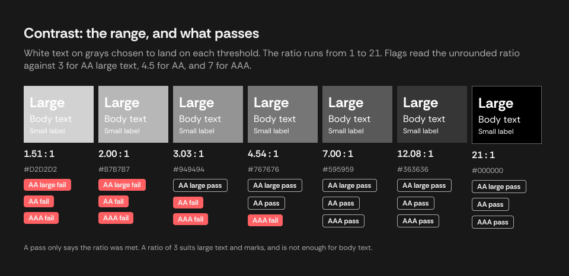

**The best any color can do.** A color with luminance Y reaches its highest ratio against white or
against black. The lower of those two is smallest where they meet:

```
1.05 / (Y + 0.05) = (Y + 0.05) / 0.05    gives    Y + 0.05 = sqrt(1.05 * 0.05)    so    Y = 0.1791
ratio there = sqrt(21) = 4.583
```

So every color reaches at least 4.583 against white or black, and no higher guarantee is possible.

**Choosing between two text colors.** Compare the two ratios, because a rule based on L gets colors near
the crossing wrong. With `#F2F2F2` and `#181818` rather than pure white and black, the crossing point
moves: they tie at Y = 0.1855, near `#777777`, at 3.98 : 1.

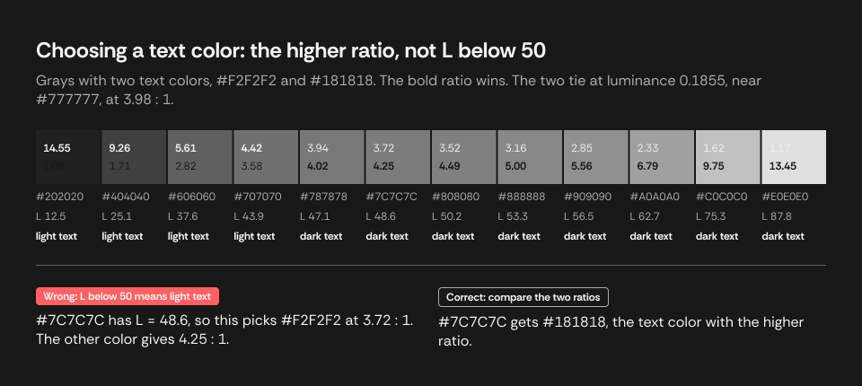

**culori:** `wcagLuminance` and `wcagContrast` read through the `lrgb` mode and ignore alpha. A color's
mode says which space its channels are in, so tagging them `p3` gives Display P3 luminance. That route
passes through XYZ and linear sRGB, which has two effects:

- Y stays within 4.9e-5 of the published weights above. Of 140,608 sampled colors, 5 get a different AA
  result against white than those weights give.
- White comes out at Y = 0.9999999999999999, so white on black is 20.999999999999996, which floors to 20.99.
  A gray is the same color in both spaces, so tagging grays `rgb` gives exactly 21.

## 9. Finding a tone at a target contrast

A tone of a color's own hue, at the least contrast that stays readable, can be found by holding H and S
fixed and searching L for the smallest change whose ratio against the color reaches a target T.

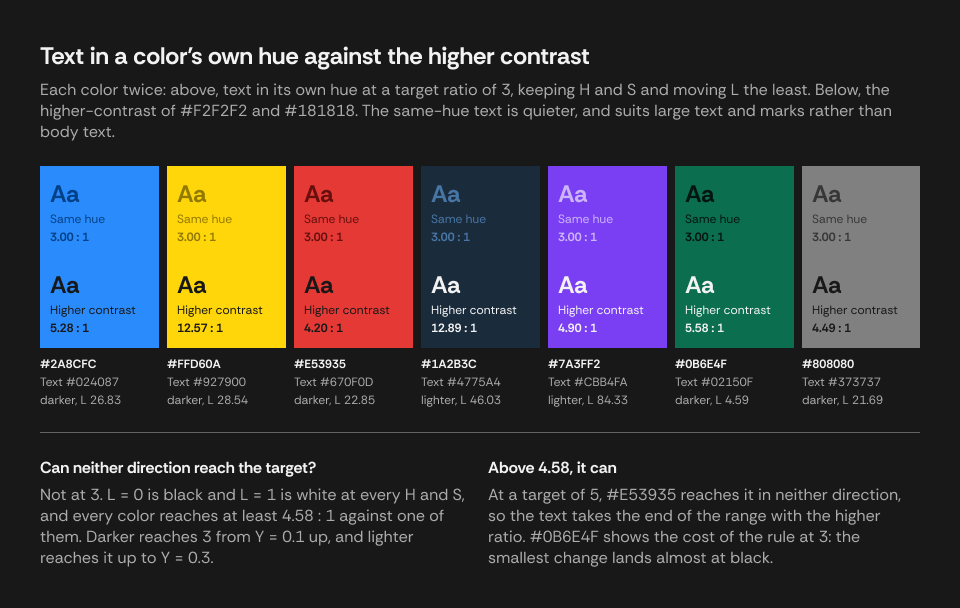

**A search can stop at the first passing value.** With H and S fixed, every channel from the
formula in [Back to RGB](#back-to-rgb) is non-decreasing in L, and luminance is strictly increasing,
so the ratio grows steadily in each direction away from the color. Each direction therefore has one
boundary, which bisection finds. All of this holds in any RGB space, since the weights are positive.

**When a direction reaches the target.** L = 0 is black and L = 1 is white, for every H and S, so the
extremes of the search are exactly the extremes of section 8. For a color of luminance Y:

```
darker reaches T    if (Y + 0.05) / 0.05 >= T
lighter reaches T   if 1.05 / (Y + 0.05) >= T
```

At T = 3, darker reaches for Y >= 0.1, and lighter reaches for Y <= 0.3. These ranges overlap, so one
direction always reaches and both do for Y between 0.1 and 0.3. Neither direction can reach only if
T is above sqrt(21), about 4.583. At T = 5, `#E53935` is such a color.

The rule can land near an extreme. `#0B6E4F` has a luminance just above 0.1, so its smallest change is
down to L = 4.59, which is almost black, though lightening would have kept more of the hue.

## 10. Writing values for reuse

The same color can be written for different consumers, shown here for `#1A2B3C` at 90%:

| Form | HEX | RGBA | HSL |
|---|---|---|---|
| Rounded, for reading | `#1A2B3CE6` | `26, 43, 60, 0.9` | `210, 40, 17, 90` |
| CSS | `#1A2B3CE6` | `rgba(26, 43, 60, 0.9)` | `hsla(210, 40%, 17%, 0.9)` |
| Full precision | `#1A2B3CE6` | `0.101960784, 0.168627451, 0.235294118, 0.9` | `210, 39.5348837, 16.8627451, 90` |

The CSS form of HSL above is rounded, so CSS that has to reproduce a color should use HEX or `rgba()`.

Nine significant digits are [enough to recover any 32-bit value](https://docs.oracle.com/cd/E19957-01/806-3568/ncg_goldberg.html),
and stop short of the digits that are only 64-bit noise. Consumers with 0 to 1 channels, such as SwiftUI,
Unity, and shaders, take this form. Every 8-bit value comes back as the same byte. 249 of the 256 come back
as the same 32-bit number as `float32(k / 255)`, and the other 7 are one 32-bit step away.

| Reused from | Acceptable? | Why |
|---|---|---|
| HEX, RGBA, for an 8-bit color | Yes | Exactly the color |
| HEX, RGBA, for a color that is not 8-bit | With care | Rounded to the nearest 8-bit color |
| Integer HSL, HSB | No | Up to 5 units per channel off when converted back |

A value also leaves its color space behind. Display P3 numbers mean a different color when read as sRGB, and
CSS `#RRGGBB`, `rgba()`, and `hsl()` all [resolve to sRGB](https://www.w3.org/TR/css-color-4/#the-hsl-notation).
CSS's way to say Display P3 is
[`color(display-p3 r g b / a)`](https://developer.mozilla.org/en-US/docs/Web/CSS/color_value/color), widely
available in browsers since May 2023. It keeps the color on wide-gamut screens, while the same numbers in sRGB
syntax can look less saturated. HEX and HSL have no Display P3 form in CSS.

## 11. Other models

For Oklab, [Ottosson's post](https://bottosson.github.io/posts/oklab/) gives the derivation and the matrices.
On building palettes programmatically, see
[Coloring With Code](https://tympanus.net/codrops/2021/12/07/coloring-with-code-a-programmatic-approach-to-design/)
and [HSB interpolation for Figma color variables](https://uxdesign.cc/simplified-figma-color-variables-based-on-hsb-interpolation-c3e404585176).

| Model | Built for | Conversion path |
|---|---|---|
| CIELAB, LCH | Approximate perceptual uniformity | Linear RGB, XYZ, adapt to D50, then a cube-root function of X/Xn, Y/Yn, Z/Zn; LCH is polar Lab |
| OKLab, OKLCH | Better hue linearity than Lab | Linear RGB, a matrix to cone-like responses, a cube root, a second matrix; OKLCH is polar OKLab |
| HCT | Hue and chroma from CAM16, tone from L* | Requires a color appearance model, and has an iterative inverse |
| CMYK | Ink on a specific press | Device-dependent, so an accurate conversion needs an ICC profile. The formula `K = 1 - M` is only a rough approximation |

**culori:** supports Lab, LCH, OKLab, and OKLCH, each by registering its mode. Its
[list of color spaces](https://culorijs.org/color-spaces/) has no HCT or CMYK.

**Registering modes in culori.** culori holds a table of the color modes it knows, and a mode's
definition contains its conversions. Registering, by calling `useMode(modeHsl)`, adds an entry to
that table. The main `culori` entry registers every mode when imported, so a bundler has to keep them
all. The `culori/fn` entry registers none, so only the modes actually imported reach the bundle, and
calling a conversion whose mode is missing throws. `wcagLuminance` and `wcagContrast` need `lrgb` to be
registered, which is easy to miss because they depend on it internally, and a color tagged `p3` needs `p3`
as well.

## 12. Measurements

Taken on 2026-11-03, with Figma's plugin API. The sweeps cover all 16,777,216 8-bit colors, against
exact integer arithmetic on the channels. The rounding sweeps use five outputs per color (H, HSL S, L,
HSB S, B), and they use `Math.fround` of k/255 as the model of Figma's storage, which the first table
confirms. The integer and 1-decimal columns used culori's conversions, and the 2-decimal column the
formulas in section 7.

### Figma storage

Written to a temporary rectangle and read back.

| Written | Read | Result |
|---|---|---|
| Paint opacity 0.9 | 0.8999999761581421 | The 32-bit form |
| Paint opacity i/1000, all 1001 values | | All the 32-bit form |
| Paint opacity k/255, all 256 values | | All the 32-bit form |
| Layer opacity 0.9 | 0.8999999761581421 | The 32-bit form |
| k/255 in each single channel, all 256 values | | All the 32-bit form |
| Gray, k/255 in all channels, all 256 values | | All the 32-bit form, except k = 234 |
| Gray, 234/255 in all channels | 0.9188234806060791, about 234.3/255 | Repeatable in two files; cause unknown |
| `figma.util.solidPaint("#1A2B3CE6")` | Opacity 0.9019607901573181 | Alpha from HEX is k/255, not 0.9 |
| Channel 1.0000001, 1.5, or -0.0001 | | Validation error |
| `#C04040` exported as PNG from an sRGB file, tagged Display P3 | Pixels 192, 64, 64 | The same numbers with a different tag, so no conversion |

The gray at 234 still rounds to `EA`, and its integer HSL and HSB match those of 234/255. Its full-precision
channel is 0.918823481 rather than 0.917647059. Separately, 5 of the 21 channels in one file's color variables
were not multiples of 1/255, such as about 243.48/255.

### Rounding methods, H, S, L, and B

Count of wrong numbers among 83,886,080 per precision. The tolerance means rounding to that many
decimal places, at the output's scale, before applying half up.

| Input | Tolerance | Integer | 1 decimal | 2 decimals |
|---|---|---|---|---|
| 64-bit | None | 72,136 | Not run | 36,608 |
| 32-bit | None | 195,957 | Not run | 108,177 |
| 32-bit | 2 decimals | 123,150 | 125,406 | 129,129 |
| 32-bit | 3 decimals | 0 | 0 | 1,050 |
| 32-bit | 4 decimals | 0 | 1,740 | 59,523 |
| 32-bit | 5 decimals | 2,964 | 82,683 | Not run |
| Recovered | 9 decimals | 0 | 0 | 0 |

### Alpha

Entered as i/10000, all 10,001 values, stored in 32 bits, against exact integer arithmetic.

| Output | No handling | Recovered |
|---|---|---|
| Byte (`a * 255`) | 2 wrong (0.7 and 0.9) | 0 |
| Percent, integer | 48 wrong | 0 |

All 256 k/255 entries gave the right byte under each method.

### Display P3

Computed from the formulas in sections 5 and 8. Of colors sampled at every fifth channel value, 1,968 of
140,608 change their AA result against white between sRGB and Display P3 weights.

Measured in a Figma file changed to Display P3 by assigning, with an instance pasted beforehand from an sRGB
file:

| Checked | Result |
|---|---|
| Document color profile | Reads `DISPLAY_P3` |
| A fill on the instance | Keeps its numbers: 42, 140, 252 |
| Remote variables on the instance | Keep their numbers, such as 255, 96, 99 |
| Storage of channels and opacity | As in the sRGB table above, including gray at 234 |
| Default PNG export of `#C04040` | Pixels 192, 64, 64, tagged Display P3 |
| PNG export of `#C04040`, chosen as sRGB | Pixels 192, 64, 64, tagged sRGB. A conversion would give 208, 49, 58, so this changes the tag only |

### Tone at a target contrast

At a target of 3, with channels sampled at every third value, neither direction failed to reach the
target for any color.

### Not measured

- A value entered through Figma's interface rather than the API. Surveyed variables were all valid 32-bit
  values, but opacity typed as a percentage in the color picker was not directly observed.
- An instance pasted into a file already in Display P3, and a file changed by converting rather than assigning.
- Whether Figma reports a change of profile to a running plugin.
- That Figma's color picker shows a Display P3 file's stored numbers, which its help page implies.
- How Figma's interface rounds an exact half in general. One color was checked: `#001801`, whose hue is
  exactly 122.5, shows as H 123, S 100, L 5, A 100% in the color picker.
- Other Figma clients.

## 13. References

Standards:

- [CSS Color Module Level 4](https://www.w3.org/TR/css-color/), W3C. Definitions of HSL and Display P3,
  rounding, and [sample conversion code](https://www.w3.org/TR/css-color-4/#color-conversion-code).
- [Web Content Accessibility Guidelines 2.2](https://www.w3.org/TR/WCAG22/), W3C. Definitions of
  [relative luminance](https://www.w3.org/TR/WCAG22/#dfn-relative-luminance) and
  [contrast ratio](https://www.w3.org/TR/WCAG22/#dfn-contrast-ratio).
- [Understanding Success Criterion 1.4.3: Contrast (Minimum)](https://www.w3.org/WAI/WCAG22/Understanding/contrast-minimum.html),
  W3C. The thresholds, and why ratios are not rounded.
- [WCAG issue 360](https://github.com/w3c/wcag/issues/360), W3C. The sRGB threshold, and luminance in
  other color spaces.

Figma:

- [Manage color profiles in design files](https://help.figma.com/hc/en-us/articles/360039825114), Figma
  Help. Profiles, Legacy files, and converting against assigning.
- [DocumentNode](https://developers.figma.com/docs/plugins/api/DocumentNode/) and
  [Paint](https://developers.figma.com/docs/plugins/api/Paint/), Figma Plugin API. The document color
  profile, and how a solid fill holds color and opacity.

Color science and libraries:

- [A perceptual color space for image processing](https://bottosson.github.io/posts/oklab/), Björn
  Ottosson. The derivation of Oklab by its creator, with its math and a comparison with HSV.
- [Color spaces](https://culorijs.org/color-spaces/) and [API](https://culorijs.org/api/), culori.
- [`color()`](https://developer.mozilla.org/en-US/docs/Web/CSS/color_value/color), MDN. Naming a color space
  in CSS, and browser availability.

Numerics:

- [What Every Computer Scientist Should Know About Floating-Point Arithmetic](https://docs.oracle.com/cd/E19957-01/806-3568/ncg_goldberg.html),
  David Goldberg. Includes why 9 decimal digits recover a 32-bit number.
- [`Math.fround`](https://developer.mozilla.org/en-US/docs/Web/JavaScript/Reference/Global_Objects/Math/fround)
  and [`Number.prototype.toFixed`](https://developer.mozilla.org/en-US/docs/Web/JavaScript/Reference/Global_Objects/Number/toFixed),
  MDN.

Tools and practice:

- [Contrast Checker](https://webaim.org/resources/contrastchecker/), WebAIM.
- [Contrast Ratio](https://www.siegemedia.com/contrast-ratio), Siege Media.
- [Coloring With Code: A Programmatic Approach to Design](https://tympanus.net/codrops/2021/12/07/coloring-with-code-a-programmatic-approach-to-design/),
  Codrops.
- [Simplified Figma color variables based on HSB interpolation](https://uxdesign.cc/simplified-figma-color-variables-based-on-hsb-interpolation-c3e404585176),
  UX Collective.
