# How Colors Work: From Light to Implementation

A bottom-up account of color for engineers, starting with light and vision and working outward through displays, encodings, color models, and the numeric decisions built on them. The formulas are derived where the derivation explains something, and every section is independent of any one library. Sources are linked where they are used and collected under [References](#references).

## Contents

- [How to read this](#how-to-read-this)
- [The whole pipeline before the details](#the-whole-pipeline-before-the-details)
- [Part I: Light and vision](#part-i-light-and-vision)
  - [1. What color is before there are numbers: light and spectra](#1-what-color-is-before-there-are-numbers-light-and-spectra)
  - [2. Why three numbers are enough: cones, metamerism, and CIE XYZ](#2-why-three-numbers-are-enough-cones-metamerism-and-cie-xyz)
  - [3. How a screen makes color: subpixels, primaries, and white point](#3-how-a-screen-makes-color-subpixels-primaries-and-white-point)
- [Part II: Light into numbers](#part-ii-light-into-numbers)
  - [4. Why encoded values are not light: transfer functions](#4-why-encoded-values-are-not-light-transfer-functions)
  - [5. How numbers come to mean a color: color spaces and gamut](#5-how-numbers-come-to-mean-a-color-color-spaces-and-gamut)
  - [6. How a continuous value becomes a finite one: quantization and rounding](#6-how-a-continuous-value-becomes-a-finite-one-quantization-and-rounding)
  - [7. What happens when colors are layered: alpha and compositing](#7-what-happens-when-colors-are-layered-alpha-and-compositing)
- [Part III: Models for people](#part-iii-models-for-people)
  - [8. How the RGB cube becomes hue and saturation: HSL and HSB](#8-how-the-rgb-cube-becomes-hue-and-saturation-hsl-and-hsb)
  - [9. Why equal numbers do not look equal: perceptual models](#9-why-equal-numbers-do-not-look-equal-perceptual-models)
- [Part IV: Numbers back to decisions](#part-iv-numbers-back-to-decisions)
  - [10. How legibility is measured: luminance and contrast](#10-how-legibility-is-measured-luminance-and-contrast)
  - [11. Finding a readable tone: searching at a target contrast](#11-finding-a-readable-tone-searching-at-a-target-contrast)
  - [12. How a value leaves the system: writing colors for other consumers](#12-how-a-value-leaves-the-system-writing-colors-for-other-consumers)
  - [13. Where implementations take over](#13-where-implementations-take-over)
- [References](#references)
- [Image credits](#image-credits)

## How to read this

This is not a guide to choosing colors. It assumes you have written `#1A2B3C` in a stylesheet and wondered, at some point, why a value that looks so definite behaves so strangely: why two grays with the same HSL lightness do not always look alike, why mixing in code gives a muddier result than mixing light, or why a contrast check says something surprising about a color you can plainly read.

The answers sit in layers, and each layer exists to solve a problem left by the one below it. Light is continuous, so vision reduces it to three responses. Screens exploit that reduction with three primaries. Primaries need numbers, numbers need a curve, a curve needs a finite number of digits, and those digits suit machines more than people, so we build other models on top. Each section therefore opens from the question the previous one left unanswered, and you can stop at the layer you need.

Two distinctions recur:

- **Physics, perception, and convention.** A spectrum is physics. That two spectra match is perception. That D65 is "white" and that a ratio of 4.5 is enough for body text are conventions, chosen by committees for stated reasons. They deserve different kinds of trust.
- **Guarantee and implementation.** A specification fixes what a value means. A library or design tool decides how it computes and stores that value. Behavior specific to one tool is kept to the [case study](./case-study-color-values-in-figma.md).

One color runs through the whole document, `#1A2B3C`, a dark slate blue.

## The whole pipeline before the details

Before any one layer, here is the whole journey in one picture, following `#1A2B3C` from a light source, through the numbers, and back to your eye.

![Eight numbered steps. 1, light leaves a source as a spectrum. 2, the eye keeps only three signals, the cone responses. 3, we standardize those signals as CIE XYZ. 4, a screen needs amounts of three lights, linear RGB. 5, those are bent to suit vision, encoded RGB. 6, they are rounded and written down as #1A2B3C. 7, the display turns them back into light. 8, a different spectrum gives the same color. Two dashed questions branch off: can text on it be read, from step 4, and how do people talk about it, from step 6.](assets/fig-15-pipeline.svg)

The same color at each stage, computed with the formulas developed below:

| Stage | Value of `#1A2B3C` | Developed in |
|---|---|---|
| Stored 8-bit channels | 26, 43, 60 | [Section 6](#6-how-a-continuous-value-becomes-a-finite-one-quantization-and-rounding) |
| Encoded, 0 to 1 | 0.101961, 0.168627, 0.235294 | [Section 4](#4-why-encoded-values-are-not-light-transfer-functions) |
| Linear light, 0 to 1 | 0.010330, 0.024158, 0.045186 | [Section 4](#4-why-encoded-values-are-not-light-transfer-functions) |
| CIE XYZ | 0.021054, 0.022735, 0.046030 | [Section 5](#5-how-numbers-come-to-mean-a-color-color-spaces-and-gamut) |
| Chromaticity x, y | 0.2344, 0.2531 | [Section 2](#2-why-three-numbers-are-enough-cones-metamerism-and-cie-xyz) |
| The same color in Display P3 | 0.116544, 0.166847, 0.229546 | [Section 5](#5-how-numbers-come-to-mean-a-color-color-spaces-and-gamut) |
| HSL | H 210, S 39.53, L 16.86 | [Section 8](#8-how-the-rgb-cube-becomes-hue-and-saturation-hsl-and-hsb) |
| Perceptual lightness L* | 16.86 | [Section 9](#9-why-equal-numbers-do-not-look-equal-perceptual-models) |
| Contrast against white | 14.43 : 1 | [Section 10](#10-how-legibility-is-measured-luminance-and-contrast) |

That HSL's L and the perceptual L* agree here, at 16.86 and 16.86, is a coincidence of this one color. [Section 9](#9-why-equal-numbers-do-not-look-equal-perceptual-models) shows how far apart they usually are.

## Part I: Light and vision

### 1. What color is before there are numbers: light and spectra

Start without any numbers at all, with a lamp in a room.

Light is electromagnetic radiation, and the part we can see has wavelengths from roughly 380 to 780 nanometers. A single wavelength is a pure spectral light, and moving through the range gives the familiar rainbow:

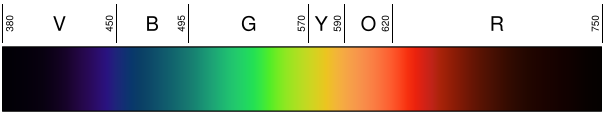

*Image: Gringer, public domain, via Wikimedia Commons.*

Almost no light you encounter is a single wavelength. A light source emits some power at every wavelength in a range, and the complete description of a light is its **spectral power distribution**, or spectrum: a function that gives power for each wavelength, S(λ). That function has hundreds of meaningful degrees of freedom, and two white lights can have very different ones:

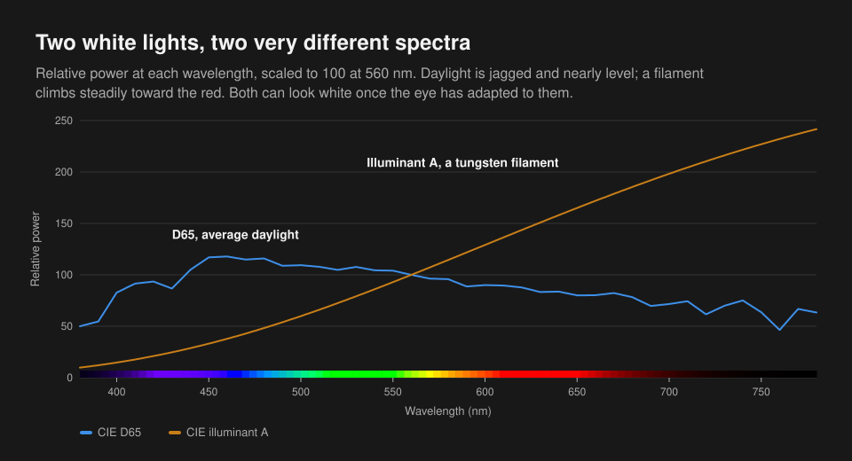

*The colored strip along the axis is approximate.*

Both curves are standards of the International Commission on Illumination (CIE), plotted here from their published values. [Illuminant D65](https://cie.co.at/datatable/cie-standard-illuminant-d65) represents average daylight, and it is a measured, tabulated shape. Illuminant A represents a tungsten filament, and it follows directly from Planck's law for a hot body at 2848 K. Comparing 700 nm with 400 nm, the filament has more than ten times as much long-wave power, relative to short-wave power, as daylight. Yet in a room lit by either, once your eyes settle, a sheet of paper looks white.

Most objects do not emit light. They reflect part of what falls on them, with a reflectance R(λ) from 0 to 1 at each wavelength, so what reaches your eye is the product at every wavelength:

```
light reaching the eye at λ = S(λ) * R(λ)
```

So an object does not "have" a spectrum of its own in the sense of emitting one, and the light that leaves it changes with the illumination. A screen is simpler: its pixels emit light directly, and for now we can ignore the room.

Nothing in that description mentions color. The spectrum is a physical quantity that an instrument can measure, and "red" is not one of its properties. Color is what a visual system makes of a spectrum. To store color in a few numbers, we need to know what that system keeps and what it throws away, which brings up the question this deep dive really rests on: **how can a function with hundreds of degrees of freedom be represented by three numbers?**

### 2. Why three numbers are enough: cones, metamerism, and CIE XYZ

Three numbers are enough because of how the retina samples light, and that fact shapes everything else in this document.

#### Three kinds of sensor

Human color vision begins with three classes of cone cell, named for the part of the spectrum they favor: long (L), medium (M), and short (S). Rod cells serve vision at very low light levels, and color perception in ordinary lighting rests on the cones. [Measurements of pigments in cells from a human retina](https://pubmed.ncbi.nlm.nih.gov/7359434/) put the absorbance peaks of the three cone types near 563, 534, and 420 nm, with rods near 498 nm.

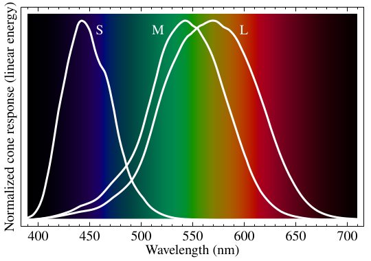

*Image: BenRG, public domain, via Wikimedia Commons.*

These response curves are measured at the front of the eye, so the lens and other pigments have already absorbed some short-wave light, which is why the peaks sit higher here than in the pigment measurements. The curves overlap heavily, especially M and L. Modern estimates of them, the [Stockman and Sharpe cone fundamentals](http://www.cvrl.org/cones.htm), are published as tables, with [their derivation](https://doi.org/10.1016/S0042-6989(00)00021-3) in the literature.

A single cone reports only one thing: how many photons it absorbed. Once absorbed, a photon's wavelength is forgotten. A dim light at the cone's peak and a brighter light off its peak can produce the identical signal. Rushton called this the [principle of univariance](https://doi.org/10.1113/jphysiol.1972.sp009719), and it means that one cone class cannot tell wavelength from intensity. Vision compares the classes to recover something about wavelength.

Each cone's response is therefore a single weighted sum across the spectrum:

```
L = sum over λ of  S(λ) * l(λ)
M = sum over λ of  S(λ) * m(λ)
S = sum over λ of  S(λ) * s(λ)
```

Here is the reduction. Whatever the spectrum, the retina's first step keeps three numbers, and everything else is gone before the signal has left the eye.

#### Different light, same color

If the visual system keeps only three numbers, then any two spectra that give the same three numbers must look the same. Such a pair is a **metamer**, and metamers are not rare curiosities. Every color screen depends on them:


*Image: cmglee and Vanessaezekowitz, CC BY-SA 4.0, via Wikimedia Commons. White background added.*

Read each column from top to bottom. On the left, a spectrum with a single narrow peak. On the right, a display's three broad curves, a very different shape. Multiplying by the cone sensitivities and adding up gives the same three responses, so the two lights look the same. There is no need to reproduce a spectrum to reproduce a color, which is why a display needs only three emitters rather than hundreds.

The same holds for white. Using the CIE tables, three narrow Gaussian peaks at 465, 535, and 615 nm, invented for this calculation and scaled by solving a 3 by 3 linear system, give X = 0.9504, Y = 1.0000, and Z = 1.0886, the same as D65 daylight, even though between the peaks they emit almost nothing.

Metamerism has limits, and they are worth keeping in mind:

- It depends on the observer. People's cones differ a little, so a pair that matches for the standard observer may not match exactly for you.
- For surfaces, it depends on the light. Two paints that match under daylight have different R(λ), so under a filament the products with S(λ) differ and the match can fail. That is why a shirt and trousers can match in the shop and clash outdoors.

#### From a private response to a public standard

To use this in engineering we need the three numbers in a standard form, for one agreed observer. In the late 1920s, Wright and Guild measured this without knowing the cone curves at all. Their observers adjusted three lights to match a test color, wavelength by wavelength. The method works because matches obey simple linear rules, [Grassmann's laws](https://en.wikipedia.org/wiki/Grassmann%27s_laws_%28color_science%29): if A matches B, then A plus C matches B plus C. Light mixing in matches behaves like vector addition.

There was one awkward result. Some test lights could not be matched by any positive mixture of the three primaries. Observers had to add a primary to the test light instead, which amounts to a negative amount of that primary. We will meet the reason shortly.

The CIE [standardized this data in 1931](https://doi.org/10.1002/(SICI)1520-6378(199702)22:1%3C11::AID-COL4%3E3.0.CO;2-7), then applied a linear transform to get three new functions, x̄, ȳ, and z̄, chosen for practical properties of the time: none ever goes negative, and ȳ equals the standard curve of perceived brightness across wavelength. Weighted sums with them give the **CIE XYZ tristimulus values**:

```
X = sum over λ of  S(λ) * xbar(λ)
Y = sum over λ of  S(λ) * ybar(λ)
Z = sum over λ of  S(λ) * zbar(λ)
```

XYZ is not a set of cone responses, and X, Y, and Z are not lights that exist. But the transform is linear and the original data came from color matching, so two spectra with the same XYZ are a metamer for the standard observer. The [CVRL database](http://www.cvrl.org/cmfs.htm) publishes these tables, and the calculation for white above used them. XYZ is the common ground that every color space below is defined against, and **Y** has a physical meaning we will use repeatedly: it is **luminance**, a measure of how intense a light appears, weighted by wavelength.

#### Separating color from intensity

Doubling the power of a light doubles X, Y, and Z, but leaves what we would call its color nearly the same. To plot color without intensity, divide out the scale:

```
x = X / (X + Y + Z)
y = Y / (X + Y + Z)
```

These are **chromaticity coordinates**. Our running color, with XYZ of 0.021054, 0.022735, and 0.046030, has x = 0.2344 and y = 0.2531. Plotting every spectral wavelength this way traces a curve known as the spectral locus:

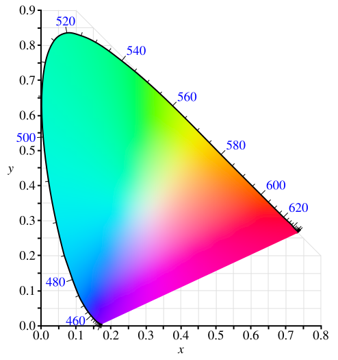

*Image: BenRG, public domain, via Wikimedia Commons. White background added. Colors are approximate, because no screen can show this entire region.*

Two properties of this diagram matter for the rest of the document:

- **Mixing draws straight lines.** Because mixing is linear in XYZ, the chromaticity of a mix of two lights lies on the straight line between them. A mix of three lies inside their triangle.
- **The locus curves outward.** All real lights lie on or inside the horseshoe, and no triangle with corners inside it can cover it all.

That second point explains the negative amounts Wright and Guild needed: a pure spectral color lying outside the triangle of three primaries cannot be reached by adding positive light. We have three numbers for any color we can see, but we can't build a device that reaches them all. **Given that limit, how does a screen actually make color?**

### 3. How a screen makes color: subpixels, primaries, and white point

A screen is the metamer trick built in hardware. It never reproduces the spectrum of the thing being shown; it emits three kinds of light, in amounts that give your cones the right three responses.

Look at a screen through a magnifying lens and each pixel resolves into separate emitters, called subpixels:

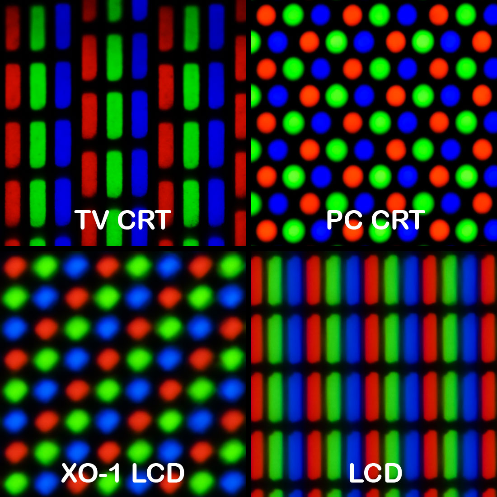

*Image: Pengo, CC BY-SA 3.0, via Wikimedia Commons.*

At normal viewing distance the subpixels are too small to see individually, and [the retina spatially integrates their light](https://learnvisualcomputing.github.io/display-optics.html). The mix that results is **additive**: red and green light together give yellow, and all three at full power give white. This is not the subtractive mixing of paint, where each pigment removes light.

The source of that light differs by technology, as [Zhu's *Foundations of Visual Computing*](https://learnvisualcomputing.github.io/display-optics.html) describes:

- An **LCD** has a white backlight. Each subpixel has a color filter, and a liquid crystal cell between two polarizers controls how much light gets through.
- An **OLED** or **MicroLED** display has subpixels that emit light directly, so a subpixel set to zero is simply off.

Both reduce to the same model for our purposes. Each subpixel adds a fixed spectrum, scaled by how hard it is driven.

#### Primaries and their triangle

The chromaticity of one subpixel at full power is a **primary**. Three primaries are three points on the chromaticity diagram, and since mixes stay inside the triangle they form, that triangle is everything the display can show at its given brightness. This is its **gamut**.

Two standard sets of primaries matter for the web, from the [predefined color spaces of CSS Color 4](https://www.w3.org/TR/css-color-4/#predefined):

| Primary | sRGB x, y | Display P3 x, y |
|---|---|---|
| Red | 0.640, 0.330 | 0.680, 0.320 |
| Green | 0.300, 0.600 | 0.265, 0.690 |
| Blue | 0.150, 0.060 | 0.150, 0.060 |
| White | 0.3127, 0.3290 (D65) | 0.3127, 0.3290 (D65) |

#### What "white" means

Three primaries fix the corners of the triangle, but not how much of each makes "full on" look neutral. For that a display needs a **white point**, the chromaticity reached when all three channels are at maximum. Both spaces above use D65, the daylight curve from section 1, whose chromaticity is x = 0.3127, y = 0.3290.

There is nothing physically special about this choice. As we saw, D65 and a filament both look white to an adapted eye, so white is a convention, and the two spaces simply agree on one that suits displays viewed in ordinary conditions.

We now have the physical picture: three emitters, each driven at some level, whose sum makes a color. The numbers `26, 43, 60` must say how hard to drive them. The tempting assumption is that 60 means about 24% of full power. It does not, and **the reason encoded values are not amounts of light is the next layer**.

## Part II: Light into numbers

### 4. Why encoded values are not light: transfer functions

If channels held linear light, a value of 0.5 would mean half the power. In sRGB, it means 21.4%. The values are bent by a **transfer function**, and the bend comes from vision.

#### Vision is not linear in light

Perceived lightness is not proportional to physical intensity. A light with 18% of a white's luminance looks roughly halfway between black and white. The CIE's lightness scale, L*, captures this with what is mostly a cube root:

```
L* = 116 * f(Y / Yn) - 16

f(t) = t ^ (1/3)                    if t > (6/29)^3
f(t) = (841 / 108) * t + 4 / 29     otherwise
```

Now suppose 8-bit codes stored linear light. The right panel of the figure below plots how far each step of one code moves in L*:


With linear coding, the first step from black jumps 3.54 in L*, and the top step moves just 0.15. The codes are spent where vision can't use them, and missing where it can, producing visible bands in the shadows. Only 47 of the 256 linear codes would lie below middle gray (L* 50, a luminance of 0.184). The sRGB curve gives 119 codes to that range, and keeps every step between 0.27 and 0.51, so its steps are far closer to perceptually even. That gain is the reason encoded values exist. A nonlinear code spends a limited number of bits where they matter.

There is a historical half of the story as well. Cathode ray tubes had a naturally nonlinear response, with light output following roughly the 2.2 power of the input signal, and the [1996 proposal that became sRGB](https://www.w3.org/Graphics/Color/sRGB.html) set out to match the behavior of such displays. The useful coincidence is that the curve hardware happened to have was close to the curve perception wanted.

#### The sRGB curve

[The sRGB transfer function](https://www.w3.org/TR/css-color-4/#predefined-sRGB) has two parts:

```
decode:  c_lin = c / 12.92                       if c <= 0.04045
         c_lin = ((c + 0.055) / 1.055) ^ 2.4     otherwise

encode:  c = 12.92 * c_lin                       if c_lin <= 0.0031308
         c = 1.055 * c_lin ^ (1 / 2.4) - 0.055   otherwise
```

Each piece is there for a reason. A pure power curve has a slope of zero at black when decoding, and an infinite slope when encoding, so small rounding errors near black would be magnified without limit. A short straight segment avoids this. The constants make the two pieces meet: at c = 0.04045 both give 0.00313081, with slopes of 0.0774 for the line and 0.0787 for the curve, which is nearly smooth. The exponent is 2.4, but because of the offset, the whole curve is closest to an overall gamma of 2.2: an encoded 0.5 decodes to 0.214, and a pure 2.2 power would give 0.218.

Consider our running color. Decoding the channels gives:

```
26/255 = 0.101961   ->   0.010330
43/255 = 0.168627   ->   0.024158
60/255 = 0.235294   ->   0.045186
```

So the blue channel, the largest, is at 23.5% of its code range but only 4.5% of its possible light. More than half of the code range lies under a small share of the light: 188 of the 256 codes emit less than half the maximum, and 90 emit less than a tenth.

#### Where the difference shows

Light adds in linear values. Anything meant to simulate light must therefore decode first, compute, and encode again. Averaging encoded numbers does something else:

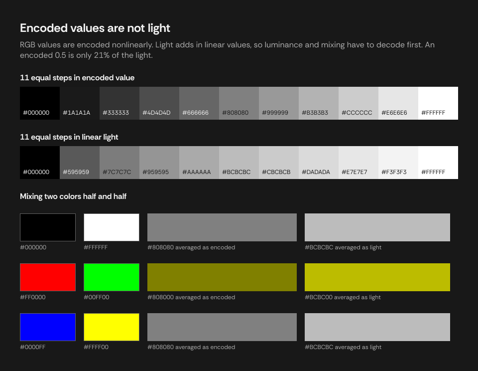

Mixing black and white half and half as encoded numbers gives `#808080`. Mixing them as light gives `#BCBCBC`. Each is a legitimate operation, with a different meaning, and neither of them is always what a designer wants. Interpolation that aims for even perceived steps can suit the encoded form, or better still one of the perceptual models in [section 9](#9-why-equal-numbers-do-not-look-equal-perceptual-models), while luminance and conversion between spaces must use linear values.

One footnote matters to anyone comparing code against standards. [WCAG](https://www.w3.org/TR/WCAG22/#dfn-relative-luminance) gave a threshold of 0.03928 until May 2021 and now gives 0.04045 ([issue 360](https://github.com/w3c/wcag/issues/360)). They give identical results for every 8-bit value, because no k/255 falls between them, and for other values they differ by at most 7.6e-7.

We can now turn numbers into amounts of light from three primaries. But the same amounts from different primaries are a different color, and nothing in `26, 43, 60` says which primaries it refers to. **What gives numbers an actual meaning?**

### 5. How numbers come to mean a color: color spaces and gamut

Three separate questions are often blurred together, and they have different answers:

| Term | Question it answers | Examples |
|---|---|---|
| Color space | Which physical color do these numbers mean? Fixed by primaries, a white point, and a transfer function. | sRGB, Display P3 |
| Color model | How is a color in that space parameterized? | RGB, HSL, HSB, CMYK |
| Encoding | How are the numbers written down? | `#1A2B3C`, 0 to 1 floats, 0 to 255 integers |

A **color space** is what ties numbers to the physical world, by connecting them to XYZ. We have developed each ingredient: primaries from section 3, a white point from section 3, a transfer function from section 4. What remains is the connection itself.

#### Deriving the matrix to XYZ

In linear form, a color is an amount of each primary, and light adds. So XYZ must be a linear function of linear RGB, a 3 by 3 matrix **M**:

```
| X |       | R |
| Y | = M * | G |
| Z |       | B |
```

The columns of M have a direct meaning. Setting R = 1, G = B = 0 shows that the first column is the XYZ of the full red primary. To build M, we need each primary's XYZ. A chromaticity (x, y) gives XYZ up to an unknown scale, by reversing the definition from section 2 and using z = 1 - x - y:

```
XYZ of a primary = s * ( x / y,  1,  z / y )
```

The unknown scales are what the white point determines. By definition, R = G = B = 1 must give the white point's XYZ, normalized here so that its Y is 1, which is three linear equations in three unknowns:

```
P = the matrix with columns (x_i / y_i, 1, z_i / y_i), one for each primary
W = ( x_w / y_w,  1,  z_w / y_w )

(s_r, s_g, s_b) = inverse(P) * W

M = P with its columns multiplied by s_r, s_g, and s_b
```

Carrying that through for the primaries and white of section 3 gives:

```
sRGB to XYZ                              Display P3 to XYZ
| 0.4123908  0.3575843  0.1804808 |      | 0.4865709  0.2656677  0.1982173 |
| 0.2126390  0.7151687  0.0721923 |      | 0.2289746  0.6917385  0.0792869 |
| 0.0193308  0.1191948  0.9505322 |      | 0.0000000  0.0451134  1.0439444 |
```

You may see 0.4124564 and similar values for sRGB elsewhere, such as in [Lindbloom's tables](http://www.brucelindbloom.com/index.html?Eqn_RGB_XYZ_Matrix.html). They come from the same method with a slightly different figure for the XYZ of D65, and differ only around the fourth decimal.

Look at the middle row. Since each primary's Y entry in P is 1, the middle row of M is exactly the three scales. These are the contributions of each primary to luminance, and sRGB's 0.2126, 0.7152, and 0.0722 say that green accounts for about 72% of white's luminance, and blue about 7%. This is the origin of the weights you may have seen in luminance formulas. They are not separate empirical constants; they follow from the primaries, the white point, and the Y curve.

Applying the sRGB matrix to the linear values of `#1A2B3C` gives XYZ of 0.021054, 0.022735, and 0.046030, the values quoted in the pipeline table. CSS Color 4 publishes [sample code](https://www.w3.org/TR/css-color-4/#color-conversion-code) for these conversions.

#### Converting between spaces

To express one physical color in another space, go through XYZ, and always work in linear values:

```
encoded A -> decode -> linear A -> matrix A -> XYZ -> inverse matrix B -> linear B -> encode -> encoded B
```

Taking `#1A2B3C` from sRGB into Display P3 gives 0.116544, 0.166847, and 0.229546. These are different numbers for the same color. Red rises by about 0.015, while green and blue fall slightly. A dark, muted color like this one sits well inside both triangles, so the shift is small.

#### Gamut

The triangles of the two spaces can now be compared directly:

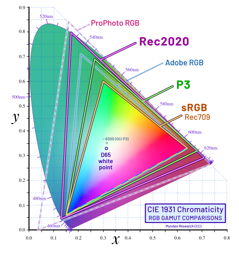

*Image: Myndex, CC BY-SA 4.0, via Wikimedia Commons. White background added. Only the sRGB and P3 triangles matter here.*

From the chromaticities above, the P3 triangle has an area about 36% larger than sRGB's on this diagram, mostly toward green, though xy areas do not correspond evenly to perceived differences. Both share the same blue.

The P3 red primary, written in linear sRGB, comes out as 1.22494, -0.042057, -0.019638. The negative numbers and the value above 1 are the arithmetic saying "outside this triangle." Before display, such a color must be **clipped** to the valid range or **gamut-mapped** along some more careful path, and each of those changes the color.

#### What the space decides, and what it does not

Because the space is what gives numbers a meaning, `#FF0000` is a different red in sRGB and in Display P3. Conversely, a color value without a known space is ambiguous. CSS resolves this by defining `#RRGGBB` as sRGB. Other contexts depend on a tag or a convention. The effect varies by kind of value:

| Value | Depends on the space? | Why |
|---|---|---|
| HEX, RGB | No | They are the numbers themselves |
| HSL, HSB | No | They rearrange the numbers |
| Luminance, contrast | Yes | They measure light, so they need the primaries |
| White and black | No | Y is 1 and 0 in both spaces |

For colors, then, the choice of space can flip an accessibility result. `#B400FF` has a contrast against white of 4.78 : 1 when read as sRGB and 4.49 : 1 when read as Display P3, which puts it on opposite sides of the 4.5 threshold explained in [section 10](#10-how-legibility-is-measured-luminance-and-contrast).

A color space specifies real numbers, though, with unlimited precision. A file holds a finite number of digits. **What does writing a value down cost?**

### 6. How a continuous value becomes a finite one: quantization and rounding

So far channels have been real numbers from 0 to 1. Storing one means choosing some finite set of values, and this has a cost, which shows up in surprisingly many places.

#### The available representations

| Representation | Values | Resolution | Typical use |
|---|---|---|---|
| 8-bit integer | 0 to 255 | 1/255, about 0.39% of the range | HEX, RGB |
| 32-bit float | 24-bit significand | Near 1, a spacing of 2^-24 and an error of at most 2^-25, about 3e-8 | GPUs and design tools |
| 64-bit float | 53-bit significand | Near 1, an error of at most 2^-53, about 1e-16 | JavaScript arithmetic |
| Decimal text | Fixed digits | Set by the format | Displayed and copied values |

A 32-bit float distinguishes every 8-bit value, and its error on the 0 to 255 scale is at most about 8e-6, so `round(x * 255)` recovers the byte. Most decimals and most values k/255 have no exact binary form in either width. In JavaScript, [`Math.fround`](https://developer.mozilla.org/en-US/docs/Web/JavaScript/Reference/Global_Objects/Math/fround) gives the 32-bit form of a number, and [Goldberg's paper](https://docs.oracle.com/cd/E19957-01/806-3568/ncg_goldberg.html) is the standard account of this arithmetic.

#### Quantization

Writing a continuous value in finite digits is **quantization**. For a channel x from 0 to 1:

```
k = round(255 * x)        quantize, x to an 8-bit value
x' = k / 255              reconstruct
|x - x'| <= 1 / 510       worst-case error
```

The worst case is half a step, since rounding picks the nearest code. Three channels at 8 bits give 256^3 = 16,777,216 colors. Too few levels and the steps become visible as bands:

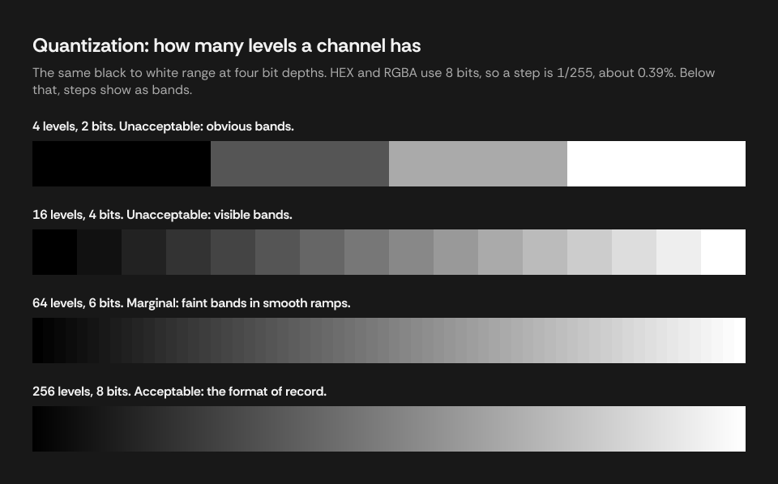

Now the reason for section 4's curve is fully visible. It is what lets 256 levels be enough, by distributing them evenly in perceived steps. Quantization is also lossy and can't be undone, which leads to a useful rule: compute each number from the exact value rather than from another rounded number.

#### How precise a display value needs to be

A rounded value may be fine to read, but can it return the original color? Counting gives a first answer. The integer HSL grid has 360 x 101 x 101 = 3,672,360 points, against 16,777,216 8-bit RGB colors, so integers can't round-trip. Taking every 8-bit color, converting it to the given precision, and converting back:

| Decimals | HSL, colors changed | Largest channel error | HSB, colors changed | Largest channel error |
|---|---|---|---|---|
| 0 | 15,001,678 | 5 | 14,732,503 | 3 |
| 1 | 0 | 0 | 0 | 0 |
| 2 | 0 | 0 | 0 | 0 |

Integer HSL and HSB are therefore for reading, while HEX and RGB integers hold an 8-bit color exactly. One decimal place already returns every color.

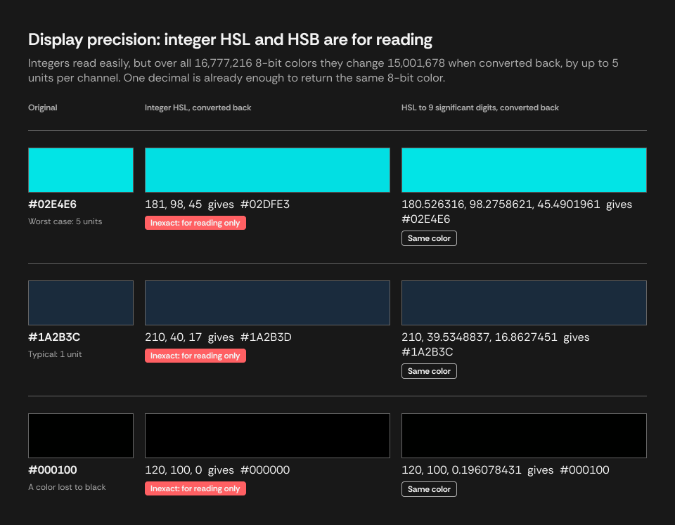

#### Choosing how to round

Rounding a number needs a rule for the case of exactly half:

| Mode | 2.5 | 3.5 | -2.5 | Suits |
|---|---|---|---|---|
| Half up | 3 | 4 | -2 | Displaying a value |
| Half even | 2 | 4 | -2 | Summing many rounded values, where it avoids bias |
| Floor | 2 | 3 | -3 | Reporting against a threshold, so that a failure never rounds into a pass |

Half up is the direction in [CSS Color 4](https://www.w3.org/TR/css-color-4/#rgb-functions), which says values that can't keep their precision are "rounded towards +∞" and applies the same wording when serializing colors. [`toFixed`](https://developer.mozilla.org/en-US/docs/Web/JavaScript/Reference/Global_Objects/Number/toFixed) follows neither half up nor half even, because it rounds the stored binary value, so a number that looks like a half can go either way.

For non-negative values, half up is `floor(x + 0.5)` in exact arithmetic. In floating-point arithmetic, it is not quite so simple. Exact halves are common in color formulas, and floating-point error can land just on the wrong side of one. The [case study](./case-study-color-values-in-figma.md) takes up that problem where it arises most sharply, in reading exact values back from 32-bit storage.

We now have single colors, written down. Real interfaces rarely show one color alone, and they often show one through another. **What does a color value mean when it is partly transparent?**

### 7. What happens when colors are layered: alpha and compositing

A pixel on screen has one color. A layer in a design may be translucent, so something must combine layers, and that is **compositing**.

Alpha is coverage rather than a color channel. It says how much of the source is laid over what is behind it. [Porter and Duff's 1984 paper](https://graphics.pixar.com/library/Compositing/) set out the algebra still in use, and the [W3C compositing specification](https://www.w3.org/TR/compositing-1/) defines its common "source over" case for the web. Over an opaque backdrop it reduces to:

```
C_out = alpha * C_source + (1 - alpha) * C_backdrop
```

It follows that a translucent color has no single appearance:

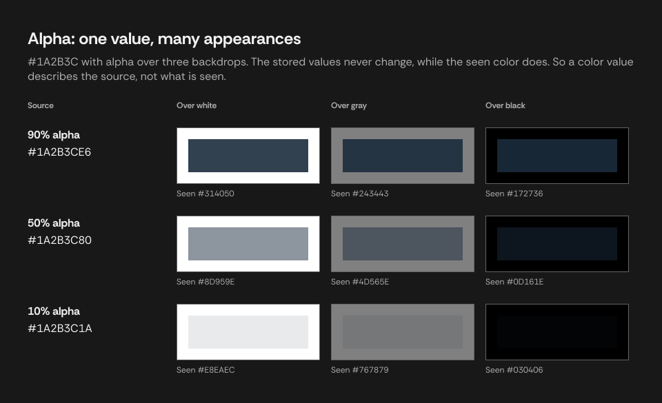

So `#1A2B3C` at 90% over white gives 0.9 * 26 + 0.1 * 255 = 48.9 in red, or about `#314050`. Two consequences follow, both easy to forget:

- **A contrast figure needs the result, not the source.** The formulas in [section 10](#10-how-legibility-is-measured-luminance-and-contrast) take opaque colors. A ratio computed from the channels alone describes the color at full opacity.
- **The formula has a space.** Section 4 says light adds in linear values, but browsers commonly apply this formula directly to encoded values. A canvas test in Microsoft Edge gives `48, 64, 79` for the color above, while computing the same mix in linear light gives about `93, 98, 105`. Encoded compositing is a long-standing default. It is cheap and familiar, but it isn't a simulation of light, so edges and translucent overlays can look different from a renderer that composites in linear values.

**Straight and premultiplied storage.** With straight alpha, channels hold the color independently of alpha. **Premultiplied** alpha stores `alpha * C` instead, and the compositing formula simplifies to `c_out = c_source + (1 - alpha) * c_backdrop`, which suits GPUs, since blending is then a single addition and a multiplication. Its cost is precision. In 8 bits at 10% alpha, a channel of 26 stores round(2.6) = 3, and recovering it gives 3 / 0.1 = 30, so the original value is gone.

We've now followed colors from the eye into numbers, and those numbers serve machines very well. But nobody thinks in terms of "26, 43, 60", or knows what to change to make it a little less saturated. **What representation suits the person choosing the color?**

## Part III: Models for people

### 8. How the RGB cube becomes hue and saturation: HSL and HSB

RGB is a cube, and its axes are the wrong questions for someone adjusting a color. People ask "what kind of color, how vivid, how light." HSL and HSB (also called HSV) are rearrangements of the same cube that answer these directly, introduced in 1978 by [Joblove and Greenberg](https://doi.org/10.1145/800248.807362) and by [Smith](https://doi.org/10.1145/965139.807361) for the color-picking needs of early graphics systems. They add no information about vision, and only rearrange the numbers. So H 210, S 40, L 17 means different colors in sRGB and in Display P3.

Their formulas look arbitrary when stated bare. They follow from one geometric idea, though.

#### Looking down the gray diagonal

Stand the RGB cube on its black corner, so that the white corner is directly above. The gray axis, where R = G = B, is now vertical. Viewed from above, the other six corners form a hexagon around that axis, in the order red, yellow, green, cyan, blue, magenta:

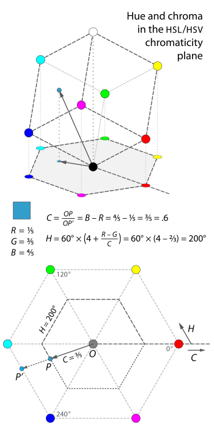

*Image: Jacob Rus, CC BY-SA 3.0, via Wikimedia Commons. White background added.*

Now we can define three quantities, each with channels from 0 to 1:

```
M = max(R, G, B)     m = min(R, G, B)     C = M - m
```

**C**, or chroma, is how far the projected point lies from the gray center. A gray has M = m and so C = 0. Pure red has C = 1. It measures distance out to the hexagon's boundary, with the hexagon treated as its own unit shape.

#### Deriving hue

Hue is the position around the hexagon, in degrees, with six corners spaced 60 degrees apart. Take the sector between red and yellow, where R is largest and B smallest. Red is the corner with G = B, and yellow is the corner where G has caught up with R. So how far along the edge a color lies is how far G has risen from B, relative to the whole range:

```
fraction along the edge = (G - B) / C
H = 60 * (G - B) / C
```

The other sectors work the same way, offset by 120 degrees for each new largest channel. When G is largest, the center of its range is green at 120 degrees, or 2 sector widths. When B is largest, it is blue at 240 degrees, or 4 sector widths. Writing them together gives the usual formula:

```
H = undefined                            if C = 0
H = 60 * (((G - B) / C) mod 6)           if M = R
H = 60 * ((B - R) / C + 2)               if M = G
H = 60 * ((R - G) / C + 4)               if M = B
```

The `mod 6` handles the last sector, where B has risen above G and the fraction is negative, so that those hues land just under 360 rather than below 0. Where C = 0 the color is achromatic and has no hue, and [CSS Color 4 calls the hue "powerless" in that case](https://www.w3.org/TR/css-color-4/#the-hsl-notation), so a displayed value needs a convention, usually 0. Since 360 and 0 are the same hue, a hue of 359.6 rounds to 360 and should display as 0.

#### Deriving lightness and brightness, and two saturations

Hue says where around the axis a color lies, and we also need its height along it. The two models choose differently, and that choice is the entire difference between them:

- **HSB** takes the height as the largest channel: B = M. This treats a pure hue as just as "bright" as white, since both have a channel at 1.
- **HSL** takes the midpoint of the extremes: L = (M + m) / 2. This puts white at the top, black at the bottom, and pure hues halfway up.

Saturation says how much chroma a color has, relative to the most it could have at that height. Working that maximum out explains the formulas.

For HSB, fix M. Chroma C = M - m is largest when m = 0, so the most available is M itself. That gives:

```
S_b = C / M        (0 if M = 0)
```

For HSL, fix L, so M + m = 2L, and find the largest C. M can't exceed 1 and m can't go below 0:

```
if L <= 0.5:  m = 0,  M = 2L,      so C_max = 2L
if L >  0.5:  M = 1,  m = 2L - 1,  so C_max = 2 - 2L
```

Both cases are one expression, C_max = 1 - |2L - 1|, which gives:

```
S_l = C / (1 - |2L - 1|)        (0 if C = 0)
```

So the two saturations are different quantities. Pure red is S = 100 in both, while a pale pink can be S = 100 in HSL and S = 10 in HSB, because at L near 1 the HSL maximum shrinks and even a small chroma is "all there is."

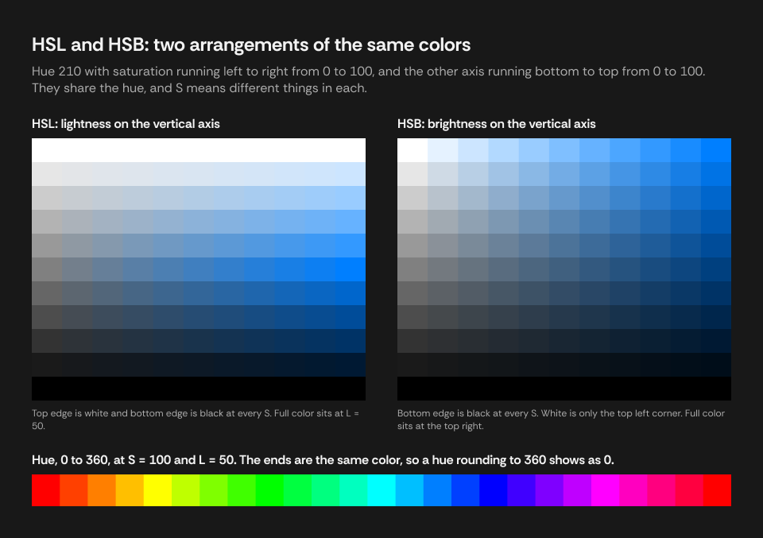

The figure shows the consequence. In HSL the top edge is white at every S, because only white has L = 100. In HSB, white is only one corner.

#### Back to RGB

Reversing this needs only C, M, and m. From the HSL definitions above, half the chroma is `a = C / 2 = S * min(L, 1 - L)`, so that `M = L + a` and `m = L - a`. Each channel is then one of the two, or in transition between them, depending on the hue. CSS Color 4's [sample code](https://www.w3.org/TR/css-color-4/#hsl-to-rgb) writes this compactly as one triangle-wave function, evaluated three times at different phases:

```
HSL:  a = S * min(L, 1 - L)
      f(n) = L - a * max(-1, min(k - 3, 9 - k, 1))     where k = (n + H / 30) mod 12
      (R, G, B) = (f(0), f(8), f(4))

HSB:  f(n) = B - B * S * max(0, min(k, 4 - k, 1))      where k = (n + H / 60) mod 6
      (R, G, B) = (f(5), f(3), f(1))
```

The two models also convert directly, since `B = M = L + a` and `S_b = 2a / B`:

```
B = L + S_l * min(L, 1 - L)
S_b = 0 if B = 0, else 2 * (1 - L / B)

L = B * (1 - S_b / 2)
S_l = 0 if L is 0 or 1, else (B - L) / min(L, 1 - L)
```

#### Worked example

`#1A2B3C` at 90% opacity:

| Step | Exact | Integer | 9 significant digits |
|---|---|---|---|
| Channels | 26/255, 43/255, 60/255 | `26, 43, 60` | `0.101960784, 0.168627451, 0.235294118` |
| M, m, C | 60/255, 26/255, 34/255 | | |
| H (M = B) | 60 * ((26 - 43) / 34 + 4) = 210 | `210` | `210` |
| L | 86/510 = 16.8627...% | `17` | `16.8627451` |
| S, HSL | 34/86 = 39.5348...% | `40` | `39.5348837` |
| S, HSB | 34/60 = 56.6666...% | `57` | `56.6666667` |
| B | 60/255 = 23.5294...% | `24` | `23.5294118` |
| Alpha byte | 0.9 * 255 = 229.5, half up | `E6` | |

These models do what they were built for: moving around the RGB cube in terms people can name. But they were built from the geometry of a cube, and nothing about vision entered the derivation. **So what happens when we ask them about how a color looks?**

### 9. Why equal numbers do not look equal: perceptual models

Take the six fully saturated hues. All have L = 50 in HSL. They don't look equally light at all:

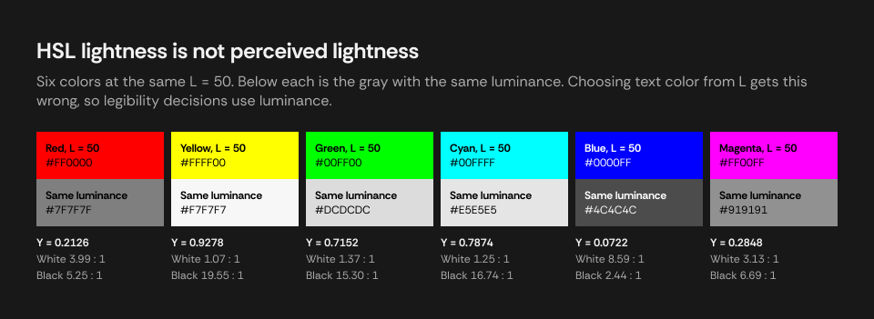

The cause is already familiar. Yellow is mostly red and green, the primaries with the highest luminance weights, and blue has the lowest. The L in HSL gives each channel an equal say in a midpoint of the encoded values. It is geometry. Vision weights them very differently. On the CIE scale from section 4, yellow is L* 97 and blue is L* 32. CSS Color 4 lists this among [HSL's disadvantages](https://www.w3.org/TR/css-color-4/#disadvantage-hsl), noting that "hue manipulation changes the visual lightness, and that hues are not evenly spaced apart," and [Ottosson's Oklab post](https://bottosson.github.io/posts/oklab/) shows the same unevenness in HSV.

So a change of hue in HSL can also change perceived lightness, and a palette generated with even steps of L has uneven perceived steps. **Perceptual models** start from the other direction. Instead of rearranging the cube, they take XYZ or something like cone responses and transform them into coordinates in which equal numeric distances try to correspond to equal perceived differences.

Their common structure comes straight from the lower layers:

```
linear RGB -> matrix -> a space close to XYZ or cone responses -> a compressive function -> opponent axes
```

The compressive function plays the role seen in section 4, approximating the nonlinear response to intensity. The opponent axes are one lightness axis and two for color, with red against green and yellow against blue. Polar forms of those two axes give hue and chroma that behave like the H and S people expect.

| Model | Built for | Conversion path |
|---|---|---|
| CIELAB, LCH | Approximate perceptual uniformity | Linear RGB, XYZ, adapt to a reference white, then a cube-root function of X/Xn, Y/Yn, Z/Zn; LCH is polar Lab |
| OKLab, OKLCH | Better hue linearity than Lab | Linear RGB, a matrix to cone-like responses, a cube root, a second matrix; OKLCH is polar OKLab |
| HCT | Hue and chroma from CAM16, tone from L* | Requires a color appearance model, and has an iterative inverse |
| CMYK | Ink on a specific press | Device-dependent, so an accurate conversion needs an ICC profile. The formula `K = 1 - M` is only a rough approximation |

In these terms, `#1A2B3C` has an L* of 16.86, and in CSS syntax it is `oklch(0.283 0.039 249.3)`. As the OKLCH hue, 249.3 is a different number from the HSL hue of 210. This isn't an error. Hue angles are defined differently in each model, and their numbers can't be compared across models.

[Ottosson's post](https://bottosson.github.io/posts/oklab/) gives the derivation of OKLab and its matrices, and CSS Color 4 [defines Lab and OKLab](https://www.w3.org/TR/css-color-4/#lab-colors). On building palettes programmatically, see [Coloring With Code](https://tympanus.net/codrops/2021/12/07/coloring-with-code-a-programmatic-approach-to-design/) and [HSB interpolation for Figma color variables](https://uxdesign.cc/simplified-figma-color-variables-based-on-hsb-interpolation-c3e404585176).

Perceptual models are approximations, each fitted to particular data. None makes distance perfectly uniform in all directions, and appearance also depends on context: surround, adaptation, size. They are better tools for generating and comparing colors, not a final answer on how a color looks.

So far, in Part III, the numbers have served people choosing a color. Often, though, the task runs the other way: a system holds a color and has to decide something about it. **Can someone actually read text on this background?**

## Part IV: Numbers back to decisions

### 10. How legibility is measured: luminance and contrast

Legibility depends mostly on differences of luminance between text and background, rather than on hue. WCAG turns that into a single number, and each piece of the formula comes from a layer developed above.

#### Luminance

Section 5 derived luminance as the middle row of the matrix to XYZ. In code:

```
Y = w_r * R_lin + w_g * G_lin + w_b * B_lin
```

The weights are that row, and they depend on the space:

| Space | w_r | w_g | w_b |
|---|---|---|---|
| sRGB | 0.2126 | 0.7152 | 0.0722 |
| Display P3 | 0.2289746 | 0.6917385 | 0.0792869 |

The inputs must be linear, from section 4. Forgetting to decode is the most common bug here, and it can produce plausible-looking numbers that are wrong.

[WCAG defines relative luminance](https://www.w3.org/TR/WCAG22/#dfn-relative-luminance) for "any point in a colorspace" and gives the formula for sRGB as a note. A comment in [issue 360](https://github.com/w3c/wcag/issues/360) says that a space such as Display P3 should use its own chromaticities and white point. Checkers such as [WebAIM's](https://webaim.org/resources/contrastchecker/) and [Siege Media's](https://www.siegemedia.com/contrast-ratio) take hex values, which CSS defines as sRGB, so their figures describe the sRGB color with those numbers.

#### The ratio

The [contrast ratio](https://www.w3.org/TR/WCAG22/#dfn-contrast-ratio) is:

```
ratio = (Y_lighter + 0.05) / (Y_darker + 0.05)
```

A ratio suits vision better than a difference, because our response to intensity is close to relative. The 0.05 is [based on typical viewing flare](https://www.w3.org/WAI/WCAG22/Understanding/contrast-minimum.html): real screens reflect some ambient light, so even "black" sends light to the eye. It also keeps the ratio finite at black. The ratio therefore runs from 1 to (1 + 0.05) / (0 + 0.05) = 21.

The thresholds are 3 (AA for large text), 4.5 (AA), and 7 (AAA), and they have stated reasons. WCAG's understanding document starts from a 3 : 1 baseline for normal vision, then multiplies to compensate for the contrast sensitivity lost at reduced acuity, giving about 4.5 at 20/40 vision and about 7 at 20/80. These thresholds are compared against the unrounded ratio. They are a convention, grounded in vision research but not a law of it.

In sRGB, `#1A2B3C` has Y = 0.02274, which gives 14.43 against white and 1.45 against black, each floored to 2 decimals.

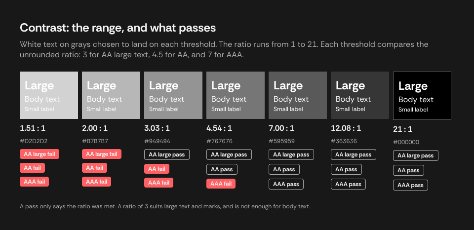

#### The best any color can do

A color with luminance Y reaches its highest ratio against white or against black. The lower of those two is smallest where they meet:

```
1.05 / (Y + 0.05) = (Y + 0.05) / 0.05    gives    Y + 0.05 = sqrt(1.05 * 0.05)    so    Y = 0.1791
ratio there = sqrt(21) = 4.583
```

So every color reaches at least 4.583 against white or black, and no higher guarantee is possible. This is a small and useful theorem: for any background, one of black or white text passes AA.

#### Choosing between two text colors

Compare the two ratios directly, because a rule based on L gets colors near the crossing wrong. With `#F2F2F2` and `#181818` rather than pure white and black, the crossing point moves: they tie at Y = 0.1855, near `#777777`, at 3.98 : 1.

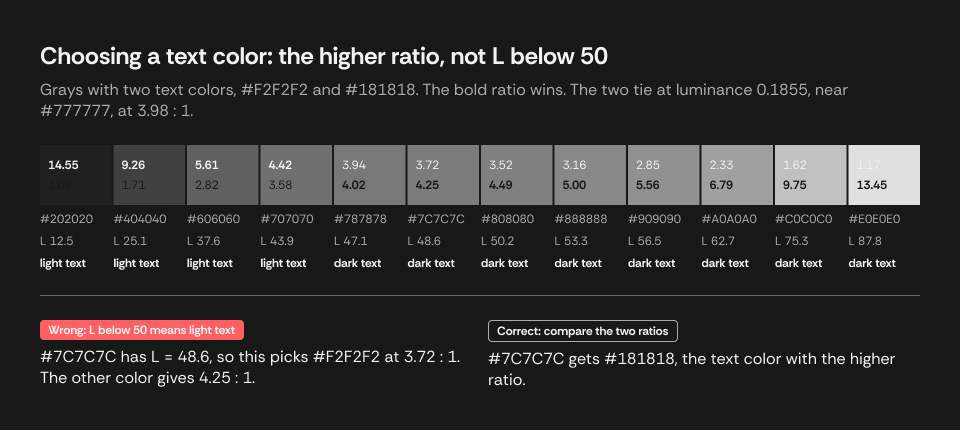

The result of this comparison is one of two fixed colors. Sometimes a design wants neither, and would rather have quiet text that clearly belongs to its background. **How do we find such a color?**

### 11. Finding a readable tone: searching at a target contrast

A tone of a color's own hue, at the least contrast that stays readable, can be found by holding H and S fixed and searching L for the smallest change whose ratio against the color reaches a target T.

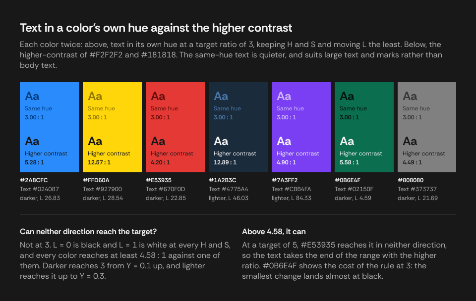

Searching is justified by two properties of the formulas we have, and neither is obvious.

**A search can stop at the first passing value.** With H and S fixed, every channel from the formula in [Back to RGB](#back-to-rgb) is non-decreasing in L, and luminance is strictly increasing, so the ratio grows steadily in each direction away from the color. Each direction therefore has one boundary, which bisection finds. All of this holds in any RGB space, since the weights are positive.

**When a direction reaches the target.** L = 0 is black and L = 1 is white, for every H and S, so the extremes of the search are exactly the extremes of section 10. For a color of luminance Y:

```
darker reaches T    if (Y + 0.05) / 0.05 >= T
lighter reaches T   if 1.05 / (Y + 0.05) >= T
```

At T = 3, darker reaches for Y >= 0.1, and lighter reaches for Y <= 0.3. These ranges overlap, so one direction always reaches, and both do for Y between 0.1 and 0.3. Neither direction can reach only if T is above sqrt(21), about 4.583, the bound from the previous section. At T = 5, `#E53935` is such a color.

The rule can land near an extreme. `#0B6E4F` has a luminance just above 0.1, so its smallest change is down to L = 4.59, which is almost black, though lightening would have kept more of the hue. "Least change in L" is a simple rule, and a perceptual measure of change might choose differently.

The search produces an exact real number. That still has to be written down for whatever uses it next, which may not share any of our assumptions. **What survives when a value leaves the system?**

### 12. How a value leaves the system: writing colors for other consumers

The same color can be written for different consumers, shown here for `#1A2B3C` at 90%:

| Form | HEX | RGBA | HSL |
|---|---|---|---|
| Rounded, for reading | `#1A2B3CE6` | `26, 43, 60, 0.9` | `210, 40, 17, 90` |
| CSS | `#1A2B3CE6` | `rgba(26, 43, 60, 0.9)` | `hsla(210, 40%, 17%, 0.9)` |
| Full precision | `#1A2B3CE6` | `0.101960784, 0.168627451, 0.235294118, 0.9` | `210, 39.5348837, 16.8627451, 90` |

The CSS form of HSL above is rounded, so CSS that has to reproduce a color should use HEX or `rgba()`.

Nine significant digits are [enough to recover any 32-bit value](https://docs.oracle.com/cd/E19957-01/806-3568/ncg_goldberg.html), and stop short of the digits that are only 64-bit noise. Consumers with 0 to 1 channels, such as SwiftUI, Unity, and shaders, take this form. Every 8-bit value comes back as the same byte. 249 of the 256 come back as the same 32-bit number as `float32(k / 255)`, and the other 7 are one 32-bit step away.

Each form loses something different, as sections 6 and 8 predict:

| Reused from | What comes back |
|---|---|
| HEX, RGBA, for an 8-bit color | Exactly the color |
| HEX, RGBA, for a color that is not 8-bit | The nearest 8-bit color |
| Integer HSL, HSB | A color up to 5 units per channel off |

A value also leaves its color space behind, and section 5 is the reason that matters. Display P3 numbers mean a different color when read as sRGB, and CSS `#RRGGBB`, `rgba()`, and `hsl()` all [resolve to sRGB](https://www.w3.org/TR/css-color-4/#the-hsl-notation). CSS's way to say Display P3 is [`color(display-p3 r g b / a)`](https://developer.mozilla.org/en-US/docs/Web/CSS/color_value/color), widely available in browsers since May 2023. It keeps the color on wide-gamut screens, while the same numbers in sRGB syntax can look less saturated. HEX and HSL have no Display P3 form in CSS.

So `#1A2B3C` as a P3 color, if we want the same appearance, is written `color(display-p3 0.116544 0.166847 0.229546)`. And that closes the loop. The numbers leave, a display decodes them, its subpixels emit three spectra, and those mix into a spectrum unlike the original, yet one which gives your cones the responses it should.

### 13. Where implementations take over

Everything above is defined by mathematics and specifications. A real tool adds its own decisions about storage, arithmetic, and rounding, and they can show through. A value like 0.9 stored in a 32-bit float reads back as 0.8999999761581421, and an obvious rounding method then produces `E5` where `E6` was entered. This is exactly the quantization problem of section 6, one layer further out.

The [case study on exact color values in Figma](./case-study-color-values-in-figma.md) picks up here. Its problem is showing the exact values someone entered, given what a design tool actually stores. It covers how rounding noise grows through the formulas, how exact halves arise, how to recover a stored value, and how to verify such a method exhaustively over all 16,777,216 8-bit colors.

One rule from that work belongs here, because it comes from the standard rather than any tool:

**Contrast takes no tolerance.** [WCAG's guidance](https://www.w3.org/WAI/WCAG22/Understanding/contrast-minimum.html) is that computed values should not be rounded, and that 4.499:1 does not meet 4.5:1. Flooring a ratio already errs low, and a tolerance could lift 4.49999 to 4.5 and turn a failure into a pass. A ratio that floating-point error puts just under a two-decimal boundary reads one hundredth low, which is the safe direction.

## References

Standards and datasets:

- [CSS Color Module Level 4](https://www.w3.org/TR/css-color/), W3C. Definitions of HSL, Lab, OKLab, and Display P3, the primaries in this document, rounding, and [sample conversion code](https://www.w3.org/TR/css-color-4/#color-conversion-code).
- [CSS Compositing and Blending Level 1](https://www.w3.org/TR/compositing-1/), W3C. The simple alpha compositing formulas.
- [Web Content Accessibility Guidelines 2.2](https://www.w3.org/TR/WCAG22/), W3C. Definitions of [relative luminance](https://www.w3.org/TR/WCAG22/#dfn-relative-luminance) and [contrast ratio](https://www.w3.org/TR/WCAG22/#dfn-contrast-ratio).
- [Understanding Success Criterion 1.4.3: Contrast (Minimum)](https://www.w3.org/WAI/WCAG22/Understanding/contrast-minimum.html), W3C. The thresholds, the flare allowance, and why ratios are not rounded.
- [WCAG issue 360](https://github.com/w3c/wcag/issues/360), W3C. The sRGB threshold, and luminance in other color spaces.
- [CIE standard illuminant D65](https://cie.co.at/datatable/cie-standard-illuminant-d65), International Commission on Illumination (CIE), [DOI 10.25039/CIE.DS.hjfjmt59](https://doi.org/10.25039/CIE.DS.hjfjmt59). The tabulated spectrum used for the D65 curves.
- [Colour & Vision Research Laboratory database](http://www.cvrl.org/), UCL. Tables of the [CIE 1931 color-matching functions](http://www.cvrl.org/cmfs.htm) and [cone fundamentals](http://www.cvrl.org/cones.htm).
- [A Standard Default Color Space for the Internet - sRGB](https://www.w3.org/Graphics/Color/sRGB.html), Stokes, Anderson, Chandrasekar, and Motta, 1996. The proposal behind sRGB, since standardized as IEC 61966-2-1 and kept for historical purposes.

Vision and color science:

- [Visual pigments of rods and cones in a human retina](https://pubmed.ncbi.nlm.nih.gov/7359434/), Bowmaker and Dartnall, *Journal of Physiology*, 1980. Peak absorbances of the three cone types and rods.
- [Pigments and signals in colour vision](https://doi.org/10.1113/jphysiol.1972.sp009719), Rushton, *Journal of Physiology*, 1972. The principle of univariance.
- [The spectral sensitivities of the middle- and long-wavelength-sensitive cones](https://doi.org/10.1016/S0042-6989(00)00021-3), Stockman and Sharpe, *Vision Research*, 2000. The derivation of modern cone fundamentals.
- [How the CIE 1931 color-matching functions were derived from Wright-Guild data](https://doi.org/10.1002/(SICI)1520-6378(199702)22:1%3C11::AID-COL4%3E3.0.CO;2-7), Fairman, Brill, and Hemmendinger, *Color Research and Application*, 1997.
- [Grassmann's laws](https://en.wikipedia.org/wiki/Grassmann%27s_laws_%28color_science%29), Wikipedia. A starting point on the linearity of color matching.
- [A perceptual color space for image processing](https://bottosson.github.io/posts/oklab/), Björn Ottosson. The derivation of Oklab by its creator, with its math and a comparison with HSV.
- [RGB/XYZ Matrices](http://www.brucelindbloom.com/index.html?Eqn_RGB_XYZ_Matrix.html), Bruce Lindbloom. The derivation of RGB to XYZ matrices, with tables.

Displays and graphics:

- [Optical Mechanisms](https://learnvisualcomputing.github.io/display-optics.html), Yuhao Zhu, *Foundations of Visual Computing*. How LCD and emissive displays make light.
- [Compositing Digital Images](https://graphics.pixar.com/library/Compositing/), Porter and Duff, SIGGRAPH 1984.
- [Color gamut transform pairs](https://doi.org/10.1145/965139.807361), Alvy Ray Smith, SIGGRAPH 1978. The origin of HSV.
- [Color spaces for computer graphics](https://doi.org/10.1145/800248.807362), Joblove and Greenberg, SIGGRAPH 1978. Hue, saturation, and lightness.
- [`color()`](https://developer.mozilla.org/en-US/docs/Web/CSS/color_value/color), MDN. Naming a color space in CSS, and browser availability.

Numerics:

- [What Every Computer Scientist Should Know About Floating-Point Arithmetic](https://docs.oracle.com/cd/E19957-01/806-3568/ncg_goldberg.html), David Goldberg. Includes why 9 decimal digits recover a 32-bit number.
- [`Math.fround`](https://developer.mozilla.org/en-US/docs/Web/JavaScript/Reference/Global_Objects/Math/fround) and [`Number.prototype.toFixed`](https://developer.mozilla.org/en-US/docs/Web/JavaScript/Reference/Global_Objects/Number/toFixed), MDN.

Tools and practice:

- [Contrast Checker](https://webaim.org/resources/contrastchecker/), WebAIM.
- [Contrast Ratio](https://www.siegemedia.com/contrast-ratio), Siege Media.
- [Coloring With Code: A Programmatic Approach to Design](https://tympanus.net/codrops/2021/12/07/coloring-with-code-a-programmatic-approach-to-design/), Codrops.
- [Simplified Figma color variables based on HSB interpolation](https://uxdesign.cc/simplified-figma-color-variables-based-on-hsb-interpolation-c3e404585176), UX Collective.

## Image credits

These images keep their own licenses, as linked, rather than the repository's. They are unmodified except where noted. The other figures are original to this repository. `fig-12` and `fig-14` are plotted directly from the CIE tables and the formulas given in the text.

| File | Source | Author | License | Change |
|---|---|---|---|---|
| `ref-visible-spectrum.svg` | [Linear visible spectrum](https://commons.wikimedia.org/wiki/File:Linear_visible_spectrum.svg) | Gringer | Public domain | White background added |
| `ref-cone-response.svg` | [Cone fundamentals with sRGB spectrum](https://commons.wikimedia.org/wiki/File:Cone-fundamentals-with-srgb-spectrum.svg) | BenRG | Public domain | None |
| `ref-cie-chromaticity.svg` | [CIE1931xy blank](https://commons.wikimedia.org/wiki/File:CIE1931xy_blank.svg) | BenRG | Public domain | White background added |
| `ref-metamerism.svg` | [Metamerism spectrum example](https://commons.wikimedia.org/wiki/File:Metamerism_spectrum_example.svg) | cmglee, Vanessaezekowitz | [CC BY-SA 4.0](https://creativecommons.org/licenses/by-sa/4.0/) | White background added |
| `ref-pixel-geometry.jpg` | [Pixel geometry 01 Pengo](https://commons.wikimedia.org/wiki/File:Pixel_geometry_01_Pengo.jpg) | Pengo | [CC BY-SA 3.0](https://creativecommons.org/licenses/by-sa/3.0/) | None |
| `ref-gamut-comparison.svg` | [CIE1931xy gamut comparison of sRGB P3 Rec2020](https://commons.wikimedia.org/wiki/File:CIE1931xy_gamut_comparison_of_sRGB_P3_Rec2020.svg) | Myndex | [CC BY-SA 4.0](https://creativecommons.org/licenses/by-sa/4.0/) | White background added |
| `ref-hue-chroma.svg` | [HSL-HSV hue and chroma](https://commons.wikimedia.org/wiki/File:HSL-HSV_hue_and_chroma.svg) | Jacob Rus | [CC BY-SA 3.0](https://creativecommons.org/licenses/by-sa/3.0/) | White background added |
