# How Websites Work: From Browser Internals to Next.js

> **A mechanism-first technical reference for engineers — October 2026.**  
> Scope: browser internals, JavaScript execution environments, module loading, compilers and bundlers, production delivery, React internals, React Server Components, and the Next.js App Router. The emphasis is on the machinery developers normally do **not** need to think about day to day.

---

## Contents

- [0. The whole system before the details: from a URL to an interactive application](#0-the-whole-system-before-the-details-from-a-url-to-an-interactive-application)
- [Part I — The browser as a document, execution, and rendering system](#part-i--the-browser-as-a-document-execution-and-rendering-system)
  - [1. What a navigation is trying to accomplish: Document Navigation and Resource Acquisition](#1-what-a-navigation-is-trying-to-accomplish-document-navigation-and-resource-acquisition)
  - [2. Who actually does the work: Chromium Processes, Blink, V8, and the Compositor](#2-who-actually-does-the-work-chromium-processes-blink-v8-and-the-compositor)
  - [3. How response bytes become a live document: HTML Parsing, DOM Construction, and Resource Discovery](#3-how-response-bytes-become-a-live-document-html-parsing-dom-construction-and-resource-discovery)
  - [4. How rules become geometry: CSS Resolution, Box Construction, and Layout](#4-how-rules-become-geometry-css-resolution-box-construction-and-layout)
  - [5. How geometry becomes pixels: Paint, Rasterization, and Compositing](#5-how-geometry-becomes-pixels-paint-rasterization-and-compositing)
  - [6. How the browser decides what runs next: Event Loops, Blink Scheduling, and Rendering Opportunities](#6-how-the-browser-decides-what-runs-next-event-loops-blink-scheduling-and-rendering-opportunities)
- [Part II — JavaScript as an embedded execution system](#part-ii--javascript-as-an-embedded-execution-system)
  - [7. What happens when JavaScript runs: V8 Parsing, Bytecode, JIT Tiers, Deoptimization, and GC](#7-what-happens-when-javascript-runs-v8-parsing-bytecode-jit-tiers-deoptimization-and-gc)
  - [8. How JavaScript reaches the browser: Blink–V8 Bindings, Web APIs, Events, and Workers](#8-how-javascript-reaches-the-browser-blinkv8-bindings-web-apis-events-and-workers)
  - [9. How imported code becomes one executable program: ES Module Graphs and Evaluation](#9-how-imported-code-becomes-one-executable-program-es-module-graphs-and-evaluation)
  - [10. What changes outside the browser: Node.js, libuv, and Runtime Boundaries](#10-what-changes-outside-the-browser-nodejs-libuv-and-runtime-boundaries)
- [Part III — From source code to deployed artifacts](#part-iii--from-source-code-to-deployed-artifacts)
  - [11. How source syntax becomes another program: Parsing, ASTs, Transforms, and Code Generation](#11-how-source-syntax-becomes-another-program-parsing-asts-transforms-and-code-generation)
  - [12. How modules become chunks: Bundler Graphs, Tree Shaking, and Code Splitting](#12-how-modules-become-chunks-bundler-graphs-tree-shaking-and-code-splitting)
  - [13. Why development feels instantaneous: Dev Servers, HMR, and React Fast Refresh](#13-why-development-feels-instantaneous-dev-servers-hmr-and-react-fast-refresh)
  - [14. How a production build reaches the browser: Manifests, Hashed Assets, CDNs, and Runtime Chunk Loading](#14-how-a-production-build-reaches-the-browser-manifests-hashed-assets-cdns-and-runtime-chunk-loading)
- [Part IV — React: a runtime that computes, schedules, and commits UI](#part-iv--react-a-runtime-that-computes-schedules-and-commits-ui)
  - [15. Why React needs an internal runtime: Components, Elements, Fibers, and Host Instances](#15-why-react-needs-an-internal-runtime-components-elements-fibers-and-host-instances)
  - [16. How React decides what work matters: Update Queues, Lanes, Scheduling, and Reconciliation](#16-how-react-decides-what-work-matters-update-queues-lanes-scheduling-and-reconciliation)
  - [17. How React changes the actual page: Commit Phases, Effects, Events, and Browser Paint](#17-how-react-changes-the-actual-page-commit-phases-effects-events-and-browser-paint)
  - [18. Where rendering happens and when: CSR, SSR, Prerendering, Streaming, and Resumable Work](#18-where-rendering-happens-and-when-csr-ssr-prerendering-streaming-and-resumable-work)
  - [19. How existing HTML becomes React-owned UI: Hydration, Suspense Boundaries, and Selective Work](#19-how-existing-html-becomes-react-owned-ui-hydration-suspense-boundaries-and-selective-work)
  - [20. How rendering crosses the server/client boundary: React Server Components, Flight, and Server Functions](#20-how-rendering-crosses-the-serverclient-boundary-react-server-components-flight-and-server-functions)
- [Part V — Next.js: turning React’s primitives into an application architecture](#part-v--nextjs-turning-reacts-primitives-into-an-application-architecture)
  - [21. What Next.js adds to React: Compilation, Routing, Runtime Placement, and Delivery](#21-what-nextjs-adds-to-react-compilation-routing-runtime-placement-and-delivery)
  - [22. How files become a navigable application: App Router Segments, Layouts, Prefetching, and Client Transitions](#22-how-files-become-a-navigable-application-app-router-segments-layouts-prefetching-and-client-transitions)
  - [23. What happens on the first request: Route Resolution, RSC Rendering, HTML Streaming, and Hydration](#23-what-happens-on-the-first-request-route-resolution-rsc-rendering-html-streaming-and-hydration)
  - [24. What `next build` actually produces: Turbopack, Multi-Target Graphs, Manifests, and `.next`](#24-what-next-build-actually-produces-turbopack-multi-target-graphs-manifests-and-next)
  - [25. Why “cached” is not one state: Cache Components, Revalidation, Router State, and HTTP Caches](#25-why-cached-is-not-one-state-cache-components-revalidation-router-state-and-http-caches)
  - [26. How mutations cross the boundary: Server Functions, Server Actions, Revalidation, and Trust](#26-how-mutations-cross-the-boundary-server-functions-server-actions-revalidation-and-trust)
  - [27. What production changes: Self-Hosting, Streaming Infrastructure, Distributed Caches, and Version Skew](#27-what-production-changes-self-hosting-streaming-infrastructure-distributed-caches-and-version-skew)
- [Part VI — Putting the machinery back together](#part-vi--putting-the-machinery-back-together)
  - [28. What the full lifecycle looks like: Seven End-to-End Execution Traces](#28-what-the-full-lifecycle-looks-like-seven-end-to-end-execution-traces)
  - [29. The durable mental model: Boundaries, Representations, and Architectural Choices](#29-the-durable-mental-model-boundaries-representations-and-architectural-choices)
- [Appendix A — Glossary of representations, runtimes, and boundaries](#appendix-a--glossary-of-representations-runtimes-and-boundaries)
- [Appendix B — Primary references and version notes](#appendix-b--primary-references-and-version-notes)

---

## How to read this reference

This is not a tutorial for writing HTML, CSS, JavaScript, React, or Next.js. It assumes an engineer already knows what a `<script>` tag, a Promise, a React component, and a Next.js route look like in ordinary work. The point is to explain the machinery hidden underneath those familiar interfaces.

The document therefore spends time on things that usually stay invisible:

- why the browser can begin displaying HTML while the response is still arriving;
- why `document.querySelector()` is not “implemented by JavaScript” even though JavaScript calls it;
- what Blink and V8 each own, and how a call crosses between them;
- why a Promise continuation can run before the browser paints even though the original function already returned;
- why a bundler has both a *module graph* and a *chunk graph*;
- why a React render can be interrupted but a DOM commit cannot be treated the same way;
- why React Server Components are neither SSR nor an RPC mechanism, even though they interact with both ideas;
- why Next.js can produce HTML, an RSC payload, browser JavaScript, server JavaScript, route metadata, and cache metadata from the same source tree.

A recurring distinction is **standard versus implementation**. HTML parsing and event-loop behavior are specified by the web platform. Blink’s task scheduler, V8’s Maglev compiler, React Fiber, Turbopack, and Next.js manifests are implementation mechanisms. Implementation details are useful because they make real behavior intelligible, but they are not browser- or framework-independent contracts unless explicitly documented as such.

A second recurring distinction is **time and place**. The same repository may execute code at development time, build time, prerender time, request time, and browser runtime. Bugs frequently come from mentally collapsing those stages into “the app runs.” This reference keeps them separate.

---

# 0. The whole system before the details: from a URL to an interactive application

Before looking at any subsystem, it helps to establish the shape of the whole machine. A modern website is not one program. It is a coordinated set of programs and representations distributed across a browser, one or more servers, build tooling, caches, and often a CDN.

Suppose a user visits `https://example.com/products/42`. At the highest level, five kinds of work have to happen:

1. **The browser establishes a document.** It decides whether this is a new document navigation, a history restoration, or something that can be satisfied by existing state. If network work is required, it obtains a response.
2. **The browser turns bytes into browser-owned structures.** HTML becomes a DOM; CSS becomes rule data and computed styles; those structures eventually produce layout and paint information.
3. **Executable code runs in one or more JavaScript runtimes.** Browser JavaScript runs in an engine such as V8, embedded inside a browser environment such as Blink. Server JavaScript may run in Node.js, which embeds the same V8 engine but exposes a very different host environment.
4. **Framework runtimes maintain application-level state.** React maintains its own representation of UI work, schedules updates, and commits changes to a host renderer such as React DOM. Next.js adds route structure, server/client partitioning, prerendering, server rendering, caching, and delivery conventions.
5. **Build tooling creates the artifacts those runtimes can actually consume.** TypeScript types disappear; JSX is transformed; module graphs are analyzed; code is split into server and browser outputs; filenames are hashed; manifests connect logical modules and routes to physical files.

A simplified modern request can therefore look like this:

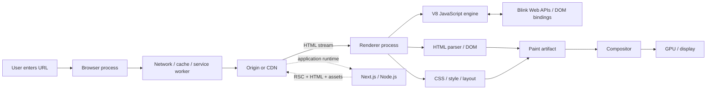

The arrows are not a strict serial pipeline. The browser can parse HTML while later bytes are still arriving; it can discover and fetch CSS while parsing continues; the compositor may keep scrolling a previously produced layer tree while the main thread is busy; server rendering may stream a fallback before a slower subtree completes. Concurrency and partial progress are fundamental to the Web.

There are also several representations of “the page” at the same time:

| Representation | Owned by | What it means |
|---|---|---|
| HTML source/response bytes | Server/browser network stack | Serialized document syntax |
| DOM | Browser rendering engine | Live object graph representing document nodes |
| Style/layout structures | Browser rendering engine | Resolved visual rules and geometry |
| Paint artifact/display items | Browser rendering engine | Instructions describing what should be drawn |
| Compositor layer/tree data | Browser compositor | Surfaces/properties that can be composed into frames |
| JavaScript objects | V8 | Program state in the JS heap |
| React elements | React application code | Immutable descriptions of desired UI |
| Fiber tree | React reconciler | Stateful work/identity structure used to compute updates |
| RSC/Flight payload | React server/client runtimes | Serialized rendered server-component representation |
| Bundles/chunks | Build system | Deployable executable assets produced from source modules |

Confusing two rows in that table is the source of many inaccurate explanations. “React renders the DOM,” for example, hides at least three distinct operations: React executes components, React commits host mutations, and the browser later performs style/layout/paint/compositing. Likewise, “Next.js sends the page” can refer to HTML, an RSC payload, JavaScript chunks, static assets, or some combination of them.

The rest of this document takes those layers apart and then reconstructs them.

---

# Part I — The browser as a document, execution, and rendering system

# 1. What a navigation is trying to accomplish: Document Navigation and Resource Acquisition

A browser does not begin with “render this React application.” It begins with a more basic responsibility: establish or update what is being shown in a browsing context. The mechanism that replaces the active document is a **navigation**.

That framing matters because an HTTP request and a navigation are not the same thing. A page can issue hundreds of HTTP requests without replacing itself. Conversely, a navigation may be satisfied from the back/forward cache without performing an ordinary network fetch at all.

## 1.1 From a URL to a browsing-context transition

Take this URL:

```text
https://app.example.com/dashboard?period=week#revenue
```

The browser can derive several kinds of information from it. The scheme and authority participate in network and security decisions. The path and query are part of the request target. The fragment is normally interpreted by the client and is not sent in the HTTP request target.

For web security, two related identities matter:

- An **origin** is normally a tuple of scheme, host, and port. `https://app.example.com` and `https://api.example.com` are therefore different origins.
- A **site**, under the modern schemeful same-site model, is based on scheme plus registrable domain. Those two hosts can be same-site while remaining cross-origin.

The distinction is not taxonomy for its own sake. DOM access is fundamentally origin-oriented; cookie policy and several anti-CSRF rules often reason about sites; Chromium’s Site Isolation uses site/process boundaries as a security mechanism. [The HTML Standard](https://html.spec.whatwg.org/) and [Chromium’s Site Isolation design](https://www.chromium.org/developers/design-documents/site-isolation/) are good primary references for the platform and implementation views respectively.

A navigation can replace the active `Document`, or it can keep the same document and merely change URL/history state. A normal link to another page is typically a **cross-document navigation**. A fragment change, or an application using `history.pushState()`, can be a **same-document navigation**. Modern client routers deliberately use the latter class of machinery when they want URL changes without throwing away the current document and all of its JavaScript state.

## 1.2 The browser first asks whether it needs the network at all

A useful mistake to eliminate early is the idea that “opening a URL means doing a GET.” Before the origin server is involved, several mechanisms may satisfy or redirect the request:

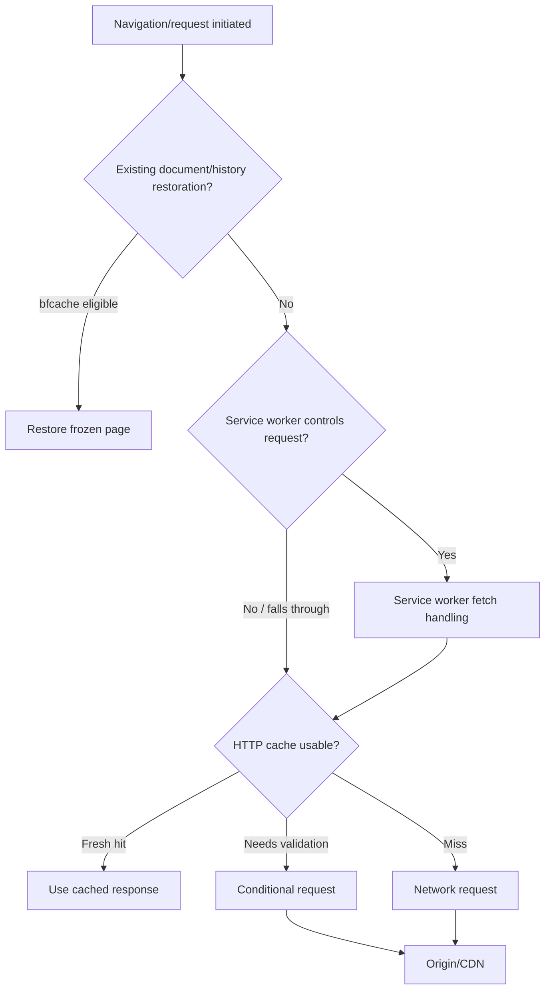

This diagram simplifies several policy checks, but it captures the important idea: **resource acquisition is a decision process, not synonymous with network transfer**.

The back/forward cache (bfcache) is particularly different from the HTTP cache. An HTTP cache stores response representations. The bfcache can preserve an entire page, including its JavaScript heap and DOM, in a suspended state for history traversal. Restoring from it is closer to resuming a frozen execution environment than reparsing an old response.

## 1.3 Once the network is needed, HTTP carries bytes; it does not define what those bytes mean

HTTP is a message protocol. A browser may carry HTTP/1.1 or HTTP/2 over TCP/TLS, while HTTP/3 uses QUIC. These choices affect setup cost, multiplexing, loss recovery, and connection reuse. They do not themselves determine whether a body is HTML, CSS, JavaScript, JSON, or an image.

A representative request and response might look like:

```http
GET /dashboard?period=week HTTP/2
Host: app.example.com
Accept: text/html,application/xhtml+xml
Accept-Encoding: br,gzip
Cookie: session=...

HTTP/2 200
Content-Type: text/html; charset=utf-8
Content-Encoding: br
Cache-Control: private, no-cache
Vary: Accept-Encoding

<!doctype html>...
```

Several layers are visible here:

- `Content-Encoding: br` says the transferred representation is Brotli-compressed. The browser must decode it before the HTML parser sees ordinary HTML bytes/characters.
- `Content-Type` tells the browser what representation it has received and influences parsing and security behavior.
- `Cache-Control` participates in reuse policy; it is not a directive to the HTML parser.
- HTTP/2 stream mechanics control transport, not DOM construction.

A response body can be consumed incrementally. The server does not have to finish computing the entire document before sending the first bytes. This property is older and more general than “streaming SSR.” Frameworks exploit the transport’s streaming capability; they did not invent it.

## 1.4 A document response creates a second problem: discovering everything else the page needs

HTML is usually an entry document, not the complete application payload. The browser learns about stylesheets, JavaScript, images, fonts, preloads, iframes, and other resources as it parses markup.

That produces at least three different graphs or orderings:

1. **Discovery order** — when the browser learns that a resource exists.
2. **Network scheduling** — when and with what priority a fetch is issued.
3. **Execution/rendering dependencies** — what must be ready before some later operation is legally or usefully performed.

They are related but not identical. A browser may fetch a script before it is allowed to execute it. It may fetch an image long before layout knows its final position. A module import may cause another request that was not present anywhere in the HTML.

The browser also performs speculative work. Chromium, like other engines, can scan ahead for likely subresources even when the main parser is blocked. The commonly used term **preload scanner** describes this optimization. It is one reason an external stylesheet referenced later in already-received markup may begin downloading while a parser-blocking script is still pending.

## 1.5 “Loaded” is not one moment

For engineering purposes, page progress has multiple milestones:

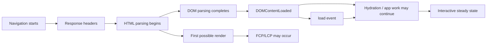

`DOMContentLoaded` is tied to HTML parsing and relevant deferred/module script execution. The `load` event waits for a broader set of load-delaying resources. Neither event means “the application has finished all asynchronous work,” and neither guarantees the main thread is responsive.

User-centric performance metrics deliberately describe different outcomes. First Contentful Paint (FCP) asks when something meaningful first appears. Largest Contentful Paint (LCP) estimates when the main content becomes visible. Interaction to Next Paint (INP) concerns how promptly interactions are reflected. Those are not aliases for DOM readiness.

## 1.6 HTTP caching and content-addressed builds solve different problems

Suppose a browser previously stored a response with an ETag. It may later validate it:

```http
GET /styles.css HTTP/2
If-None-Match: "a91f..."
```

If the representation is unchanged, the server can return `304 Not Modified`, allowing the client to reuse its stored bytes. That is HTTP cache validation.

A build pipeline often solves a different problem by changing the URL whenever content changes:

```text
/_next/static/chunks/dashboard.7c09d3f1.js
```

Such content-hashed files can be served with very long immutable cache lifetimes because new content gets a new URL. The browser never needs to ask whether the old URL has changed; by convention, it has not.

The two mechanisms compose:

- HTML and route responses may be short-lived or revalidated.
- Hashed assets may be immutable for a year.
- The HTML or framework payload acts as the *reference* that tells the browser which hashed assets belong to this application version.

This leads directly to **version skew**: if a client holds references from build A while a server or CDN exposes only build B, lazy navigation or dynamic import can fail. This is a deployment-consistency problem, not necessarily an application-code defect.

### Primary references

- [WHATWG HTML — navigation and document lifecycle](https://html.spec.whatwg.org/)
- [Fetch Standard](https://fetch.spec.whatwg.org/)
- [RFC 9110 — HTTP Semantics](https://www.rfc-editor.org/rfc/rfc9110)
- [RFC 9111 — HTTP Caching](https://www.rfc-editor.org/rfc/rfc9111)
- [Chromium Site Isolation](https://www.chromium.org/developers/design-documents/site-isolation/)

---

# 2. Who actually does the work: Chromium Processes, Blink, V8, and the Compositor

Terms such as *browser*, *rendering engine*, *JavaScript engine*, and *renderer* are often used interchangeably in casual discussion. That is harmless until the goal is to understand which subsystem actually owns an operation. At that point, the distinctions become essential.

For concreteness, this chapter uses Chromium as the reference implementation. Firefox and WebKit make different implementation choices, but the conceptual separation between privileged browser coordination, document rendering, JavaScript execution, networking, and graphics is broadly useful.

## 2.1 Chromium is a multi-process application, not one giant event loop

A simplified Chromium architecture looks like this:

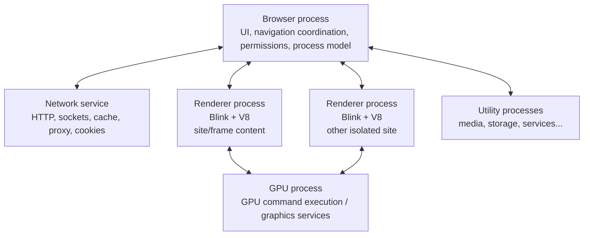

The **browser process** is privileged. It owns top-level browser UI, coordinates navigation, enforces important security decisions, and controls renderer processes. The **renderer process** runs web-content machinery in a sandbox. The **network service** owns much of the actual network stack. The **GPU process** isolates graphics-driver interaction and participates in compositing/raster work. Chromium also uses utility processes for specialized services.

This architecture has both reliability and security motivations. A renderer crash should not necessarily terminate the whole browser. More importantly, a compromised renderer is intentionally denied direct unrestricted access to files, devices, and arbitrary other sites. [Chromium’s Site Isolation design](https://www.chromium.org/developers/design-documents/site-isolation/) pushes this further by using process separation as a security boundary between sites, including out-of-process iframes.

## 2.2 Blink is the Web platform implementation inside the renderer

**Blink** is Chromium’s rendering engine, but “rendering engine” understates its scope. Blink implements a large part of the Web platform that a document experiences:

- HTML parsing and DOM objects;
- CSS parsing, style resolution, layout, and paint;
- event dispatch and many Web APIs;
- resource-loading integration;
- worker environments;
- Web IDL bindings that connect JavaScript-visible APIs to Blink’s C++ implementations;
- scheduling infrastructure for renderer tasks.

Chromium’s current source organization describes Blink’s rendering core as four principal stages: **DOM, Style, Layout, and Paint**. The output of core rendering is a paint artifact that can be consumed by the compositor machinery. See [Blink Renderer Core](https://chromium.googlesource.com/chromium/src/+/refs/heads/main/third_party/blink/renderer/core/README.md) and [Blink’s renderer directory overview](https://chromium.googlesource.com/chromium/src/+/master/third_party/blink/renderer/README.md).

Blink is therefore the owner of the actual `Document`, `Element`, layout, and paint implementation in Chromium. V8 does not implement the DOM.

## 2.3 V8 is an embedded language engine

**V8** implements ECMAScript execution. Given JavaScript source, it parses the language, generates executable representations, runs the program, manages JavaScript objects, and performs garbage collection and JIT compilation.

V8 does *not* intrinsically provide `document`, `fetch`, `setTimeout`, `<div>` elements, or the browser event loop. Those come from the **host environment** embedding V8. Chromium/Blink is one such host; Node.js is another. This is why the same JavaScript language can run in a browser and in Node while exposing very different global APIs.

One V8 concept that becomes important when embedded in a browser is an **isolate**: broadly, an independent V8 engine instance with its own managed heap. Blink associates isolates with execution threads. A **context** provides a global environment and associated built-ins/prototype chains. Frames and isolated worlds can therefore execute JavaScript in separate contexts even while referring to underlying browser objects. Chromium’s [V8 bindings design](https://chromium.googlesource.com/chromium/src/+/master/third_party/blink/renderer/bindings/core/v8/V8BindingDesign.md) documents this integration in implementation detail.

## 2.4 Blink and V8 meet through generated bindings, not magic

Consider:

```js
const button = document.querySelector('#save');
button.textContent = 'Saving…';
```

From JavaScript, both operations look like ordinary property/method accesses. Under the hood, however, `document` is not just an object literal implemented in application JavaScript.

The Web platform specifies interfaces using **Web IDL**. Blink has an IDL compiler that generates C++ binding code between V8 and Blink. Chromium’s own description is explicit: when a JavaScript-visible Web IDL method or attribute is used, **V8 calls generated bindings code, which then calls Blink code**. See [Blink’s IDL compiler documentation](https://chromium.googlesource.com/chromium/src/+/master/third_party/blink/renderer/bindings/IDLCompiler.md).

A simplified call path is:

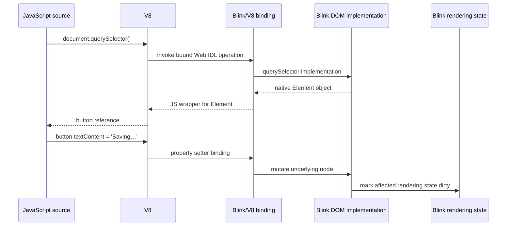

The JavaScript-facing object is a V8 wrapper associated with an underlying Blink object. Chromium’s binding architecture even allows different JavaScript “worlds” to have distinct wrappers and contexts while sharing the same underlying C++ DOM object. That is useful, for example, for extension isolated worlds.

This bridge is one reason the browser has to coordinate garbage collection across language and DOM object lifetimes. V8 manages JavaScript heap objects; Blink also has managed C++ object lifetimes. References crossing the boundary must not leave a live DOM object collected while JavaScript can still reach it, nor leak entire documents forever because a wrapper was mishandled.

## 2.5 Main-thread ownership explains a large class of performance problems

Blink’s task-scheduling documentation states the practical constraint plainly: most important Blink work, including JavaScript execution, DOM, CSS, and layout, happens on the renderer’s main thread. [Blink Task Scheduling](https://chromium.googlesource.com/chromium/src/+/refs/heads/main/third_party/blink/renderer/platform/scheduler/TaskSchedulingInBlink.md) exists largely because many kinds of work compete for that thread.

This gives a more precise meaning to “JavaScript blocks rendering.” It does **not** mean that every graphics operation in Chromium stops whenever V8 runs. The compositor can perform some work independently, and networking proceeds elsewhere. It means that a long-running main-thread JavaScript task prevents the same renderer main thread from performing DOM event dispatch, style recalculation, layout, and other main-thread rendering updates until control returns.

That distinction explains why scrolling and compositor-driven transforms can sometimes remain smooth while application JavaScript is busy, yet clicking a button or changing layout can feel frozen.

## 2.6 The compositor and GPU are separate from Blink’s DOM/layout work

Blink’s core rendering stages eventually produce paint information. Chromium then has compositor machinery that organizes visual content into compositable structures, rasterizes content into tiles/surfaces as needed, and submits graphics work through the GPU process.

Conceptually:


Not every update travels through every box. A compositor-only transform may reuse previously rasterized content and change how it is positioned in the composed frame. A text color change usually requires new paint/raster work but not necessarily layout. A width change can invalidate geometry and therefore force layout before painting.

The browser is therefore best understood as a **set of cooperating pipelines with shared constraints**, not a single `render()` function.

### Primary references

- [Chromium multi-process architecture](https://www.chromium.org/developers/design-documents/multi-process-architecture/)
- [Chromium Site Isolation](https://www.chromium.org/developers/design-documents/site-isolation/)
- [Blink Renderer Core](https://chromium.googlesource.com/chromium/src/+/refs/heads/main/third_party/blink/renderer/core/README.md)
- [Blink renderer architecture](https://chromium.googlesource.com/chromium/src/+/master/third_party/blink/renderer/README.md)
- [Blink/V8 bindings design](https://chromium.googlesource.com/chromium/src/+/master/third_party/blink/renderer/bindings/core/v8/V8BindingDesign.md)
- [Blink IDL compiler](https://chromium.googlesource.com/chromium/src/+/master/third_party/blink/renderer/bindings/IDLCompiler.md)

---

# 3. How response bytes become a live document: HTML Parsing, DOM Construction, and Resource Discovery

With the browser architecture in place, “the browser receives HTML” can be unpacked properly. The network service delivers response data; the renderer consumes it; Blink’s HTML machinery constructs browser-owned objects while simultaneously discovering resources and occasionally handing control to JavaScript.

The important point is that parsing is **incremental and stateful**. The browser does not normally wait for the entire HTML file, convert it into a tree in one batch, and only then begin the rest of the page.

## 3.1 Byte decoding precedes HTML tokenization

The response body is bytes. HTML parsing operates on decoded characters. The browser determines an encoding using the HTML encoding rules, response metadata, byte-order information, and early document declarations where applicable. This is why character encoding is not merely an application-string concern; it determines what character stream the parser receives.

Once characters are available, the HTML parser conceptually has two major stages:

1. **Tokenization** — consumes characters using tokenizer states and emits tokens such as start tags, end tags, comments, and character data.
2. **Tree construction** — consumes tokens using insertion modes, a stack of open elements, and other parser state to mutate the DOM.

The algorithm is intentionally not XML-like. HTML has specified error recovery and historical behaviors such as implied elements, table foster parenting, and adoption-agency handling. Two pieces of markup that *look* similarly nested to a human can produce different DOM structures because the parser is running a defined state machine. See [WHATWG HTML — Parsing](https://html.spec.whatwg.org/multipage/parsing.html).

## 3.2 The DOM is a live browser object graph, not “the HTML in memory”

A useful shorthand is “HTML becomes the DOM,” but the DOM deserves a more precise identity. It is a browser-owned graph of objects implementing standardized interfaces such as `Document`, `Element`, `Text`, and `Node`.

The DOM can diverge from source text immediately:

- the parser may insert implied elements;
- scripts may add, remove, or reorder nodes;
- parser error recovery may produce a tree that does not visually mirror source nesting;
- pseudo-elements can affect rendering without existing as DOM nodes;
- Shadow DOM creates additional tree relationships that are not represented by simply reading source HTML.

Serializing the DOM later is therefore not guaranteed to reproduce the original source byte-for-byte or even structurally in every malformed-markup case.

## 3.3 Parsing and JavaScript execution can interrupt one another

A parser-inserted classic script without `async` or `defer` is special because its execution can affect what the parser should see next. Legacy `document.write()` makes the dependency obvious: executing the script can inject more input into the parser itself.

Consider:

```html
<link rel="stylesheet" href="/app.css">
<script src="/bootstrap.js"></script>
<main id="app"></main>
<script type="module" src="/entry.js"></script>
```

The rough behavior is not “download everything, then execute everything.” Instead:

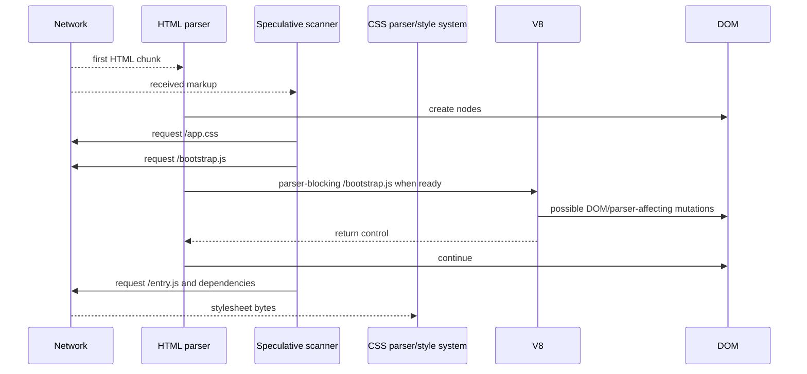

The speculative scanner is an optimization, not a second authoritative parser. It can discover likely URLs ahead of the primary parser, but it cannot execute arbitrary JavaScript to know every future resource dependency.

## 3.4 Script attributes encode ordering contracts

The most important script forms can be summarized like this:

| Script form | Fetch behavior | Evaluation behavior | Relationship to HTML parsing |
|---|---|---|---|
| Classic, parser-inserted, no `async`/`defer` | Requested when discovered | Executes at parser position when ready | Ordinarily blocks further parsing |
| Classic `defer` | Fetches in parallel | Runs after parsing, in document order, before `DOMContentLoaded` | Does not block the parser while fetching |
| Classic `async` | Fetches in parallel | Runs when ready; independent of sibling source order | May interrupt ongoing parsing |
| `type="module"` | Fetches module graph | Deferred-style by default; graph semantics apply | Does not ordinarily block parsing |
| Module `async` | Fetches module graph | Runs when graph is ready, independent of normal deferred order | Does not ordinarily block parsing |

There are subtleties for dynamically inserted scripts, top-level `await`, import maps, and failure propagation, but the table captures the baseline ordering guarantees.

Stylesheets introduce another dependency. A stylesheet is not simply “a parser blocker like a script,” yet a script may be delayed by already-discovered blocking stylesheets because the script can ask questions such as computed style whose answer must reflect those styles. This creates a dependency chain where CSS delays script execution and the delayed script indirectly delays parser progress.

## 3.5 Resource discovery is part of browser performance architecture

If a critical resource is only discoverable after JavaScript executes, the browser cannot fetch it early from markup scanning. If a stylesheet imports another stylesheet, the second URL is discovered only after the first stylesheet arrives and is parsed. If a JavaScript bundle dynamically imports a feature, that chunk may not be requested until runtime reaches that import.

This is why seemingly high-level build decisions change low-level network behavior. A framework that knows the dependency graph ahead of time can emit `<link rel="preload">` or `<link rel="modulepreload">`, allowing the browser to acquire resources before ordinary discovery would reach them.

The browser still owns scheduling. A preload is a strong hint about expected future use, not permission to violate execution semantics.

## 3.6 Document readiness follows parser and script rules, not visual completion

When the parser reaches the end of the input, the document is not automatically “done.” The HTML Standard specifies work that must happen around deferred scripts and load-delaying resources before readiness transitions and events are dispatched.

Three commonly confused states are:

- `document.readyState === "loading"` — parsing is still in progress;
- `"interactive"` — parsing has completed, with deferred/module execution interacting with `DOMContentLoaded` timing;
- `"complete"` — the broader load process has completed and the `load` event is associated with this stage.

None of these is a direct promise that the browser has painted every resource or that framework hydration has finished.

### Primary references

- [WHATWG HTML — Parsing](https://html.spec.whatwg.org/multipage/parsing.html)
- [WHATWG HTML — Scripting](https://html.spec.whatwg.org/multipage/scripting.html)
- [Blink renderer architecture](https://chromium.googlesource.com/chromium/src/+/master/third_party/blink/renderer/README.md)

---

# 4. How rules become geometry: CSS Resolution, Box Construction, and Layout

The DOM tells the browser which document nodes exist. It does not tell the browser how large they are, where they are placed, or even whether a given node creates a visible box. CSS is the input to a second set of algorithms that convert document structure plus style rules into visual constraints and eventually geometry.

The important mental shift is to stop treating “CSSOM + DOM = render tree” as a single opaque step. Real engines maintain several representations because selector matching, computed style, layout participation, paint properties, and compositing have different update costs and lifetimes.

## 4.1 CSS parsing produces structured rules; it does not immediately style every element

A stylesheet such as:

```css
.card > .title {
  font-size: 1.25rem;
  margin-block-end: 0.5rem;
}
```

is parsed into structured rule data. The engine later determines which elements match each relevant selector. It then resolves the cascade across origin, cascade layers, importance, specificity, scoping, source order, inheritance, and custom-property substitution.

That resolution occurs because browsers need a **computed style** for elements that participate in styling. But computed values are not always final physical values. Percentages, font-relative dimensions, intrinsic sizing, and other properties can require layout context before a used value is known.

It is therefore useful to separate:

```text
CSS source
  -> parsed rules
  -> selector matching
  -> cascade/inheritance
  -> computed style
  -> box/layout participation
  -> used geometry
```

## 4.2 The DOM tree and the layout/box structures are not the same tree

Several common CSS behaviors demonstrate the difference:

- `display: none` leaves a DOM element present but suppresses its normal box generation.
- `display: contents` can make an element participate in the DOM while not generating its usual principal box.
- `::before` and `::after` can introduce generated visual content that is not an ordinary DOM child node.
- Text may be fragmented into line boxes according to width, writing mode, fonts, and shaping.
- Positioned or fragmented content can participate in layout structures that do not correspond one-to-one with DOM ancestry.

This is why “walk the DOM and draw each element” is not a useful model of browser rendering.

## 4.3 Layout is constraint solving under formatting-context rules

Layout determines geometry: positions, dimensions, line breaks, fragment boundaries, and related spatial data. Different formatting contexts have different algorithms. Block flow, flex layout, grid layout, table layout, multi-column fragmentation, positioned layout, and inline text shaping are not one universal box-placement algorithm.

For example, a flex container’s child width can depend on:

- the container’s available main size;
- each item’s flex basis and min/max constraints;
- intrinsic content sizes;
- sibling flex factors;
- gaps and borders;
- writing direction.

That dependency is why a size change in one part of the tree can force geometry recalculation elsewhere.

Modern engines try hard to make update cost proportional to the affected region. Blink tracks invalidation so that changing a class on one element does not imply blindly recalculating every style and every box in the document. Still, dependencies can propagate. A changed font can alter text metrics, which changes line breaks, which changes container height, which shifts following content.

## 4.4 Style invalidation and layout invalidation are separate questions

Consider three mutations:

```js
node.classList.add('warning');
node.style.width = '420px';
node.style.transform = 'translateX(10px)';
```

Their costs depend on the styles involved, but conceptually:

- adding a class can require selector/style recalculation for the node and possibly related descendants/relatives;
- changing `width` commonly invalidates layout and later paint;
- changing a transform can often avoid layout and be represented as a compositor property update.

The browser defers much of this work until it needs to produce a correct frame or answer a synchronous query. That deferral is an optimization: multiple DOM/style writes can be coalesced into one update cycle.

## 4.5 Forced synchronous layout is an ordering problem

Suppose application code writes geometry and immediately reads geometry:

```js
for (const row of rows) {
  row.style.width = `${target}px`;          // invalidates style/layout
  console.log(row.getBoundingClientRect()); // needs current geometry now
}
```

To return a correct rectangle, Blink may need to flush pending style and layout before the read completes. Repeating this write/read pattern can force many small synchronous layout passes: the classic **layout thrashing** pattern.

The important lesson is not “`getBoundingClientRect()` is slow.” The method is expensive when it imposes a synchronization barrier after work that the browser had hoped to batch.

A better pattern groups mutations and observations when possible:

```js
for (const row of rows) {
  row.style.width = `${target}px`;
}

const rects = rows.map((row) => row.getBoundingClientRect());
```

Even this may cause a layout flush before the first read, but it allows one coherent layout update instead of repeatedly invalidating after each measurement.

## 4.6 CSS is therefore part of application scheduling, not merely presentation

Because style and layout share the renderer main thread with JavaScript, application code can create or avoid work by the order in which it touches DOM and style APIs. Frameworks do not remove this constraint. React can batch host mutations, but after the commit, the browser still has to resolve whatever style/layout work those mutations imply.

This is the first clear example of a theme that will recur throughout the document: **framework scheduling sits on top of browser scheduling; it does not replace it**.

### Primary references

- [Chromium Rendering Core](https://www.chromium.org/teams/rendering/)
- [Blink Renderer Core](https://chromium.googlesource.com/chromium/src/+/refs/heads/main/third_party/blink/renderer/core/README.md)
- [CSS Cascading and Inheritance](https://www.w3.org/TR/css-cascade-6/)
- [CSS Display](https://www.w3.org/TR/css-display-3/)

---

# 5. How geometry becomes pixels: Paint, Rasterization, and Compositing

Once layout has established geometry, the browser still has not produced pixels. Knowing that a heading occupies a rectangle at `(x, y)` says nothing yet about the order in which its background, text glyphs, shadows, clipped descendants, and overlapping siblings should be drawn.

Modern browser graphics therefore separate **paint**, **rasterization**, and **compositing**. The separation is the foundation for smooth scrolling and many animation optimizations.

## 5.1 Paint records what should be drawn

Blink’s paint stage walks the relevant visual structures and produces paint information describing drawing operations and their associated properties. In current Blink architecture, core rendering outputs a **PaintArtifact** for downstream compositing machinery.

Conceptually, the output resembles a display list more than a screenshot:

```text
paint background for card
paint border
clip descendants to rounded rectangle
paint image
paint glyph run for title
paint box shadow
...
```

This distinction matters because recorded drawing instructions can be reused, reorganized, rasterized in tiles, and composited without rerunning layout every time.

## 5.2 Rasterization turns drawing instructions into pixel-backed content

**Rasterization** executes paint operations into pixel surfaces or tiles. Chromium can perform raster work away from the renderer main thread and use GPU acceleration where appropriate. Rasterization is still real work: large surfaces, filters, shadows, huge images, and frequent invalidation can be expensive even if no layout occurs.

The term “GPU accelerated” is therefore too coarse to predict performance. A GPU can make certain operations efficient while another workload becomes limited by raster bandwidth, memory, uploads, or synchronization.

## 5.3 Compositing decides how already-produced surfaces form the frame

The compositor deals with independently transformable visual content and property trees/layers. If an element’s visual content is already rasterized and an animation changes only a compositor-supported transform or opacity, the compositor may produce new frames by changing how that surface is positioned or blended without asking Blink to redo layout and paint on every frame.

A simplified update-cost matrix is useful:

| Change | Style recalc | Layout | Paint/raster | Composite |
|---|---:|---:|---:|---:|
| Text/content change | Usually | Often | Usually | Yes |
| `width`/geometry change | Usually | Usually | Usually | Yes |
| `color` change | Usually | Usually no | Usually | Yes |
| `transform` on composited content | Maybe minimal | No | Often reusable | Yes |
| `opacity` on composited content | Maybe minimal | No | Often reusable | Yes |

This is intentionally conceptual. Engines can promote/demote content, cache paint/raster results, and change internal heuristics.

## 5.4 A composited layer is an engine decision, not a CSS primitive

Developers often talk about an element “getting its own layer,” but CSS does not expose a simple one-element-one-layer model. Chromium derives compositor structures from paint output and from **property trees** that represent transforms, clips, effects such as opacity, and scrolling relationships. The engine then decides which content benefits from independent compositing or raster backing.

That decision is a trade-off. Independent surfaces can make transforms, opacity changes, video, fixed-position content, or scrolling cheaper to update, but every extra surface can consume memory and introduce raster/upload/compositing overhead. `will-change: transform` is therefore a hint, not a command to “turn on the GPU,” and indiscriminately applying it can make a page worse.

The practical distinction is visible in these two animations:

```css
/* Changes geometry; typically participates in layout. */
.moving-a {
  position: relative;
  animation: left-right 1s linear infinite alternate;
}
@keyframes left-right {
  from { left: 0; }
  to   { left: 200px; }
}

/* Can often be satisfied by compositor work once content is ready. */
.moving-b {
  animation: translate 1s linear infinite alternate;
}
@keyframes translate {
  from { transform: translateX(0); }
  to   { transform: translateX(200px); }
}
```

The second animation is *eligible* for a cheaper path because a transform can change how an existing surface is composed without changing the element's layout geometry. Eligibility is not a universal guarantee: filters, descendants, clipping, layerization decisions, memory pressure, and browser heuristics can still alter the actual work performed.

A useful mental model is therefore:

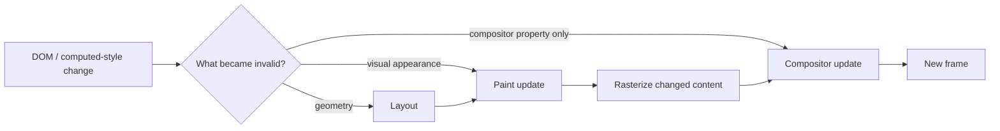

The key question is not “is this GPU accelerated?” but **which earlier stages can the engine safely reuse?**

## 5.5 Scrolling reveals why the compositor exists

Imagine a page that is already laid out and rasterized into tiles. If the user scrolls, many frames can be produced by changing which existing content is visible and requesting newly needed tiles as necessary. The compositor can often respond to input independently of the renderer main thread.

That is why a page can sometimes continue to scroll while a long JavaScript task is running. The same page may still feel “frozen” when the user clicks a button, because event dispatch and application code require main-thread progress.

Compositor-thread scrolling also explains why scroll-linked effects that require synchronous main-thread JavaScript are harder to keep smooth. The compositor can move already-prepared content at display cadence; if every frame also requires JavaScript, fresh style calculation, or layout, the main thread re-enters the critical path.

## 5.6 A frame is the result of synchronized subsystems

A useful end-to-end visual pipeline is:

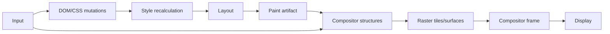

Input can feed both compositor-level behavior and main-thread behavior. The compositor may immediately handle scrolling while simultaneously sending events/updates that eventually reach the main thread.

The practical consequence for framework engineers is important: **“DOM update complete” is not “pixels displayed.”** A React commit can finish, after which Blink may still need to recalculate style, run layout, paint, rasterize, and composite before the user sees the change.

### Primary references

- [Chromium — The Rendering Critical Path](https://new.chromium.org/developers/the-rendering-critical-path/)
- [Blink Renderer Core](https://chromium.googlesource.com/chromium/src/+/refs/heads/main/third_party/blink/renderer/core/README.md)
- [Chromium Rendering Core documentation index](https://www.chromium.org/teams/rendering/)
- [Chromium — RenderingNG architecture](https://developer.chrome.com/docs/chromium/renderingng-architecture)

---

# 6. How the browser decides what runs next: Event Loops, Blink Scheduling, and Rendering Opportunities

The browser has now accumulated several kinds of pending work: JavaScript callbacks, input events, parser work, timers, networking completions, style/layout updates, animation callbacks, and compositor coordination. The fact that much of Blink is main-thread-oriented means it needs rules for deciding what gets to run and when the browser is allowed to update the rendering.

Two layers must be kept distinct:

- the **HTML event-loop model**, which defines web-observable scheduling semantics such as tasks and microtask checkpoints;
- the browser’s **internal scheduler**, which chooses among implementation task queues and priorities while respecting web-platform requirements.

## 6.1 A JavaScript turn is embedded in a larger browser loop

A simplified event-loop iteration is often presented as:

```text
pick a task
run it to completion
perform a microtask checkpoint
possibly render
repeat
```

That is a useful starting model, provided “possibly render” is taken seriously. The browser is not obliged to paint between every two tasks, and rendering is constrained by refresh timing, visibility, pending work, and implementation scheduling.

A **task** may come from sources such as user interaction, timers, networking, or posted messages. Promise reactions and `queueMicrotask()` callbacks enter the **microtask** machinery. Once a task returns to the event loop, the browser performs a microtask checkpoint before moving on to a later rendering opportunity or task as specified by the platform algorithms.

Consider:

```js
button.addEventListener('click', () => {
  label.textContent = 'A';

  Promise.resolve().then(() => {
    label.textContent = 'B';
  });

  queueMicrotask(() => {
    label.textContent = 'C';
  });

  setTimeout(() => {
    label.textContent = 'D';
  }, 0);
});
```

A common observable order is that the click task writes `A`, the queued microtasks update through `B` and `C`, and only a later timer task writes `D`. There is normally no browser paint *required* between `A`, `B`, and `C`; all of that can occur before the browser gets a rendering opportunity.

This is why “I awaited a resolved Promise, so the UI should repaint first” is not a safe assumption.

## 6.2 Microtasks are powerful precisely because they run before the loop moves on

Promise continuations use microtasks. This gives them low scheduling latency and deterministic ordering relative to the current task, but it also means an unbounded chain of microtasks can starve the browser from reaching other work.

```js
function again() {
  queueMicrotask(again);
}
again();
```

A browser cannot keep producing normal main-thread rendering progress if JavaScript perpetually replenishes the microtask queue. “Asynchronous” does not imply “cooperatively yielding to rendering.”

## 6.3 `requestAnimationFrame` aligns application work with rendering, but does not create another thread

`requestAnimationFrame()` asks the browser to invoke a callback before an upcoming rendering update. It is useful for coordinating visual mutations with frame production, but the callback still normally executes on the renderer main thread.

A typical frame-oriented sequence is:

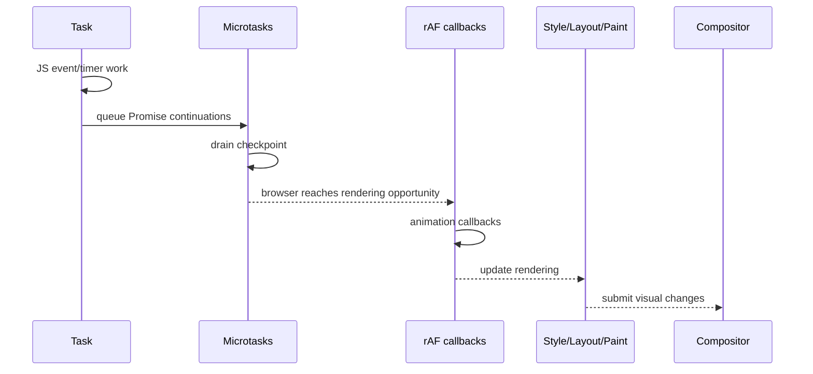

If the main thread is occupied by a 200 ms JavaScript task, the browser cannot run a main-thread rAF callback in the middle of that task merely because the display refreshes.

## 6.4 Blink has its own scheduler because web-visible “tasks” are not all equally urgent internally

Chromium’s Blink scheduler documentation explains that input handling, compositor-related work, background work, timers, and other task classes can have different priorities or throttling behavior. Browsers can defer, throttle, freeze, or prioritize internal queues as long as they preserve required web semantics.

For example, background pages may have timers throttled or execution frozen to save power. During active user interaction, the scheduler can prioritize responsiveness-oriented work. This is an implementation policy layered under the standard’s observable behavior.

This distinction becomes useful when debugging performance: a flame chart’s internal scheduler categories are not themselves HTML-standard “task sources,” even if they implement work triggered by them.

## 6.5 Event dispatch enters JavaScript; JavaScript can immediately re-enter Blink

A click illustrates the Blink/V8 loop:

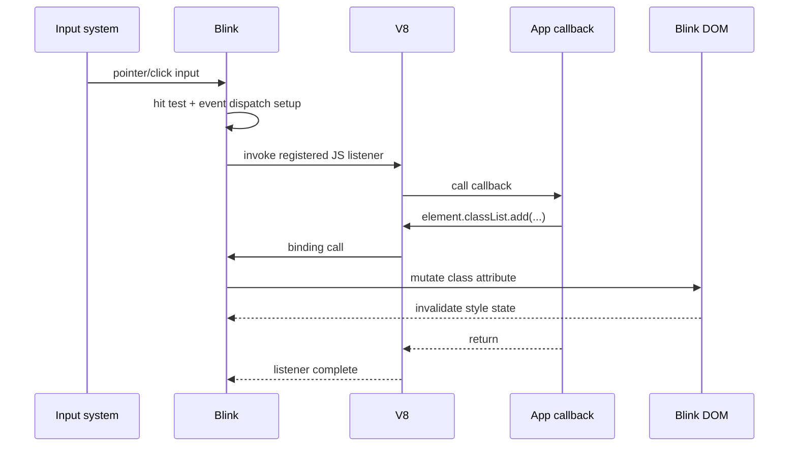

The mutation does not have to perform layout immediately. Blink can mark rendering state dirty and defer expensive work until the next point at which correct style/layout is required.

A synchronous geometry read can change that:

```js
box.classList.add('expanded');
const height = box.offsetHeight;
```

The second line may force pending style/layout to be brought current before JavaScript continues because the API contract requires a meaningful geometry result.

## 6.6 Lifecycle events and page freezing add another scheduling dimension

Pages are not always continuously active. Visibility changes, history traversal, bfcache entry/restore, freezing, and background throttling can suspend or alter execution. For long-lived applications, especially SPAs, it is incorrect to equate “document lifetime” with “continuous main-thread execution from load until close.”

The browser may preserve a document and later emit `pageshow` for a bfcache restoration rather than perform a fresh load. This matters to analytics initialization, WebSocket handling, timers, and any code that assumes `DOMContentLoaded` runs for every apparent navigation.

## 6.7 The browser scheduling model is the substrate React must cooperate with

React can assign priorities to its own units of work and may yield while computing a future tree. It cannot preempt a currently running JavaScript stack frame at an arbitrary machine instruction. React’s cooperative scheduling only works when React itself structures reconciliation as resumable units and returns control to the host between chunks of work.

That relationship is essential:

> **Browser:** owns the main thread and rendering opportunities.  
> **V8:** executes JavaScript when the host invokes it.  
> **React:** organizes some of its JavaScript work so it can yield back to the browser before committing visible mutations.

### Primary references

- [WHATWG HTML — Event loops](https://html.spec.whatwg.org/multipage/webappapis.html#event-loops)
- [Blink task scheduling](https://chromium.googlesource.com/chromium/src/+/refs/heads/main/third_party/blink/renderer/platform/scheduler/TaskSchedulingInBlink.md)
- [MDN — `requestAnimationFrame`](https://developer.mozilla.org/docs/Web/API/Window/requestAnimationFrame)

---

# Part II — JavaScript as an embedded execution system

# 7. What happens when JavaScript runs: V8 Parsing, Bytecode, JIT Tiers, Deoptimization, and GC

JavaScript source is not normally translated once into one final machine-code program and then left alone. V8 is a dynamic-language runtime designed to balance several competing goals: fast startup, reasonable memory use, quick generation of executable code, and high peak throughput for code that proves worth optimizing.

That trade-off leads to **tiered execution**. Functions can begin in a relatively cheap execution representation and move through progressively more optimized tiers as runtime feedback accumulates. An optimized assumption can later become invalid, at which point execution may **deoptimize** to a less specialized representation.

The exact V8 pipeline evolves. As of the current V8 architecture, the important named pieces include Ignition, Sparkplug, Maglev, TurboFan, and Turboshaft. The durable concept is not the exact number of tiers; it is **adaptive compilation driven partly by observed runtime behavior**.

## 7.1 Parsing: source text first becomes syntax and semantic structures

When V8 encounters JavaScript source, it has to perform lexical/syntactic analysis and create internal compiler structures representing the program. Engines optimize this phase aggressively because production applications can contain megabytes of JavaScript, much of which may never execute on the initial path.

For a function such as:

```js
function total(items) {
  let sum = 0;
  for (const item of items) {
    sum += item.price;
  }
  return sum;
}
```

an engine must determine lexical bindings (`items`, `sum`, `item`), control flow, property access operations, loop structure, and language semantics. This is not yet equivalent to knowing that `item.price` is always a floating-point load from a fixed memory offset. JavaScript allows `item` to have different shapes, getters, proxies, or values across calls.

That uncertainty is exactly why runtime feedback matters.

## 7.2 Ignition: compact bytecode gives V8 a cheap starting representation

V8’s **Ignition** is a register-based bytecode interpreter. JavaScript functions can be compiled to compact bytecode, then executed by the interpreter. “Register-based” here refers to *virtual interpreter registers*, not directly to CPU registers.

Conceptually:

```text
JavaScript source
    ↓ parse / compile
Ignition bytecode
    ↓ interpret
program behavior + runtime feedback
```

Bytecode is attractive for startup because it can be generated relatively quickly and stored compactly. V8’s [Ignition documentation](https://v8.dev/docs/ignition) and [original Ignition design overview](https://v8.dev/blog/ignition-interpreter) describe this motivation.

The interpreter is not “slow mode that always stays slow.” Its execution also gathers information about how the program behaves.

## 7.3 Hidden classes/shapes and inline caches: dynamic objects can still exhibit stable structure

JavaScript objects are semantically dynamic:

```js
const user = { id: 1, name: 'A' };
user.email = 'a@example.com';
```

An implementation cannot assume that every property access is a fixed C-style struct load. Yet real programs frequently create many objects with the same property layout and access the same properties repeatedly.

V8 internally tracks object **shapes** (historically and commonly discussed as hidden classes/maps). Property access sites can use **inline caches** and runtime feedback to record what kinds of receiver shapes have appeared.

A conceptual progression for `user.name` is:

```text
first executions:
  receiver shape unknown → generic lookup

feedback accumulates:
  site usually sees shape S → remember likely access path

optimized code:
  check receiver still has shape S
  load field from specialized location
  otherwise take fallback/deoptimization path
```

The optimization is speculative, but guarded. JavaScript semantics remain authoritative.

## 7.4 Sparkplug: baseline machine code without expensive optimization

Interpreting bytecode has overhead. V8’s **Sparkplug** baseline compiler can generate machine code quickly from bytecode without performing the expensive whole-program-style optimizations associated with top-tier compilation.

An important implementation trick is that Sparkplug uses a frame layout compatible with Ignition’s execution model, making transitions and stack walking cheaper. The [V8 Sparkplug article](https://v8.dev/blog/sparkplug) describes this as a deliberate way to get machine-code execution with low compilation cost.

This creates a useful intermediate trade-off:

```text
Ignition
  cheap to produce, interpreter overhead
       ↓ hot enough
Sparkplug
  cheap-ish machine code, limited optimization
       ↓ hotter / enough feedback
optimizing tiers
```

## 7.5 Maglev: optimize sooner without paying full top-tier compilation cost

V8 introduced **Maglev** as a fast optimizing JIT between Sparkplug and its highest optimization tier. Maglev uses runtime feedback and a control-flow-graph-based intermediate representation to produce better machine code while keeping compilation latency lower than the end-tier optimizer.

The motivation is straightforward. If V8 waits too long to produce optimized code, medium-lived web code spends too much time in lower tiers. If it invokes the heaviest optimizer too early, compilation itself becomes expensive. Maglev occupies that middle ground. See [Maglev — V8’s Fastest Optimizing JIT](https://v8.dev/blog/maglev).

## 7.6 TurboFan and Turboshaft: peak optimization is a compiler pipeline of its own

**TurboFan** is V8’s high-tier optimizing compiler. Historically it was strongly associated with a Sea-of-Nodes intermediate representation. V8 has been replacing major backend stages with **Turboshaft**, a more conventional control-flow-graph-oriented IR/backend. The 2025 V8 article [“Land ahoy: leaving the Sea of Nodes”](https://v8.dev/blog/leaving-the-sea-of-nodes) is important because older explanations that equate modern TurboFan entirely with Sea of Nodes are now incomplete.

At a conceptual level, the top-tier optimizer can perform work such as:

- type/shape specialization based on feedback;
- inlining known calls;
- eliminating redundant checks;
- folding constants and simplifying control flow;
- lowering high-level JavaScript operations into progressively lower-level IR;
- register allocation and machine-code generation.

This code is fast because it has assumptions. Those assumptions must be checked.

## 7.7 Deoptimization: optimized code is a conditional bet

Suppose repeated calls show that `add(a, b)` receives small integers. An optimizing compiler may specialize arithmetic for that pattern. A later call might pass a string:

```js
function add(a, b) {
  return a + b;
}

add(1, 2);
add(3, 4);
add('x', 'y');
```

The JavaScript language requires the third call to concatenate. If optimized machine code assumed numeric addition, V8 must take a path that preserves language semantics. It may bail out of optimized code, reconstruct a less-specialized execution state, and continue in a tier capable of handling the new behavior.

This is **deoptimization**. It is not an exceptional bug. It is part of the design of a speculative optimizing VM.

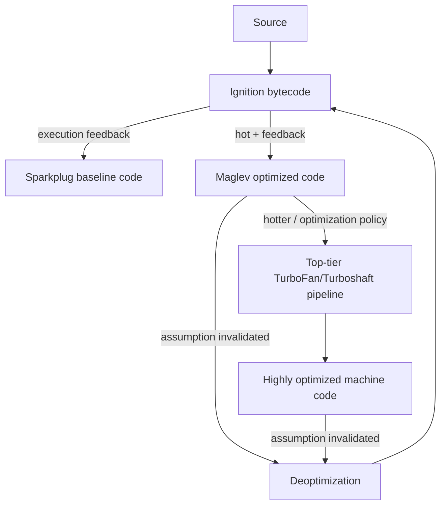

The actual tier-selection machinery is more nuanced than this diagram, but the representation flow is accurate enough for framework reasoning.

## 7.8 Closures matter because execution state can outlive the call that created it

Framework code relies heavily on closures:

```js
function Counter() {
  let count = 0;
  return () => ++count;
}
```

Lexical environments allow the returned function to retain access to bindings even after the outer invocation has returned. In a React component, every render creates a new invocation and therefore new lexical bindings. A callback created during render N closes over render N’s bindings; it does not automatically “point at” variables from render N+1.

This is the runtime foundation beneath stale-closure behavior in hooks. The issue is not a React-specific quirk. React exposes ordinary JavaScript closure semantics through a rendering model that repeatedly invokes component functions.

## 7.9 Garbage collection: reachability, generations, and pause management

JavaScript does not require application code to explicitly free ordinary objects. V8 tracks object reachability and reclaims objects that are no longer reachable from roots such as active execution state and globals.

V8 uses a generational heap because most allocated objects die young. Short-lived objects can be collected frequently in a young generation, while survivors move toward older-generation storage. Major collection identifies live objects across more of the heap and can sweep or compact memory.

The important performance problem is **pause time**. A naïve collector that stopped JavaScript for every full marking/sweeping operation would create visible jank. V8’s Orinoco GC architecture uses parallel, incremental, and concurrent techniques so substantial GC work can be moved off or divided around the main execution path. The detailed [V8 Orinoco “Trash talk” article](https://v8.dev/blog/trash-talk) remains a useful architectural explanation.

For browser code, V8 GC is only part of the memory story. JavaScript wrappers can reference Blink DOM objects, and Blink has its own managed lifetime machinery (Oilpan). The binding layer must preserve cross-heap reachability correctly.

## 7.10 Why framework engineers should care about the engine without programming “for the JIT”

This chapter is not an invitation to write application code around undocumented compiler heuristics. Those change. The durable implications are more modest:

- JavaScript execution has startup/compilation costs as well as transfer size.
- Large bundles cost CPU even after they arrive over a fast network.
- Long synchronous execution still monopolizes the main thread regardless of JIT tier.
- Object allocation is not automatically catastrophic; modern generational GCs are designed around short-lived allocation patterns.
- unstable runtime shapes and megamorphic access patterns can reduce optimization opportunities, but micro-optimizing these without measurement is usually counterproductive.
- framework behavior based on closures, object identity, and synchronous call-stack semantics ultimately inherits ordinary JavaScript execution rules.

### Primary references

- [V8 Ignition](https://v8.dev/docs/ignition)
- [V8 Sparkplug](https://v8.dev/blog/sparkplug)
- [V8 Maglev](https://v8.dev/blog/maglev)
- [V8 TurboFan](https://v8.dev/docs/turbofan)
- [V8 — leaving the Sea of Nodes / Turboshaft](https://v8.dev/blog/leaving-the-sea-of-nodes)
- [V8 Orinoco garbage collector](https://v8.dev/blog/trash-talk)

---

# 8. How JavaScript reaches the browser: Blink–V8 Bindings, Web APIs, Events, and Workers

V8 can execute ECMAScript, but a website would be remarkably limited if all it could do were manipulate in-memory numbers, strings, arrays, and objects. The browser becomes useful because the host exposes capabilities: DOM access, networking, timers, storage, canvas, observers, workers, media, and much more.

The phrase **Web API** often hides the most interesting boundary in the browser: JavaScript values live in V8, while many browser objects and operations are implemented in Blink or other Chromium services.

## 8.1 ECMAScript and the host environment are deliberately separate

These are language features:

```js
const x = new Map();
const p = Promise.resolve(1);
const y = [1, 2, 3].map(v => v * 2);
```

These are host-provided browser capabilities:

```js
document.querySelector('main');
fetch('/api/items');
setTimeout(callback, 1000);
new ResizeObserver(callback);
```

The ECMAScript specification defines `Map` and Promise semantics. HTML, Fetch, DOM, and other Web specifications define browser APIs and integration semantics. V8 provides the language engine; Blink and Chromium provide much of the host.

That separation also explains why Node can expose `process`, filesystem APIs, and TCP servers without having a DOM.

## 8.2 Web IDL describes the JavaScript-facing shape of many browser interfaces

Web APIs are commonly specified using **Web IDL**. An interface definition can describe attributes, methods, argument types, inheritance, promises, callbacks, and conversion rules. Browser engines then implement those interfaces in native code and generate or hand-write the binding glue that presents them to JavaScript.

In Blink, IDL definitions are processed into generated C++ V8 binding code. A call such as:

```js
const rect = element.getBoundingClientRect();
```

can therefore involve:

1. V8 resolves `getBoundingClientRect` on the JavaScript wrapper/prototype.
2. Calling it enters generated Blink/V8 binding code.
3. The binding validates/converts arguments and receiver state as required.
4. Blink’s DOM/layout implementation performs the native operation.
5. The native result is converted/wrapped into JavaScript-visible objects.
6. V8 returns control to application JavaScript.

The cross-boundary conversion rules are part of why API calls are not equivalent to reading ordinary JS fields.

## 8.3 Wrapper identity connects JavaScript objects to native DOM objects

When JavaScript stores an element:

```js
const a = document.querySelector('#x');
const b = document.querySelector('#x');
console.log(a === b);
```

the engine/browser integration must preserve sensible JavaScript identity for repeated access to the same underlying DOM object within the same world/context.

Chromium’s binding design distinguishes the underlying C++ object from its V8 wrapper. Different isolated worlds can have distinct wrappers over the same native object, preserving security separation while still referring to one document structure.

This becomes particularly important around browser extensions and frames. One renderer process can host multiple V8 contexts, each with its own global object and prototype chains. “The page has one JavaScript global state” is therefore an oversimplification once frames and isolated worlds enter the picture.

## 8.4 Event listeners reverse the direction of the call boundary

DOM API calls usually travel JavaScript → bindings → Blink. Events travel the other way.

When code runs:

```js
button.addEventListener('click', onClick);
```

Blink associates a JavaScript callback with the event target. Later, an input event causes browser machinery to hit-test, construct/dispatch an event, and invoke the callback through V8 in the appropriate execution context.

The callback can then immediately call back into Blink:

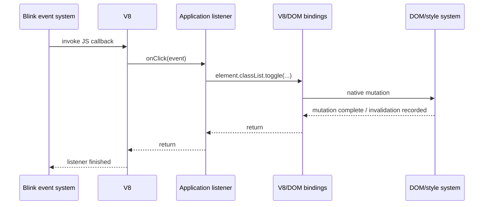

This back-and-forth can occur many times inside one task. The event loop does not need to intervene for every individual DOM method call.

## 8.5 `fetch()` illustrates asynchronous host work cleanly

When application code calls:

```js
const response = await fetch('/api/report');
```

V8 does not synchronously perform socket I/O until bytes return. Browser host machinery initiates the fetch algorithm, possibly involving service workers, caches, the network service, CORS checks, redirects, and streaming response bodies.

The Promise returned to JavaScript represents future completion. When the relevant asynchronous operation reaches a state that should settle the Promise, browser/runtime integration queues the corresponding reactions so JavaScript can resume at a later microtask checkpoint.

The CPU does not “sit inside `await`.” The async function suspends its JavaScript continuation, leaving the host free to process other work.

## 8.6 Timers are scheduling requests, not dedicated sleeping threads

`setTimeout(fn, 100)` does not allocate a JavaScript thread that sleeps for precisely 100 ms. The host records timer state. Once the delay threshold and scheduling rules permit, a task is made runnable. The callback executes only when the event loop actually gets to it.

Therefore:

```js
setTimeout(() => console.log('timer'), 0);
blockCpuForTwoSeconds();
```

cannot make the timer callback execute during the synchronous two-second function. The main JavaScript thread remains occupied.

## 8.7 Workers create separate JavaScript execution environments

A **Web Worker** runs JavaScript in a separate worker global environment and, in Chromium, typically uses a separate worker thread and V8 isolate/context arrangement appropriate to that worker. It does not have normal direct access to the owning page’s DOM.

Communication is explicit:

```js
// main thread
worker.postMessage({ type: 'calculate', payload });
worker.onmessage = (event) => render(event.data);

// worker
self.onmessage = (event) => {
  const result = heavyCalculation(event.data.payload);
  self.postMessage(result);
};
```

Values are usually transferred through the structured-clone algorithm. Certain objects such as `ArrayBuffer` can be transferred so ownership moves rather than copying all bytes. Shared memory is possible with `SharedArrayBuffer` under the required security/isolation conditions.

Workers solve a different problem from Promises:

- Promise/`async` code allows asynchronous *waiting* without holding the call stack.
- Workers allow CPU execution on a different thread.

A CPU-heavy loop wrapped in `Promise.resolve().then(...)` is still CPU-heavy main-thread JavaScript. Moving it to a worker can actually provide parallel execution.

## 8.8 Service workers are workers with a network/proxy lifecycle, not background page threads

A **Service Worker** has no DOM and has an event-driven lifecycle independent of a particular page instance. It can intercept controlled fetches, participate in offline caching, and handle selected background events.

The browser may terminate a service worker when idle and restart it for later events. Application designs that assume persistent in-memory state inside the service worker are therefore fragile. The durable model is **event-driven execution with persistent data stored elsewhere**.

### Primary references

- [Web IDL Standard](https://webidl.spec.whatwg.org/)
- [Blink bindings overview](https://chromium.googlesource.com/chromium/src/+/refs/heads/main/third_party/blink/renderer/bindings/README.md)
- [Blink IDL compiler](https://chromium.googlesource.com/chromium/src/+/master/third_party/blink/renderer/bindings/IDLCompiler.md)
- [Blink V8 binding design](https://chromium.googlesource.com/chromium/src/+/master/third_party/blink/renderer/bindings/core/v8/V8BindingDesign.md)
- [Fetch Standard](https://fetch.spec.whatwg.org/)
- [HTML — Web workers](https://html.spec.whatwg.org/multipage/workers.html)

---

# 9. How imported code becomes one executable program: ES Module Graphs and Evaluation

An `import` statement looks local in source code, but its semantics require the runtime to construct and evaluate a **module graph**. This is the native mechanism that bundlers imitate, transform, or partially preserve.

Understanding native modules first prevents a common conceptual inversion: modules were not invented by bundlers. Modern bundlers consume module semantics to build deployable artifacts.

## 9.1 A module is identified and loaded as a module, not as an arbitrary script file

Given:

```html
<script type="module" src="/main.js"></script>
```

and:

```js
// main.js
import { render } from './view.js';
import { getSession } from './auth.js';

render(await getSession());
```

the browser needs `/main.js`, but evaluating it also requires its transitive imports. The module loader therefore discovers a graph:

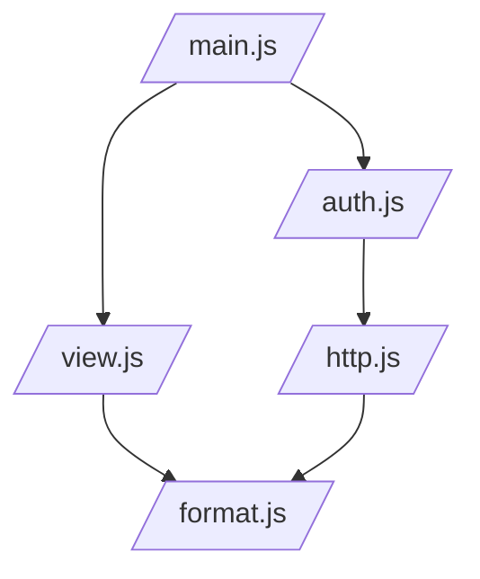

A shared module such as `/format.js` is not normally evaluated once per importing edge. The module system maintains module identity/mapping so a given resolved module record can be shared within the appropriate module map.

## 9.2 Resolution happens before execution can be understood

The string in an import declaration is a **module specifier**:

```js
import { x } from './local.js';
import React from 'react';
```

Browsers natively understand URLs/relative URL resolution. Bare specifiers such as `'react'` are not automatically npm package lookups in an ordinary browser environment. They need an import map, rewriting by tooling, or some other resolution mechanism.

This distinction matters because Node and bundlers have package-resolution algorithms that are not simply “what the browser does.”

## 9.3 Module loading has separate linking and evaluation concerns

A useful conceptual decomposition is:

```text
fetch/obtain source
  → parse as module
  → discover dependencies
  → recursively obtain module graph
  → instantiate/link bindings
  → evaluate modules in dependency-aware order
```

**Instantiation/linking** establishes module environments and connects imports to exported bindings. **Evaluation** executes top-level module code.

ES module imports are **live bindings**. An imported binding refers to the exporter’s binding rather than receiving a one-time copy of the value.

```js
// counter.js
export let count = 0;
export function increment() { count++; }

// consumer.js
import { count, increment } from './counter.js';
console.log(count); // 0
increment();
console.log(count); // 1
```

That semantic property is relevant to tree shaking and cyclic graphs.

## 9.4 Linking creates environments and live connections before ordinary top-level execution

It is useful to make the abstract phrase “link the module graph” more concrete. After source has been parsed as modules, the engine has records describing requested modules, local declarations, imports, and exports. Linking walks the graph and creates the module environments needed to connect those declarations.

Conceptually, this code:

```js
// price.js
export let currency = 'INR';
export function setCurrency(next) {
  currency = next;
}

// ui.js
import { currency } from './price.js';
export function label(amount) {
  return `${currency} ${amount}`;
}
```

does **not** copy the current string `'INR'` into `ui.js` as part of loading. The import is connected to the exported binding. `setCurrency('USD')` changes what later reads of `currency` in `ui.js` observe.

That is one reason module linking must be modeled separately from source concatenation. A bundler can place both modules into one output file, but the generated code must preserve the observable binding semantics.

The browser-side loading story has another layer: HTML defines how module scripts are fetched and maps resolved module URLs to fetched module scripts; ECMAScript defines the language-side module records, instantiation, and evaluation. The complete behavior is a cooperation between the host and the language engine.

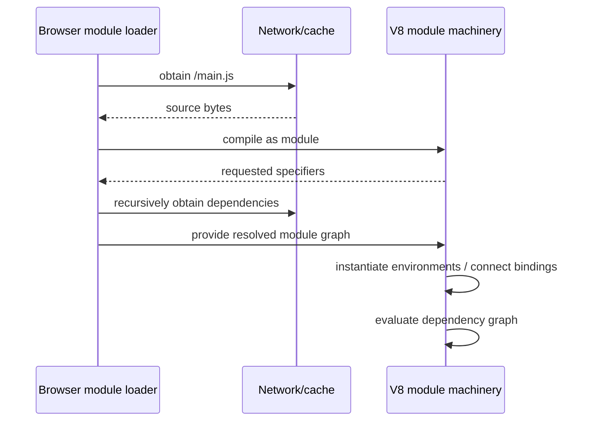

The exact browser implementation is more involved, but this separation is the important architectural fact: **fetching is not linking, and linking is not evaluation**.

## 9.5 Cycles are legal because linking and evaluation are not “recursive `require` text insertion”

Two modules can import each other. The loader can create module records and bindings for the graph before all top-level execution has finished. Cycles can still produce runtime hazards when code accesses a binding before it is initialized, but the graph itself is not automatically invalid.

Bundlers must preserve equivalent semantics when they combine modules or rewrite the graph.

## 9.6 Top-level `await` introduces asynchronous graph evaluation

A module can contain:

```js
const config = await fetch('/config.json').then(r => r.json());
export default config;
```

Now evaluation of modules depending on that module may have to wait for the asynchronous dependency. This is qualitatively different from putting an `await` inside a function that nobody calls during module initialization.

Top-level `await` therefore changes module-graph startup behavior. A graph can be fully fetched yet not fully evaluated.

## 9.7 Dynamic `import()` moves a dependency edge to runtime

Static imports are visible during graph construction:

```js
import { editor } from './editor.js';
```

Dynamic import:

```js
button.onclick = async () => {
  const { editor } = await import('./editor.js');
  editor.open();
};
```

creates a dependency that may only be requested/evaluated when the expression runs. Native browsers can fetch the module then. Bundlers use the same semantic boundary as a natural **code-splitting point**, producing a separate chunk that can be loaded on demand.

## 9.8 Import maps change browser resolution; they do not bundle

An import map can tell the browser how to resolve bare-like specifiers:

```html
<script type="importmap">
{
  "imports": {
    "lib/": "/vendor/lib-v4/"
  }
}
</script>
```

This changes the mapping from specifier to module URL. It does not concatenate modules, tree-shake exports, minify source, or generate chunks. Import maps and bundlers can solve overlapping *resolution* problems while remaining fundamentally different mechanisms.

### Primary references

- [ECMAScript Language Specification — Modules](https://tc39.es/ecma262/)
- [HTML Standard — JavaScript modules](https://html.spec.whatwg.org/multipage/webappapis.html#integration-with-the-javascript-module-system)
- [HTML Standard — Import maps](https://html.spec.whatwg.org/multipage/webappapis.html#import-maps)

---

# 10. What changes outside the browser: Node.js, libuv, and Runtime Boundaries

Node.js is often described as “JavaScript on the server.” That is directionally true but incomplete. Node embeds V8, then supplies a host environment oriented around processes, files, sockets, streams, and server I/O rather than documents, layout, and browser UI.

The distinction between **engine** and **runtime** becomes concrete here:

```text
Browser runtime                      Node.js runtime
---------------                      ---------------
V8                                   V8
+ Blink DOM/Web APIs                 + Node core APIs
+ HTML event loop integration        + libuv event loop integration
+ renderer/compositor                + filesystem/network/process services
+ browser security model             + OS process permissions
```

## 10.1 Node embeds V8 but delegates much asynchronous I/O coordination to libuv

Node’s native layer uses **libuv** to provide its cross-platform event loop, asynchronous networking integration, and a worker pool for operations that cannot be efficiently expressed as nonblocking OS events on every platform.

When JavaScript performs asynchronous file I/O, DNS operations, socket I/O, timers, or other host work, the JavaScript call returns while native runtime machinery arranges completion. Later, Node schedules the corresponding JavaScript callback or Promise continuation.

The slogan “Node is single-threaded” is therefore imprecise. A typical JavaScript isolate executes one JS stack at a time, but the process contains runtime threads and may use a libuv worker pool. Applications can also create worker threads explicitly.

## 10.2 “Asynchronous I/O” can mean an OS readiness mechanism or work in a thread pool

The phrase *libuv handles asynchronous I/O* hides two materially different mechanisms.

For network sockets, operating systems expose readiness/completion facilities such as epoll, kqueue, IOCP, and related mechanisms. libuv can register interest and let the operating system tell it when a socket is ready rather than dedicating one thread to every connection.

Some operations do not fit that model consistently across platforms. libuv therefore also maintains a worker pool. Filesystem operations are an important example; selected DNS, compression, and cryptographic work can also consume worker-pool capacity depending on the Node API involved.

A simplified server request path is therefore not “JavaScript starts another JavaScript thread”:

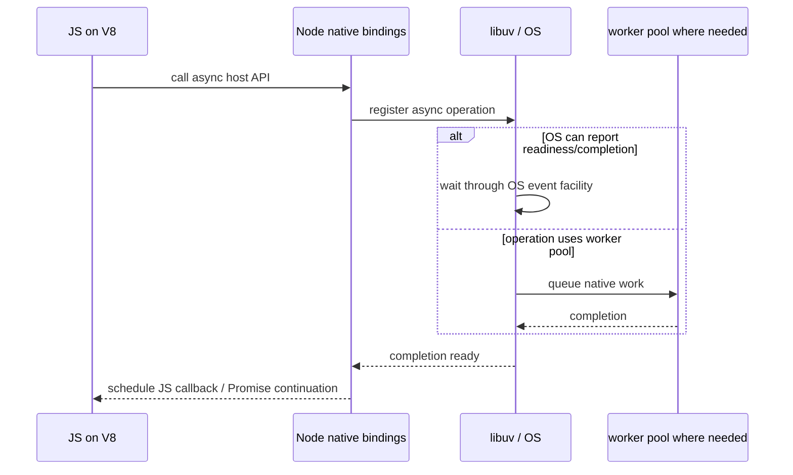

This distinction matters operationally. A Node server can support many mostly-idle network connections without allocating a JavaScript thread per request, while a saturated native worker pool can still delay APIs that depend on that pool.

## 10.3 Node’s event loop has phases rather than the browser’s rendering checkpoints

Node documents event-loop phases including timers, pending callbacks, poll, check, and close callbacks. Since libuv 1.45 / Node 20-era behavior, timers are processed after the poll phase in the main loop iteration, with compatibility details around initial entry. See [Node.js — The Event Loop](https://nodejs.org/learn/asynchronous-work/event-loop-timers-and-nexttick).

A simplified picture:

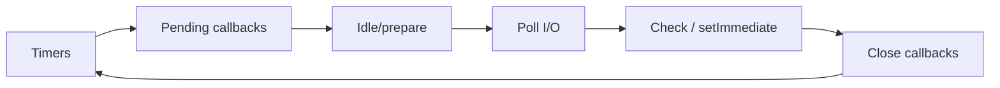

This diagram omits microtask/`process.nextTick` details and version subtleties. The important point for web engineers is that Node does **not** have a browser rendering step where it needs to paint a document. Its scheduling priorities are shaped around server/process I/O.

## 10.4 The same Promise syntax runs inside different hosts

This browser code:

```js
await fetch('/api/data');
```

and this Node code:

```js
await fs.promises.readFile('./data.json');
```

both use JavaScript Promise/`await` semantics, but the pending operation is owned by different host machinery.

This is why framework source must respect runtime placement. A module importing `node:fs` is meaningful in Node but cannot simply be included in a normal browser bundle. A module using `document` is meaningful in a browser renderer but not during ordinary Node server rendering.

## 10.5 CommonJS and ES modules have different loaders and semantics

Node historically standardized around CommonJS:

```js
const x = require('./x');
module.exports = value;
```

Modern Node also implements ES modules:

```js
import x from './x.js';
export default value;
```

The difference is deeper than syntax. ESM has static import/export structure and live bindings. CommonJS performs `require()` calls and exposes `module.exports`, with different cycle and evaluation behavior. Node maintains interoperability rules because real dependency graphs contain both formats.

Bundlers and frameworks therefore need to know not just “this dependency is JavaScript,” but which module system and resolution conditions apply to a given target.

## 10.6 Streams and backpressure are part of the server runtime model

Web servers frequently move data that is larger than a convenient in-memory value: request bodies, uploaded files, generated HTML, database exports, or proxied responses. Node streams represent such data as a sequence rather than requiring the whole payload to exist at once.

The important mechanism is **backpressure**. A producer should not indefinitely generate bytes faster than a downstream socket, file, compressor, or client can consume them. Stream abstractions carry signals that allow production to slow down instead of turning temporary throughput mismatch into unbounded memory growth.

That mechanism is directly relevant to framework streaming. When React or Next.js emits an HTML stream, application generation, Node's stream machinery, compression, a reverse proxy, the TCP stack, and the remote client all form one flow-controlled path. “The framework streamed the response” does not mean every byte immediately reached the user; each downstream buffer and transport participates.

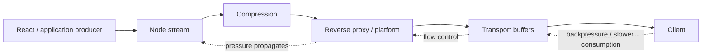

Node's event loop also has two especially important high-priority callback mechanisms: Promise microtasks and `process.nextTick()`. They are not ordinary event-loop phases. Excessive recursive scheduling can starve I/O just as an unbounded microtask chain can starve browser rendering. Framework server code therefore has scheduling failure modes even without a display pipeline.

## 10.7 Edge runtimes are a third host category

Framework “edge” runtimes typically expose Web-standard APIs such as `Request`, `Response`, `fetch`, streams, and cryptography while omitting or restricting Node-specific facilities such as arbitrary filesystem access or native addons.

They should not be modeled as “Node but physically closer to the user.” Their host capability set can differ materially.

| Capability | Browser | Node.js | Typical edge runtime |
|---|---:|---:|---:|
| DOM/layout | Yes | No | No |
| `window`/`document` | Yes | No | No |
| Node filesystem/process APIs | No | Yes | Usually no/restricted |
| Web `Request`/`Response`/`fetch` | Yes | Yes in modern Node | Usually yes |
| Long-lived process assumptions | Page lifecycle | Often possible | Often constrained |
| Server sockets/listeners | No ordinary server listen | Yes | Platform-managed |

This runtime matrix becomes operationally important in Next.js because compilation and deployment may target Node, browser, or platform-specific runtimes from one source repository.

### Primary references

- [Node.js — The Event Loop](https://nodejs.org/learn/asynchronous-work/event-loop-timers-and-nexttick)
- [Node.js ECMAScript modules](https://nodejs.org/api/esm.html)
- [libuv design overview](https://docs.libuv.org/en/v1.x/design.html)
- [Node.js — Streams](https://nodejs.org/api/stream.html)

---

# Part III — From source code to deployed artifacts

# 11. How source syntax becomes another program: Parsing, ASTs, Transforms, and Code Generation

Modern frontend source is often not the program a browser ultimately executes. TypeScript contains type syntax browsers do not execute. JSX is not native JavaScript syntax in the form most applications write it. Frameworks may inject directives or metadata. Development builds may contain instrumentation that production builds omit.

The umbrella word **compile** hides several different operations. It is more precise to follow the representation changes.

## 11.1 Parsing creates a structural representation of source

A compiler or transform tool first parses source text according to some grammar and creates an **abstract syntax tree (AST)** or related internal representation.

Source:

```tsx
export function Greeting({ name }: { name: string }) {
  return <h1>Hello, {name}</h1>;
}
```

A simplified AST shape might conceptually contain:

```text
FunctionDeclaration Greeting
  Parameter ObjectPattern{name}
    TypeAnnotation {...}
  ReturnStatement
    JSXElement h1
      JSXText "Hello, "
      JSXExpression Identifier(name)
```

Real ASTs contain far more location and syntax metadata. The important point is that transforms operate on structure rather than performing brittle search-and-replace over text.

## 11.2 TypeScript compilation normally erases types from runtime output

For ordinary TypeScript, type annotations participate in static checking but do not become runtime type guards automatically.

Input:

```ts
function double(value: number): number {
  return value * 2;
}
```

Representative emitted JavaScript:

```js
function double(value) {
  return value * 2;
}
```

Therefore a JavaScript value from a network request is not runtime-validated merely because an interface described its expected shape at compile time.

A build system may separate type checking from transpilation entirely. SWC, esbuild, or another fast transformer can strip TypeScript syntax while `tsc` runs separately for diagnostics.

## 11.3 JSX transformation changes syntax into runtime calls or compiler output

Classic JSX transformation was easy to see:

```jsx
<Card title="Report" />
```

could become conceptually:

```js
React.createElement(Card, { title: 'Report' });
```

Modern JSX runtimes can instead emit imports/calls such as `jsx` from a JSX runtime package, avoiding the need for `React` to be in lexical scope solely for JSX.

Framework compilers can go further by attaching metadata, distinguishing server/client references, or performing static optimizations. The exact transform is tool- and framework-specific; JSX itself is source syntax, not DOM construction.

## 11.4 Transpilation is not bundling

A transformer can take one source file and emit one corresponding JavaScript file:

```text
src/Button.tsx
   ↓ parse/transform/codegen
build/Button.js
```

A **bundler** additionally reasons about dependencies across files and decides how modules are grouped into deployable outputs:

```text
Button.tsx ─┐
icons.ts ───┼─> module graph ─> chunk assignment ─> app.abc123.js
utils.ts ───┘
```

Many tools perform both jobs, which is why the words are frequently conflated.

## 11.5 Intermediate representations make multi-stage optimization possible

A serious compiler rarely performs every optimization directly on raw AST nodes. It can lower source syntax into intermediate representations designed for specific analyses: control flow, data flow, target-independent operations, or target-specific code generation.

The same idea appeared in V8’s JIT pipeline. It also appears in static build tooling. An IR allows the compiler to separate “what the program means” from “how this target should express it.”

For web builds, common transform classes include:

- TypeScript/JSX syntax lowering;
- syntax targeting for older browser baselines;
- environment-constant substitution;
- dead-branch elimination after constants become known;
- framework-specific directive analysis;
- minification and identifier/property rewriting where safe;
- CSS or asset reference rewriting.

## 11.6 SWC, Babel, esbuild, and framework compilers overlap without being identical

The ecosystem contains tools optimized for different goals:

- **Babel** is a highly extensible JavaScript syntax transformation platform with a broad plugin ecosystem.
- **SWC** is a Rust-based compiler used by Next.js for transformations/minification and framework compilation tasks.
- **esbuild** combines extremely fast parsing/transformation with bundling and minification.
- **TypeScript (`tsc`)** provides the TypeScript type checker and can also emit JavaScript.
- **React Compiler** performs React-specific program analysis/optimization rather than acting as a general-purpose replacement for every build step.

A production pipeline can contain several of them. The correct question is not “which compiler does this project use?” but “which transformation is being performed, by which tool, at which stage, for which target?”

## 11.7 Source maps preserve a correspondence between generated and authored code

After transforms, the browser may execute:

```js
function a(b){return b*2}
```

while the developer authored a TypeScript function across several lines. A **source map** encodes mappings between positions in generated output and positions in original sources.

Developer tools use this correspondence to show authored filenames/lines in stack traces and breakpoints even though the runtime executes generated code.

A source map does not cause the browser to execute the TypeScript source. It is debugging metadata layered over generated artifacts.

### Primary references

- [ECMAScript specification](https://tc39.es/ecma262/)
- [TypeScript compiler options](https://www.typescriptlang.org/tsconfig/)
- [Babel handbook/docs](https://babeljs.io/docs/)
- [SWC documentation](https://swc.rs/docs/getting-started)
- [Source Map specification](https://tc39.es/source-map-spec/)

---

# 12. How modules become chunks: Bundler Graphs, Tree Shaking, and Code Splitting

A compiler can transform a file in isolation. A bundler answers a larger deployment question: **given one or more application entry points and their transitive dependencies, what set of files should be emitted so the target runtime can execute the application efficiently and correctly?**

That requires at least two distinct graphs: the source/module graph and the output/chunk graph.

## 12.1 Module resolution turns specifiers into concrete graph nodes

Given:

```js
import { Button } from './ui/Button';
import zod from 'zod';
```

a bundler must resolve each specifier according to its configured rules. This can involve:

- relative paths and extension probing;
- package `exports`/conditions;
- aliases;
- workspace packages;
- browser/server conditions;
- ESM versus CommonJS entry points;
- virtual/generated modules introduced by plugins/frameworks.

Resolution is target-sensitive. A package can intentionally expose different entry points for `browser`, `node`, `import`, or other conditions.

## 12.2 The module graph describes semantic dependency; the chunk graph describes delivery

Suppose source modules form this graph:

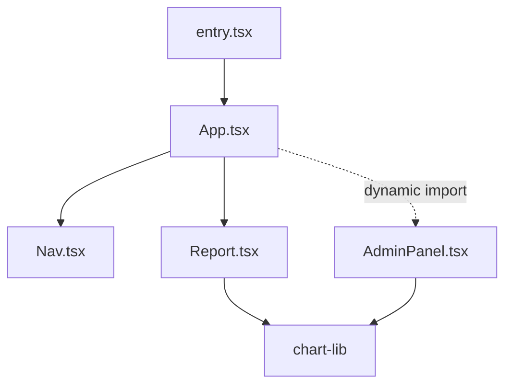

The bundler might emit:

```text
main.8da2.js        entry + App + Nav + Report + shared runtime
vendor-chart.f31.js chart library
admin.0bc4.js       AdminPanel
```

That output is the **chunk graph**. It does not have to mirror the source graph one module per file. A chunk can contain many modules, and one module’s transformed code can participate in target-specific outputs.

The bundler must also emit enough runtime metadata/code to know that loading `admin.0bc4.js` may require `vendor-chart.f31.js`.

## 12.3 Dynamic imports are natural split points, but chunking is an optimization problem

A bundler could put every module into one file. That minimizes request count but maximizes initial transfer/parse/evaluation. It could emit every module separately. That maximizes granularity but can create enormous request and coordination overhead.

Code splitting seeks a useful middle ground:

- critical startup code arrives early;
- rarely used routes/features arrive on demand;
- shared code is reused instead of duplicated excessively;
- caching remains effective across releases;
- chunk waterfalls do not become worse than the byte savings.

There is no universally optimal split. The graph, usage patterns, protocol, CDN, and browser behavior all matter.

## 12.4 Tree shaking is static reachability analysis under semantic constraints

ES modules expose statically analyzable imports/exports:

```js
// math.js
export function add(a, b) { return a + b; }
export function multiply(a, b) { return a * b; }

// app.js
import { add } from './math.js';
console.log(add(2, 3));
```

A bundler may determine that `multiply` is not reachable from an entry and omit it. But safe elimination depends on side effects and language semantics.

Consider:

```js
// setup.js
registerGlobalPlugin();
export const version = '1';
```

Even if nobody imports `version`, dropping the module could change behavior because its top-level execution has a side effect.

Package metadata such as `sideEffects` can help bundlers reason about whether modules are safe to prune, but incorrect declarations can make valid code disappear. Tree shaking is not “delete unused function names”; it is a proof problem constrained by what static analysis can establish.

## 12.5 CommonJS makes some static analysis harder

This code is structurally more dynamic:

```js
const moduleName = condition ? './a' : './b';
const value = require(moduleName);
```

A bundler may need conservative behavior because the dependency cannot be resolved as cleanly from static syntax. ESM’s static declarations are one reason modern package ecosystems increasingly prefer ESM for optimization-friendly builds.

## 12.6 Bundlers need a runtime bootstrap when output no longer maps directly to native modules

If transformed modules are packed into custom chunks, the browser needs code that can:

- register modules contained in a newly loaded chunk;
- map module/chunk IDs;
- ensure shared dependencies are available;
- return a Promise for dynamic imports;
- avoid loading the same chunk repeatedly;
- surface loading failures.

Conceptually:

```js
// highly simplified pseudo-runtime
const loadedChunks = new Set();
const modules = new Map();

async function loadChunk(id) {
  if (loadedChunks.has(id)) return;
  await injectScript(chunkManifest[id]);
  loadedChunks.add(id);
}
```

Real bundler runtimes are more sophisticated, but the principle matters for debugging: a dynamic `import()` in authored source may become a call into a generated chunk loader rather than remaining a literal browser-native import.

## 12.7 Non-JavaScript assets can participate in the dependency graph

Modern bundlers allow code such as:

```js
import './card.css';
import logoUrl from './logo.svg';
```

The bundler does not pretend CSS or SVG is JavaScript. It interprets those imports as graph edges handled by asset-specific pipelines. It may extract CSS into a stylesheet chunk, transform the SVG into a URL or component, fingerprint files, and rewrite references in emitted code.

This is how an apparently JavaScript-centric module graph becomes an application **asset graph**.

## 12.8 Scope hoisting and minification alter representation without changing module semantics

Bundlers can sometimes concatenate compatible modules into a shared scope, remove wrapper overhead, rename local bindings, fold expressions, and minify syntax. These transformations reduce bytes and runtime indirection, but they must preserve observable semantics such as module initialization order and live bindings.

The deployment artifact is therefore not “your files with whitespace removed.” It is the output of graph analysis, semantic transforms, and delivery optimization.

### Primary references

- [Rollup — ES module bundler concepts](https://rollupjs.org/)
- [webpack concepts](https://webpack.js.org/concepts/)
- [esbuild API/concepts](https://esbuild.github.io/api/)
- [Node package `exports`](https://nodejs.org/api/packages.html)

---

# 13. Why development feels instantaneous: Dev Servers, HMR, and React Fast Refresh

A production build optimizes for stable, cacheable, compact deployment artifacts. A development server optimizes for a different metric: **the time between changing source and seeing the effect**.

That difference explains why development and production can have significantly different module boundaries, filenames, optimization passes, caching behavior, and even bug surfaces.

## 13.1 The development server sits between the browser and an incrementally maintained graph

A dev tool watches source files and maintains dependency information. When the browser asks for a resource, the tool can transform it on demand instead of prebuilding the entire application.

A simplified architecture:


Vite often leans heavily on native ESM during development. Turbopack instead continues to bundle in development but uses incremental computation and caching designed for large graphs. Different tools can optimize the same feedback loop using different delivery strategies.

## 13.2 Hot Module Replacement is a protocol for changing a running module graph

Without HMR, a source edit can simply force a full page reload. That is correct but expensive: DOM state, scroll position, in-memory application state, and network work may all reset.

HMR instead attempts to update a portion of the running graph. At a conceptual level:

1. a source file changes;
2. the dev server determines which compiled module output changed;
3. it sends the browser a message identifying an update;
4. the browser fetches or receives the new module representation;
5. HMR runtime code finds an **acceptance boundary** capable of handling replacement;
6. old module effects may be disposed;
7. updated code is evaluated and integrated.

If no safe boundary exists, the system falls back to a full reload.

## 13.3 HMR state preservation is not automatic correctness

Replacing executable code while preserving old in-memory objects is inherently tricky. Suppose a module owns a singleton:

```js
export const connection = createConnection();
```

Re-evaluating the module may create another connection unless disposal logic or framework integration cleans up the old one. That is why HMR APIs expose dispose/accept hooks and why hot-reload behavior can differ from a clean production startup.

## 13.4 React Fast Refresh layers component semantics over HMR

React Fast Refresh attempts to preserve component state across source edits when it can determine that the edited module still represents compatible React component boundaries.

For example, changing rendering text may preserve hook state:

```tsx
export default function Counter() {
  const [count, setCount] = useState(0);
  return <button onClick={() => setCount(c => c + 1)}>{count} clicks</button>;
}
```

But edits that change component identity or invalidate refresh assumptions can cause remounting, resetting state. Fast Refresh is not just “webpack/Turbopack HMR but faster”; it uses React-specific knowledge to decide when stateful component instances can survive code replacement.

## 13.5 Development transformations intentionally add overhead and behavior

Development code can include:

- source maps and readable module boundaries;
- error overlays;
- runtime warnings;
- React Strict Mode diagnostics;
- refresh instrumentation;
- less aggressive minification/dead-code removal;
- development-only assertions.

A performance profile from `next dev` is therefore not a production performance profile. Likewise, a lifecycle that appears to run twice under development Strict Mode is not necessarily evidence that production commits twice.

### Primary references

- [Vite — HMR API](https://vite.dev/guide/api-hmr)
- [webpack — Hot Module Replacement](https://webpack.js.org/concepts/hot-module-replacement/)
- [Next.js — Fast Refresh](https://nextjs.org/docs/architecture/fast-refresh)
- [Next.js — Turbopack](https://nextjs.org/docs/app/api-reference/turbopack)

---

# 14. How a production build reaches the browser: Manifests, Hashed Assets, CDNs, and Runtime Chunk Loading

A build is useful only if the runtime can find its outputs. Production delivery therefore needs a mapping from **logical application identity** — routes, modules, dynamic imports — to **physical deployed artifacts** such as hashed JavaScript and CSS files.

This mapping is where manifests, generated runtime code, HTML tags, preload hints, CDNs, and cache policy meet.

## 14.1 Content hashes turn filenames into versioned identities

Suppose a bundler emits:

```text
assets/main.948a71.js
assets/report.2f88c4.js
assets/app.c14ad0.css
```

If `report` changes, a new build may emit:

```text
assets/report.a103de.js
```

The URL is now a practical content/version identity. Servers can use:

```http
Cache-Control: public, max-age=31536000, immutable
```

for such assets because a changed resource should receive a new URL.

This is very different from serving `/app.js` with a short cache lifetime and hoping every browser revalidates at exactly the right time.

## 14.2 HTML or framework payloads connect logical entry points to hashed artifacts

An initial HTML response might contain:

```html
<link rel="stylesheet" href="/assets/app.c14ad0.css">
<script type="module" src="/assets/main.948a71.js"></script>
```

A runtime manifest can also map a logical dynamic chunk to a physical file:

```json
{
  "admin": "/assets/admin.651aa2.js",
  "chart": "/assets/chart.1ea09c.js"
}
```

In frameworks, these mappings can be richer: routes to server entries, Server Component references to client chunks, CSS dependencies, prerender metadata, and server-function identifiers.

The browser does not intuit these relationships from filenames. Build output creates and ships the references.

## 14.3 Preload and modulepreload expose dependency knowledge earlier

Without hints, the browser may discover a resource only after evaluating another script. Build tooling already knows many static dependencies, so it can emit hints:

```html
<link rel="modulepreload" href="/assets/vendor.311b.js">
```

This allows fetching work to begin before normal module evaluation would expose the edge.

The goal is to reduce **discovery latency**, not just transfer time.

## 14.4 The CDN and browser cache are separate storage/control planes

A typical static-asset request path can be:

```mermaid
flowchart LR
    B[Browser] --> BC{Browser cache?}
    BC -->|hit| X[Use local bytes]
    BC -->|miss| CDN[CDN edge]
    CDN -->|edge hit| B
    CDN -->|edge miss| O[Origin/static store]
    O --> CDN
```

The browser’s HTTP cache belongs to one client profile. The CDN cache is shared infrastructure and can serve many users. They can have different freshness rules and cache keys.

For application responses, reverse proxies and framework caches add more layers. “Clear the cache” is meaningless until the exact layer is identified.

## 14.5 Dynamic imports convert runtime control flow into network activity

Authored code:

```js
const { openEditor } = await import('./editor.js');
```

can become a generated runtime call that resolves a chunk ID and injects/fetches a hashed asset. At runtime:

```mermaid
sequenceDiagram
    participant App as Running app
    participant RT as Bundler runtime
    participant Net as Browser network stack
    participant CDN as CDN/origin
    participant V8 as V8

    App->>RT: dynamic import boundary reached
    RT->>RT: map module -> chunk URL
    RT->>Net: request editor.ab12.js
    Net->>CDN: HTTP request
    CDN-->>Net: chunk bytes
    Net-->>RT: resource available
    RT->>V8: evaluate/register chunk modules
    V8-->>App: resolve import Promise
```

A `ChunkLoadError` can therefore come from several layers: stale runtime metadata, deleted old assets, a CDN miss, a network failure, a CSP violation, corrupted response content, or an application bug during evaluation.

## 14.6 Rolling deployments create a distributed consistency problem

Suppose client C loaded HTML from build A. A deployment replaces servers with build B. C later performs a lazy import or framework navigation still referencing A’s identifiers.

If A’s assets remain available, the old client can continue safely. If the CDN/origin immediately removes them, the old client fails. If a Server Function identifier points to implementation A but lands on server B, the function reference may be unknown or cryptographically incompatible.

Production frameworks therefore need a version-skew strategy: retain old immutable assets, coordinate build IDs, route clients consistently, or detect a version mismatch and force a full reload.

In frameworks that coordinate client-side navigation across rolling deployments, this same consistency problem requires explicit build/deployment identity; Next.js provides `deploymentId` for that purpose.

### Primary references

- [RFC 9111 — HTTP Caching](https://www.rfc-editor.org/rfc/rfc9111)
- [HTML — link types preload/modulepreload](https://html.spec.whatwg.org/multipage/links.html)
- [webpack code splitting](https://webpack.js.org/guides/code-splitting/)
- [Rollup code splitting](https://rollupjs.org/tutorial/#code-splitting)

---
# Part IV — React: a runtime that computes, schedules, and commits UI

React is easiest to misunderstand when it is introduced as “a library for components.” Components are its authored unit, but the engineering problem React solves at runtime is broader: **given a stateful application whose desired UI changes over time, how can the system repeatedly compute the next UI, preserve the right state, schedule the work with useful priorities, and change the host environment without making application code manually synchronize every DOM node?**

That framing matters because the browser already knows how to mutate the DOM. React does not replace Blink, layout, paint, or the event loop. React sits above them. It owns a logical model of the application UI, decides what host mutations are required, and asks the browser to perform those mutations at commit time.

The distinction between *React rendering* and *browser rendering* is therefore fundamental. React’s render phase computes. React’s commit phase mutates the host. Blink subsequently performs whatever style, layout, paint, raster, and compositing work those mutations make necessary.

---

# 15. Why React needs an internal runtime: Components, Elements, Fibers, and Host Instances

A small DOM update can be written imperatively:

```js
const button = document.querySelector('#save');
button.disabled = isSaving;
button.textContent = isSaving ? 'Saving…' : 'Save';
```

Nothing is inherently wrong with this. The problem appears when dozens of state variables can affect hundreds of DOM nodes through overlapping conditions. The application then needs an explicit synchronization strategy: every state transition must update every relevant piece of UI, without accidentally leaving some DOM state stale.

React changes the programming model. Instead of encoding *how to mutate the previous DOM into the next DOM*, application code describes *what the UI should be for the current inputs*. React owns the synchronization machinery between those descriptions and the host environment.

## 15.1 One component produces several different representations

Consider:

```jsx
function SaveButton({ isSaving }) {
  return (
    <button disabled={isSaving}>
      {isSaving ? 'Saving…' : 'Save'}
    </button>
  );
}
```

It is useful to separate four things that are routinely collapsed into the word “component”:

| Representation | What it is | Where it lives |
|---|---|---|
| **Component function** | Executable JavaScript authored by the developer | JavaScript module / V8 heap |
| **React element** | Immutable-ish description of what should appear: type, key, props, children | React’s JavaScript-level representation |
| **Fiber** | Mutable runtime work record used to preserve state, relate renders, schedule work, and record effects | React reconciler |
| **Host instance** | Concrete object in the rendering host; for React DOM, typically a DOM `Element`, `Text`, etc. | Blink DOM implementation, exposed to JS through bindings |

JSX hides the first transformation. Depending on compiler configuration, this:

```jsx
<button disabled={isSaving}>Save</button>
```

is compiled to something conceptually similar to:

```js
jsx('button', {
  disabled: isSaving,
  children: 'Save'
});
```

The result is **not a DOM node**. It is a JavaScript description. Creating it does not ask Blink to create a `<button>`.

That separation gives React room to perform work before touching the visible page.

```mermaid
flowchart LR
    C[Component function] -->|execute| E[React element descriptions]
    E -->|reconcile| F[Fiber work-in-progress tree]
    F -->|commit required changes| H[DOM host instances]
    H --> B[Blink style/layout/paint]
```

## 15.2 React elements are descriptions, not retained UI objects

A React element roughly carries information such as:

```text
{
  type: SaveButton,
  key: null,
  props: { isSaving: true }
}
```

or, for a host element:

```text
{
  type: "button",
  key: null,
  props: {
    disabled: true,
    children: "Saving…"
  }
}
```

The exact object shape is an implementation detail. The useful conceptual point is that element objects describe an intended tree for *this render*. React does not attach long-lived component state to those transient element objects.

Long-lived identity is associated with the Fiber structure.

## 15.3 Fiber exists because React needs continuity across renders

Suppose the application renders:

```jsx
<Editor documentId="42" />
```

and later renders:

```jsx
<Editor documentId="42" />
```

again with updated surrounding state. React needs to know that the second `Editor` corresponds to the same logical position as the first so that hook state, refs, pending updates, and other runtime information can survive.

A Fiber is the mutable record through which React tracks that continuity and the work associated with it. Conceptually, a Fiber contains fields for things such as:

- component/host type and `key`;
- parent (`return`), first child, and next sibling links;
- the associated host instance, when there is one;
- pending and memoized props;
- memoized state and hook state;
- update queues;
- flags indicating work that must be committed;
- priority information represented through **lanes** and child lanes;
- an `alternate` pointer connecting the current and work-in-progress versions of the same logical Fiber.

These names are visible in React’s reconciler source, but they are **implementation details rather than public API**. Their importance here is explanatory: React does not rebuild application state from scratch every time a component function runs. It maintains a persistent runtime graph that lets one render be related to another.

## 15.4 The current tree and work-in-progress tree separate calculation from visible state

React generally reasons about two versions of the Fiber tree:

- **current** — the tree corresponding to what has been committed;
- **work in progress** — the tree React is currently calculating.

Fibers are paired through `alternate` references so React can reuse structures rather than allocate an entirely unrelated tree for every update.

```mermaid
flowchart TB
    subgraph Current[Current / committed]
        C1[App Fiber] --> C2[Editor Fiber]
        C2 --> C3[button Fiber]
    end

    subgraph WIP[Work in progress]
        W1[App Fiber] --> W2[Editor Fiber]
        W2 --> W3[button Fiber]
    end

    C1 -. alternate .- W1
    C2 -. alternate .- W2
    C3 -. alternate .- W3
```

This double-buffered model is one reason React can perform a substantial amount of render work without immediately modifying the DOM. If lower-priority work becomes obsolete or must yield to something more urgent, the browser-visible UI is still represented by the current tree.

That does **not** mean all React work can always be interrupted at any arbitrary point. The important boundary is that the render phase is designed as calculation, while the commit of host mutations is kept separate and comparatively short.

## 15.5 Host configuration is how the reconciler becomes “React DOM”

The reconciler itself is not intrinsically tied to the DOM. React renderers provide host-specific operations. In a DOM renderer, those operations ultimately create elements, create text nodes, compare properties, append children, change attributes/properties, and remove nodes.

Conceptually:

```text
React reconciler
    |
    | host operations
    v
React DOM renderer
    |
    | DOM API / browser bindings
    v
Blink DOM implementation
```

This is why the same high-level reconciler architecture can target environments other than browsers. The host renderer supplies the concrete mutation or persistence semantics.

A DOM commit such as “set the `disabled` property” eventually crosses the JavaScript/browser binding boundary described in Chapter 8. At that point React is no longer manipulating an abstract element description; it is calling into the browser’s DOM implementation.

## 15.6 Render purity is an architectural requirement, not a style preference

React can call a component because it needs to calculate a possible next tree. That calculation may be restarted, abandoned, or repeated. Therefore render logic must not rely on “this function runs exactly once before the DOM changes.”

Bad render-time side effect:

```jsx
function Message({ value }) {
  analytics.track('rendered-message', value); // external side effect during render
  return <p>{value}</p>;
}
```

The function may execute without its work ever being committed. It may also execute more than once during development checks or restarted work. React’s purity requirements follow directly from the separation between **speculative calculation** and **committed external effects**.

The official React model describes the visible pipeline as *trigger → render → commit*. Internally, Fiber gives React considerably more machinery inside the render step.

## 15.7 A second layer now participates before runtime: React Compiler

Modern React also has an optional build-time compiler. React Compiler 1.0 became stable in 2025 and remains part of the React 19-era toolchain. It is not a replacement for Fiber or the runtime reconciler. Its job is different: analyze authored component code at build time and generate code that can avoid unnecessary recalculation while preserving React semantics.

A useful pipeline is:

```mermaid
flowchart LR
    SRC[JS/TS + JSX] --> PARSE[Babel-compatible AST input]
    PARSE --> HIR[React Compiler HIR / control-flow representation]
    HIR --> ANA[Data-flow, mutation and dependency analysis]
    ANA --> OPT[Memoization-oriented transforms]
    OPT --> GEN[Generated JavaScript]
    GEN --> RUN[React runtime / Fiber]
```

The compiler uses a custom intermediate representation suitable for reasoning about control flow, values, mutation, and reactive dependencies. That is significantly richer than performing textual replacements around `useMemo` calls.

The practical architectural distinction is:

- **React Compiler** can reduce avoidable runtime recomputation by transforming source code;
- **React reconciler/Fiber** still decides how updates are represented, scheduled, reconciled, and committed;
- **Blink** still performs the DOM and rendering work after React commits.

Do not treat “React compilation” and “React rendering” as two names for the same stage.

### Primary references

- [React — Render and Commit](https://react.dev/learn/render-and-commit)
- [React reconciler host configuration](https://github.com/facebook/react/blob/main/packages/react-reconciler/README.md)
- [ReactFiber source](https://github.com/facebook/react/tree/main/packages/react-reconciler/src)
- [React Compiler v1.0](https://react.dev/blog/2025/10/07/react-compiler-1)
- [React Compiler documentation](https://react.dev/learn/react-compiler)

---

# 16. How React decides what work matters: Update Queues, Lanes, Scheduling, and Reconciliation

A state update does not directly mutate the DOM. It creates work for React.

That distinction is central to modern React. If every `setState` call synchronously traversed and committed the entire affected tree, a sufficiently expensive update would monopolize the main thread. React instead records updates, gives work priorities, computes candidate trees, and coordinates when that computation should run.

This chapter describes the internal model at a level useful for understanding behavior. Individual lane constants, function names, and heuristics are implementation details and can change between React releases.

## 16.1 A state setter enqueues an update; it does not “set the variable”

Consider:

```jsx
function Counter() {
  const [count, setCount] = useState(0);

  return (
    <button onClick={() => {
      setCount(c => c + 1);
      setCount(c => c + 1);
    }}>
      {count}
    </button>
  );
}
```

Each setter call creates or contributes an update to a queue associated with the relevant hook/Fiber. The functional updater receives the state produced by the preceding queued update, which is why the example can advance by two in one render.

Conceptually:

```text
memoized state: 0

update queue:
  (c => c + 1)
  (c => c + 1)

process queue during render:
  0 -> 1 -> 2

candidate memoized state: 2
```

This is very different from assigning `count = 1` in ordinary JavaScript. The variable captured by the already-running event handler belongs to that render’s lexical environment. The setter requests future React work.

## 16.2 Hooks are stored against Fiber identity

Function components appear not to have instances, yet hook state persists. The persistence comes from React’s runtime structures.

During rendering, React associates a sequence of hook records with the component’s Fiber. Conceptually:

```text
Fiber: Counter
  memoizedState
      |
      v
  Hook(useState) -> Hook(useRef) -> Hook(useEffect) -> ...
```

This explains the “Rules of Hooks” more deeply than “React dislikes conditionals.” React needs stable correspondence between the nth hook call in one render and the nth hook record from the previous render.

This is invalid:

```jsx
if (loggedIn) {
  const [profile, setProfile] = useState(null);
}

const [theme, setTheme] = useState('dark');
```

If `loggedIn` changes, the positional correspondence shifts. The runtime can no longer reliably tell which previous hook state belongs to which current call.

## 16.3 Lanes represent classes of pending work

Not every update has the same urgency. Typing into an input should generally remain responsive even if the same interaction starts an expensive results update.

React’s reconciler represents work priorities using **lanes**. Internally, lanes are bit-based sets. A root and individual Fibers can record which lanes contain pending work; React can then choose a suitable subset to render.

The durable mental model is not the exact bit assignments. It is:

> An update is associated with a scheduling category. Multiple compatible updates can be processed together, while less urgent work can remain pending.

For example:

```jsx
setQuery(nextQuery); // urgent input state

startTransition(() => {
  setResultsFilter(nextQuery); // transition work
});
```

The two updates belong to different scheduling semantics. The input update should not have to wait for a large transition render merely because they originated in the same user gesture.

React 19.3 also improved the independence of separate transitions so a slow transition need not entangle unrelated transition work. This is a good example of why exact scheduler heuristics should be treated as version-sensitive even though the lane/prioritization model is durable.

## 16.4 Root scheduling connects React priorities to browser time

React maintains pending work at the root. When updates arrive, the reconciler marks affected Fibers/root lanes and ensures suitable work is scheduled.

At a high level:

```mermaid
sequenceDiagram
    participant E as Browser event
    participant R as React event/update code
    participant Q as Fiber update queue
    participant S as React scheduler/work loop
    participant C as Commit
    participant B as Browser rendering

    E->>R: click / input
    R->>Q: enqueue update + lane
    Q->>S: root has pending work
    S->>S: select lanes and render work
    Note over S: may yield/restart for non-urgent work
    S->>C: finished tree is ready
    C->>B: mutate DOM / layout-effect work
    B->>B: style, layout, paint as required
```

React does not gain a magical thread by doing this. Normal React DOM rendering still consumes JavaScript time on the browser main thread. Cooperative scheduling means React can structure its calculation into units and decide whether to continue or yield between units. Yielding gives the browser opportunities to process higher-priority work; it does not turn CPU-heavy component code into parallel execution.

## 16.5 A Fiber is a unit of work in the render traversal

The reconciler walks the work-in-progress tree. Two conceptual operations are useful:

- **begin work** — inspect an existing Fiber/update state, execute components where required, reconcile returned children, and descend;
- **complete work** — finish the Fiber after its children, prepare host-instance information/flags, and bubble relevant subtree information upward.

A simplified traversal:

```text
begin App
  begin Header
  complete Header
  begin Main
    begin Results
    complete Results
  complete Main
complete App
```

Because parent/child/sibling relationships are explicit in Fiber, React can retain a pointer to the next unit and continue the traversal rather than relying on one deeply nested JavaScript call stack for the entire logical render.

The actual reconciler source contains multiple work loops for synchronous and concurrent behavior. The important model is that the Fiber graph turns rendering into explicit work units that React can manage.

## 16.6 Reconciliation answers an identity question before it answers a DOM question

When React compares previous and next child descriptions, it first needs to decide which logical children correspond.

For sibling collections, identity is strongly influenced by **element type and key**.

Previous:

```jsx
<ul>
  <Row key="a" item={A} />
  <Row key="b" item={B} />
</ul>
```

Next:

```jsx
<ul>
  <Row key="b" item={B} />
  <Row key="a" item={A} />
</ul>
```

With stable keys, React can recognize that the same logical rows moved. Their component state can remain associated with the correct identity.

Without suitable keys, position becomes much more important. That can produce state that appears to “move” between rows because React preserved the runtime identity at a position while application data moved elsewhere.

### Identity, state preservation, and replacement

A useful rule is:

```text
same compatible type + same key at corresponding position
        -> React may preserve Fiber/component state

different type or different key
        -> old identity is removed; new identity is mounted
```

Example:

```jsx
{editing
  ? <Editor key="edit" />
  : <Preview key="preview" />}
```

Changing component type necessarily changes identity here. But even the same type can be deliberately reset with a new key:

```jsx
<Editor key={documentId} documentId={documentId} />
```

When `documentId` changes, the new key tells React that this should be a fresh `Editor` identity rather than the old editor with new props.

## 16.7 Reconciliation records effects; it does not perform visible mutations as it discovers them

During render, React can discover that a host node must be inserted, updated, moved, or deleted. It records the required work through Fiber flags/subtree flags and prepared update information.

That means this conceptual algorithm is **wrong**:

```text
compare one element
immediately mutate DOM
compare next element
immediately mutate DOM
...
```

A better model is:

```text
process pending updates
        ↓
construct/reuse work-in-progress Fibers
        ↓
reconcile child identities
        ↓
record host changes/effects
        ↓
finish candidate tree
        ↓
commit the finished work
```

Separating these phases is what lets React abandon incomplete render work without leaving the visible DOM half-updated.

## 16.8 Bailouts and memoization reduce work, but they do not define correctness

If React can prove that a subtree does not need new work for the selected lanes and relevant inputs are unchanged, it can reuse existing work rather than executing everything below it.

`memo`, stable values, and React Compiler-generated memoization can increase these opportunities. But the correctness model remains declarative: the application should render correctly even when a component is invoked again. Memoization is an optimization, not permission for render-time side effects.

This is another reason the React Compiler is architecturally interesting. It can automate many memoization decisions from data-flow analysis rather than requiring application authors to manually encode all caching boundaries.

### Primary references

- [ReactFiberLane.js](https://github.com/facebook/react/blob/main/packages/react-reconciler/src/ReactFiberLane.js)
- [ReactFiberWorkLoop.js](https://github.com/facebook/react/blob/main/packages/react-reconciler/src/ReactFiberWorkLoop.js)
- [ReactFiberHooks.js](https://github.com/facebook/react/blob/main/packages/react-reconciler/src/ReactFiberHooks.js)
- [React — State as a Snapshot](https://react.dev/learn/state-as-a-snapshot)
- [React — Queueing a Series of State Updates](https://react.dev/learn/queueing-a-series-of-state-updates)
- [React performance tracks](https://react.dev/reference/dev-tools/react-performance-tracks)
- [React 19.3](https://react.dev/blog/2026/09/09/react-19-3)

---

# 17. How React changes the actual page: Commit Phases, Effects, Events, and Browser Paint

A successful render leaves React with a finished candidate tree and a description of the host work required to make the committed environment match it. Until that point, the user may still be looking at the DOM from the previous commit.

The **commit** is where React crosses from speculative calculation into externally observable mutation.

## 17.1 Render and commit have different correctness constraints

The render phase can be restarted or abandoned. The commit phase cannot casually be replayed: removing a DOM node, changing focus, invoking a layout effect, or calling a ref callback changes external state.

That leads to a useful division:

| React phase | Main purpose | Can visible host state change? |
|---|---|---:|
| Render/reconciliation | Compute candidate output and required work | No, not as the normal model |
| Commit | Apply host mutations and commit lifecycle/effect work | Yes |
| Passive effects | Synchronize with external systems after commit | Yes |

Internally, React’s commit machinery has finer-grained subphases. Publicly, the most useful distinctions are host mutation work, layout-related work, and passive effects.

## 17.2 Mutation work calls into the DOM renderer

Suppose a component changes:

```jsx
function Status({ online }) {
  return <p className={online ? 'online' : 'offline'}>{online ? 'Online' : 'Offline'}</p>;
}
```

After reconciliation, React may need to update both a property/attribute representation and a text node. During the commit, React DOM performs the necessary DOM operations.

The complete chain is approximately:

```mermaid
flowchart LR
    F[Fiber commit flags] --> RD[React DOM host operations]
    RD --> JS[DOM-facing JS/native bindings]
    JS --> BL[Blink DOM implementation]
    BL --> INV[Style/layout/paint invalidation]
    INV --> RP[Browser rendering pipeline]
```

React has finished *its* rendering before the browser necessarily finishes *painting* the visual result. Those are different uses of the word “render.”

## 17.3 `useLayoutEffect` and `useEffect` exist at different synchronization points

A layout effect is intended for work that must observe or change layout-related state before the browser presents the resulting frame. A typical measurement pattern is:

```jsx
function Tooltip() {
  const ref = useRef(null);
  const [height, setHeight] = useState(0);

  useLayoutEffect(() => {
    setHeight(ref.current.getBoundingClientRect().height);
  }, []);

  return <div ref={ref} style={{ transform: `translateY(${-height}px)` }}>…</div>;
}
```

Conceptually:

1. React commits DOM mutations.
2. Layout effects run while React still controls the commit path.
3. A layout effect may read layout, potentially forcing Blink to calculate it.
4. The effect may synchronously enqueue another React update.
5. React can complete the correction before the browser presents the frame.

That capability is useful for measurement, but expensive if overused because it lengthens the pre-paint critical path.

Passive `useEffect` work is designed for synchronization that does not need to block that initial visual presentation: subscriptions, analytics, many network-side effects, integrations with external systems, and so on.

A common simplified timeline is:

```text
React render
    ↓
DOM mutation commit
    ↓
layout effects
    ↓
browser may style/layout/paint
    ↓
passive effects
```

Reality has scheduling nuance. React may flush effects at different times around interactions, and browser paint opportunities depend on the event loop. The semantic distinction to rely on is that `useLayoutEffect` is synchronous around the commit and can block paint, whereas `useEffect` is not the tool for pre-paint layout measurement.

## 17.4 A DOM mutation can trigger different amounts of browser work

React does not know merely from “a component rendered” whether the browser will perform layout or paint. It is the committed DOM/style change that matters.

Examples:

| Commit | Likely browser consequence |
|---|---|
| Change a text node | style/layout and paint may be needed |
| Change `width` | layout, paint, compositing consequences may follow |
| Change a transform on an already composited layer | can sometimes remain compositor-side |
| Change an attribute unused by style/layout | may require little rendering work |
| Render computes same host output | React may perform no DOM mutation at all |

This explains a frequently confusing performance trace: “React rendered” is not synonymous with “the browser repainted the whole component.”

## 17.5 React’s event handling begins with a browser event

React event handlers do not bypass the DOM event system. The browser still determines that a click, pointer move, input event, or key event occurred. Blink dispatches the DOM event; React’s event infrastructure receives it and invokes the application handler through V8.

A state-changing click can therefore cross several layers:

```mermaid
sequenceDiagram
    participant U as User/device
    participant BL as Blink event dispatch
    participant V8 as V8
    participant RE as React event system
    participant F as Fiber scheduler
    participant DOM as DOM/Blink
    participant BR as Browser rendering

    U->>BL: pointer/click input
    BL->>V8: invoke registered JS listener
    V8->>RE: React event handling
    RE->>V8: call application onClick
    V8->>F: setState -> enqueue update
    F->>F: render/reconcile selected lanes
    F->>DOM: commit required mutations
    DOM->>BR: invalidate style/layout/paint as necessary
    BR-->>U: new frame
```

This connects three scheduling systems that are easy to conflate:

- the browser decides when the event task is dispatched;
- React decides how application updates generated by the event are prioritized and reconciled;
- the browser decides when its next rendering opportunity occurs after JavaScript yields control.

## 17.6 Batching is possible because setters enqueue work

React can batch multiple updates that occur within an appropriate scheduling context and process them in one render/commit rather than committing after every setter call.

For example:

```jsx
function handleClick() {
  setOpen(true);
  setSelectedId(id);
  setMode('details');
}
```

A simplistic synchronous state system might expose intermediate UI after each setter. React can enqueue these changes and derive one consistent candidate tree.

Batching improves both efficiency and consistency: user-visible UI does not need to pass through every intermediate JavaScript assignment-like state.

## 17.7 `flushSync` is an escape hatch because synchronous commits have a cost

Sometimes integration code needs React to commit before the next statement observes the DOM. React DOM exposes `flushSync` for such cases.

That API should feel exceptional. Forcing synchronous completion removes scheduling freedom and can lengthen a main-thread task. The existence of `flushSync` makes the default model clearer: state updates are requests for React work, not direct DOM commands.

## 17.8 Refs bridge React identity to concrete host instances

A ref to a DOM element exposes the committed host instance:

```jsx
function SearchBox() {
  const inputRef = useRef(null);

  return (
    <>
      <input ref={inputRef} />
      <button onClick={() => inputRef.current?.focus()}>
        Focus
      </button>
    </>
  );
}
```

React is responsible for attaching/detaching the ref at the appropriate commit points. The `HTMLInputElement` reachable through `ref.current` is a browser object represented in JavaScript through Blink/V8 bindings. Calling `focus()` therefore leaves the React abstraction and directly invokes browser behavior.

This is a good example of how the layers coexist rather than replace one another.

### Primary references

- [React — Render and Commit](https://react.dev/learn/render-and-commit)
- [React — `useLayoutEffect`](https://react.dev/reference/react/useLayoutEffect)
- [React — `useEffect`](https://react.dev/reference/react/useEffect)
- [ReactDOM — `flushSync`](https://react.dev/reference/react-dom/flushSync)
- [ReactFiberCommitWork.js](https://github.com/facebook/react/blob/main/packages/react-reconciler/src/ReactFiberCommitWork.js)
- [React performance tracks](https://react.dev/reference/dev-tools/react-performance-tracks)

---
# 18. Where rendering happens and when: CSR, SSR, Prerendering, Streaming, and Resumable Work

“Rendering” is often discussed as though applications choose one mode from a menu: CSR, SSR, SSG, ISR, streaming. That vocabulary is useful, but it hides the more fundamental decisions.

For any piece of UI, ask two questions:

1. **Where is the React tree evaluated?** In the browser, on a server during a request, or ahead of requests during a build/background generation step?
2. **When does the resulting representation become available?** Before deployment, at request time, after browser JavaScript starts, or incrementally as asynchronous dependencies resolve?

Once those axes are clear, the acronyms become consequences rather than magic modes.

## 18.1 Client-side rendering puts initial UI computation in the browser

A traditional React SPA may deliver an HTML shell such as:

```html
<!doctype html>
<html>
  <body>
    <div id="root"></div>
    <script type="module" src="/assets/app.a4e91.js"></script>
  </body>
</html>
```

The browser can construct and paint the document shell quickly, but the application UI inside `#root` depends on JavaScript:

```js
const root = createRoot(document.getElementById('root'));
root.render(<App />);
```

The critical path becomes roughly:

```mermaid
sequenceDiagram
    participant B as Browser
    participant S as Static server/CDN
    participant V as V8
    participant R as React

    B->>S: GET /
    S-->>B: HTML shell
    B->>S: GET app JS chunks
    S-->>B: JS
    B->>V: parse/evaluate bundles
    V->>R: createRoot().render()
    R->>R: render + reconcile
    R->>B: create/commit DOM
    B->>B: style/layout/paint
```

If data must be fetched after startup, the usable-content path becomes longer still: JavaScript boots, application code requests data, data returns, React renders, and only then can content be committed.

CSR is not inherently “bad.” It is a placement decision. It can be excellent for highly interactive applications whose users already have the app loaded, where server-generated HTML provides little benefit, or where static hosting and client APIs are operationally desirable.

## 18.2 Server-side rendering moves initial React evaluation to the request path

With server-side rendering, React executes components on a server and serializes host output as HTML:

```js
const html = renderToString(<App initialData={data} />);
```

or, in modern streaming setups, a streaming server-render API produces output incrementally.

The browser can parse and display that HTML before the application’s client JavaScript is fully evaluated. But a critical distinction follows:

> **Server-rendered HTML is not automatically an interactive React application.**

If Client Components or ordinary client-side React logic are expected to handle events and preserve React state, the browser needs the corresponding JavaScript and must establish React’s runtime relationship with the existing DOM. That process is **hydration**: React establishes client-side ownership and behavior while reusing the server-created DOM where it corresponds to the client tree.

SSR therefore moves the initial *HTML production* earlier, but it does not necessarily eliminate client JavaScript.

## 18.3 Static prerendering changes time, not necessarily representation

If a page does not depend on request-specific state, the server render can happen before any user asks for the page.

```text
Build/production step
    React render
        ↓
    HTML generated
        ↓
    immutable/static artifact
        ↓
Deployment/CDN
        ↓
Request
    serve existing HTML
```

The browser still receives HTML. The architectural change is *when* the expensive rendering work occurs.

This can dramatically reduce request-time compute and make CDN distribution straightforward. It also creates a freshness problem: if source data changes, when and how is the prerendered result regenerated or invalidated?

Framework terms such as **static generation**, **incremental regeneration**, and **revalidation** are different answers to that freshness problem.

## 18.4 Streaming removes “finish the whole tree” from the response prerequisite

Without streaming, the server may need all required data before it can send a complete HTML response. If one subtree is slow, everything behind the response can wait.

Suspense-compatible server rendering changes that topology. A boundary can provide a fallback while work behind it remains unresolved.

```jsx
function Page() {
  return (
    <main>
      <Header />
      <Suspense fallback={<ResultsSkeleton />}>
        <SlowResults />
      </Suspense>
    </main>
  );
}
```

Conceptually:

```mermaid
sequenceDiagram
    participant S as React server renderer
    participant B as Browser
    participant D as Slow data source

    S->>S: render Header
    S->>D: SlowResults awaits data
    S-->>B: stream shell + Header + fallback
    B->>B: parse and paint available HTML
    D-->>S: data resolves
    S->>S: finish SlowResults
    S-->>B: stream completed boundary content/instructions
    B->>B: integrate later content
```

Streaming changes **response granularity**. It does not by itself mean that JavaScript is unnecessary, that Server Components are in use, or that hydration disappears.

Those concerns can coexist but must be kept separate.

## 18.5 Suspense is a coordination boundary, not merely a spinner component

At the language level, `await` pauses an async function. In React rendering, a component can **suspend** by depending on a resource whose value is not ready. React can then use the nearest Suspense boundary to decide what can be shown while that work remains pending.

That same coordination abstraction participates in several environments:

- client rendering can show fallback UI while a subtree suspends;
- streaming SSR can emit outer content while a boundary waits;
- Server Components can suspend on server-side asynchronous work;
- frameworks can align route-level loading states with Suspense boundaries.

The important idea is not the spinner. It is that the tree contains explicit points at which incomplete work is allowed to defer without withholding all surrounding work.

## 18.6 React’s server APIs increasingly separate prerendering from request-time continuation

Modern React exposes several server-rendering APIs with different operational properties. Besides streaming request-time rendering, React 19-era server APIs include static/prerender-oriented operations. React 19.2 introduced partial prerendering APIs such as `prerender`/resume-oriented capabilities for frameworks to produce an initial portion ahead of time and continue deferred work later.

These are primarily **framework-building primitives**, not an instruction that application developers should assemble their own Next.js equivalent.

Conceptually, resumable server work allows a framework to divide:

```text
work safe to perform before the request
            +
work requiring request-time information
```

without treating the entire route as either wholly static or wholly request-rendered.

Next.js Cache Components/Partial Prerendering applies a framework-level policy around a related objective: construct an app shell ahead of time where possible and leave request-dependent holes behind Suspense boundaries.

## 18.7 Rendering location and interactivity are independent dimensions

A useful matrix is:

| UI property | Rendered in browser | Rendered on server/build |
|---|---:|---:|
| Can produce HTML | Yes, by DOM commits | Yes, by server renderer |
| Can access browser APIs during render | Yes | No |
| Can directly access server filesystem/DB | Normally no | Yes, subject to runtime |
| Can include interactive event handlers | Yes | Only after corresponding client code participates |
| Can avoid shipping component implementation to browser | No for that client-rendered code | Yes with Server Components |

SSR and Server Components are therefore not synonyms. SSR answers, “Can we produce initial HTML on the server?” Server Components answer, “Can some component implementation remain server-only while its rendered result participates in a React tree?”

### Primary references

- [React DOM server APIs](https://react.dev/reference/react-dom/server)
- [React — `<Suspense>`](https://react.dev/reference/react/Suspense)
- [React 19.2](https://react.dev/blog/2025/10/01/react-19-2)
- [React Server Components](https://react.dev/reference/rsc/server-components)

---

# 19. How existing HTML becomes React-owned UI: Hydration, Suspense Boundaries, and Selective Work

Server-rendered HTML gives the browser something it can parse, lay out, and paint. But a DOM tree created from HTML does not inherently know which JavaScript closure should run when a button is clicked or which Fiber should preserve a component’s state.

**Hydration** establishes that runtime relationship while attempting to reuse the DOM that is already present.

## 19.1 Hydration is not “render the page again from scratch”

For a server-rendered React root, client code typically does the conceptual equivalent of:

```jsx
hydrateRoot(
  document.getElementById('root'),
  <App />
);
```

React runs the client-side component logic needed to establish its tree and match that logical result against the server-created DOM.

The high-level goal is:

```text
server HTML -> browser DOM
                   +
              client React render
                   ↓
          matching logical tree
                   ↓
     React attaches ownership/behavior
```

If the existing host nodes correspond to what React expects, React can reuse them rather than throwing them away and recreating them.

The HTML supplied the initial visible structure; hydration supplies client-side React participation.

## 19.2 Server and client output must agree because hydration assumes correspondence

Consider a component that renders time directly:

```jsx
function Timestamp() {
  return <span>{Date.now()}</span>;
}
```

The server may emit one value and the browser render another milliseconds later. React now has a mismatch between the DOM it is trying to adopt and the client output it calculated.

Hydration mismatches can arise from:

- nondeterministic values (`Date.now()`, random numbers);
- browser-only information used to change first-render output;
- locale/time-zone differences;
- data that changed between server and client rendering;
- invalid HTML causing the browser parser to construct a DOM different from what the framework expected;
- extensions or intermediaries that modify markup.

The fix is not “silence the warning.” The architectural question is why the server and client disagreed about the same initial UI.

React 19.3 adds a first-class `browser()` primitive for cases where a subtree cannot produce meaningful server output. A component can suspend on the server and render through an appropriate Suspense fallback, then proceed normally in the browser. That is cleaner than pretending a browser-dependent component has deterministic server output.

## 19.3 Hydration has its own critical path

A page may be visually present but not yet ready for all expected interactions.

A simplified first-load timeline:

```mermaid
sequenceDiagram
    participant N as Network
    participant P as HTML parser/Blink
    participant C as CSS/layout/paint
    participant V as V8
    participant R as React hydration

    N-->>P: HTML bytes stream
    P->>P: construct DOM
    P->>C: available document can render
    C->>C: first visible paint(s)
    N-->>V: client JS chunks
    V->>V: parse/evaluate modules
    V->>R: hydrateRoot / framework bootstrap
    R->>R: match React tree to DOM
    R->>P: attach/update where necessary
```

This is why “the page appeared” and “the app is interactive” are not necessarily the same moment.

Performance techniques that produce very early HTML but ship enormous hydration bundles can improve one milestone while worsening another.

## 19.4 Suspense boundaries allow hydration work to be coordinated more locally

Modern React does not have to treat a large server-rendered page as one indivisible hydration unit. Suspense boundaries help React coordinate when particular subtrees become ready.

Suppose:

```jsx
<App>
  <Navigation />
  <Suspense fallback={<FeedSkeleton />}>
    <Feed />
  </Suspense>
</App>
```

If the feed’s server content or client resources are not ready, the navigation can still be useful independently. React’s hydration architecture can prioritize relevant boundaries rather than requiring every part of the tree to complete before any part is useful.

The exact implementation details have evolved across React releases. The stable principle is that Suspense creates scheduling/streaming boundaries that let readiness be expressed at subtree granularity.

## 19.5 Event replay solves an awkward race during hydration

Imagine server HTML already contains a button. The user clicks it before React has fully hydrated the relevant boundary.

Simply ignoring the click would make server-rendered UI feel broken. React DOM has machinery to coordinate events around hydration and can replay certain events after the corresponding boundary becomes ready.

Conceptually:

```text
button is visible
    ↓
user clicks before boundary hydrated
    ↓
React/browser event integration notices blocked target
    ↓
relevant hydration work is prioritized
    ↓
when ready, event can be dispatched/replayed against hydrated tree
```

This is one of the deeper reasons hydration is not equivalent to “add all event listeners when the JS file loads.” It is tied into React’s scheduling and event infrastructure.

## 19.6 Hydration still costs JavaScript execution

Server rendering does not erase client cost for Client Components. Their modules must still be transferred (unless cached), parsed, compiled/evaluated by V8, and rendered/hydrated by React.

That yields an important design consequence:

> Server-rendering more HTML and shipping less client JavaScript are separate optimizations.

React Server Components target the second problem by allowing component implementations and dependencies to stay out of the browser module graph entirely when they do not need client behavior.

### Primary references

- [React DOM — `hydrateRoot`](https://react.dev/reference/react-dom/client/hydrateRoot)
- [React — `<Suspense>`](https://react.dev/reference/react/Suspense)
- [React 19.3 — `browser`](https://react.dev/blog/2026/09/09/react-19-3)
- [React — Render and Commit](https://react.dev/learn/render-and-commit)

---

# 20. How rendering crosses the server/client boundary: React Server Components, Flight, and Server Functions

Traditional SSR can execute React on a server, but it usually still assumes the same component implementation will participate in the client application during hydration. That means dependencies used by those components can end up in browser-facing bundles even if their most important job happened during server rendering.

React Server Components (RSC) establish a different boundary. A Server Component can execute in a server/build environment and contribute its **rendered React result** without its component implementation being part of the client module graph.

That is the motivation: not merely “render on the server,” but **make server-only execution a first-class part of the component architecture**.

## 20.1 Server Components and Client Components form different module graphs

Consider:

```tsx
// ProductPage.tsx — Server Component in an RSC framework
import { db } from './database';
import BuyButton from './BuyButton';

export default async function ProductPage({ id }) {
  const product = await db.products.get(id);

  return (
    <article>
      <h1>{product.name}</h1>
      <BuyButton productId={id} />
    </article>
  );
}
```

```tsx
// BuyButton.tsx
'use client';

import { useState } from 'react';

export default function BuyButton({ productId }) {
  const [pending, setPending] = useState(false);
  // ...
  return <button disabled={pending}>Buy</button>;
}
```

The `'use client'` directive creates a **module-graph boundary**. The bundler/framework must now reason about two related graphs:

```mermaid
flowchart LR
    subgraph ServerGraph[Server module graph]
        P[ProductPage]
        DB[database driver]
        F[server-only formatting library]
        P --> DB
        P --> F
    end

    subgraph ClientGraph[Client module graph]
        B[BuyButton]
        H[React client/hooks]
        B --> H
    end

    P -. client reference .-> B
```

The database driver does not need to become downloadable browser code. `ProductPage` itself also need not be represented as a client-executable component implementation.

The client still needs `BuyButton` because its event/state logic runs there.

## 20.2 The RSC payload is a React representation, not HTML

Server Components are rendered into a serialized protocol representation commonly called the **Flight** or RSC payload. Frameworks use React’s RSC implementation details to encode information including:

- rendered Server Component output;
- values/props that are serializable across the boundary;
- references to Client Components/modules;
- Suspense-related incremental data;
- references associated with Server Functions.

A deliberately schematic payload might conceptually express:

```text
article
  h1 "Mechanical Keyboard"
  client-reference BuyButton { productId: "42" }
```

Do not treat that as literal wire syntax. The RSC wire format and framework/bundler integration APIs are not a public application-level interchange format. React explicitly notes that while Server Components are stable in React 19, the lower-level framework/bundler APIs do not follow ordinary minor-version semver guarantees; frameworks should pin compatible React versions.

This distinction is important because developers sometimes see the RSC response in DevTools and assume it is an arbitrary Next.js serialization. It originates in React’s server-component architecture, with Next.js providing the bundling, routing, caching, and transport integration.

## 20.3 Initial HTML and the RSC payload solve different problems

An RSC-capable framework can use the server-rendered React result in two ways on initial navigation:

1. **HTML** gives the browser immediately parseable document/UI output.
2. **RSC payload** gives the React client enough structural information to reconcile the Server/Client Component tree and reference the right Client Component code.

A simplified flow:

```mermaid
sequenceDiagram
    participant SR as Server RSC renderer
    participant SSR as React DOM server renderer
    participant B as Browser
    participant RC as React client

    SR->>SR: execute Server Components
    SR-->>SSR: RSC-rendered tree + client references
    SSR->>SSR: produce HTML representation
    SSR-->>B: stream HTML
    SR-->>B: stream/transport RSC payload
    B->>RC: client bootstrap has payload + modules
    RC->>RC: reconcile server/client tree
    RC->>B: hydrate Client Component regions
```

The implementation can interleave and stream these representations more intricately than the diagram suggests. The conceptual separation is what matters.

On subsequent framework-controlled navigation, the browser may not need another complete HTML document. It can request RSC data for the destination and merge the resulting React tree into the existing client application.

## 20.4 Serialization is an architectural boundary

A Server Component cannot hand an arbitrary in-memory server object directly to a Client Component. Values crossing the boundary must be representable by the RSC serialization model.

This is why code such as the following is conceptually suspect:

```tsx
const connection = openDatabaseConnection();
return <ClientWidget connection={connection} />;
```

A live database connection contains process-local state and capabilities that have no meaningful browser representation. Pass data, identifiers, or Server Function references through supported serialization instead.

The boundary is both technical and security-relevant. Anything serialized into the client-visible result should be treated as potentially observable by the client.

## 20.5 Server Components are not the same thing as “components that run on an SSR server”

A concise comparison:

| Property | Traditional SSR Client Component | Server Component |
|---|---|---|
| Can execute on server for initial output | Yes | Yes |
| Component implementation normally needed in browser | Yes, for hydration/client renders | No |
| Can use client state/effects | Yes when running in browser | No |
| Can directly use server-only resources | Usually through server-render context/data layer | Yes, in server environment |
| Output for React client | HTML + hydration assumptions | RSC representation; framework may also derive HTML |
| Can be async component in server architecture | Framework/React-server dependent | Yes |

The key difference is **module/runtime placement**, not simply where the first render happened.

## 20.6 Server Functions invert the call direction

Server Components let server code contribute UI to the client. **Server Functions** allow client-side code to hold a reference that, when invoked, causes an async function to execute on the server.

Example:

```ts
// actions.ts
'use server';

export async function renameProject(id: string, name: string) {
  await db.project.update({ id, name });
}
```

```tsx
'use client';

import { renameProject } from './actions';

export function RenameButton({ id }) {
  return (
    <button onClick={() => renameProject(id, 'New name')}>
      Rename
    </button>
  );
}
```

The client bundle cannot contain the server function body, database credentials, or a magical cross-process JavaScript closure. Instead, the framework/compiler replaces the import/use with a **server reference** that can be serialized and invoked through framework transport.

Conceptually:

```mermaid
sequenceDiagram
    participant UI as Client Component
    participant RF as Server reference/runtime
    participant HTTP as Framework transport
    participant S as Server runtime
    participant DB as Database

    UI->>RF: renameProject(id, name)
    RF->>HTTP: encode server-function invocation
    HTTP->>S: request + function reference + args
    S->>S: resolve function reference
    S->>DB: update row
    DB-->>S: success
    S-->>HTTP: serialized result / UI update data
    HTTP-->>RF: response
    RF-->>UI: Promise settles / React update integrates
```

React calls these **Server Functions**. When one is used as an action—for example as a form `action` or from action-related APIs—it is also a **Server Action**. The two terms are related but not strictly synonymous.

## 20.7 `'use server'` and `'use client'` are compilation directives, not network APIs

The directives inform an RSC-aware build system how modules/functions participate in the split graphs.

`'use client'` means, roughly: this module is a client entry boundary, and dependencies brought below it must be usable in the client build.

`'use server'` identifies server-callable function boundaries for the framework/compiler.

Neither directive itself opens a socket or chooses an HTTP path. The framework supplies the build-time transformation, manifests/references, transport endpoint, serialization, security controls, and deployment runtime that make the semantic boundary operational.

This is a recurring theme in modern React: a source-level construct may express intent, while the framework and bundler provide the mechanism that turns that intent into separately executable artifacts.

## 20.8 Server Functions remain server endpoints from a security perspective

A convenient function-call syntax can obscure the trust boundary. A client invoking a Server Function is still an untrusted network client asking the server to perform work.

The server must still perform:

- authentication;
- authorization for the specific operation/resource;
- input validation;
- CSRF/origin protections as appropriate to the framework transport;
- rate/abuse controls where needed;
- safe handling of errors and sensitive return data.

Never treat “the button was hidden from unauthorized users” as authorization. A determined client can manufacture requests.

### Primary references

- [React — Server Components](https://react.dev/reference/rsc/server-components)
- [React — Server Functions](https://react.dev/reference/rsc/server-functions)
- [React — `'use client'`](https://react.dev/reference/rsc/use-client)
- [React — `'use server'`](https://react.dev/reference/rsc/use-server)
- [React 19](https://react.dev/blog/2024/12/05/react-19)

---
# Part V — Next.js: turning React’s primitives into an application architecture

React provides a rendering model and, in modern versions, primitives for server components, server functions, streaming, hydration, transitions, and compilation. It deliberately does not define an entire production application platform.

A framework still has to answer questions such as:

- Which source file corresponds to `/products/42`?
- Which modules belong in the server build and which belong in browser chunks?
- When can a route be prerendered, and which parts require request-time information?
- How are Client Component references mapped to actual JavaScript assets?
- How does a client navigation fetch a new React tree without replacing the document?
- Which computed results can be cached, under what key, and how are they invalidated?
- How are Server Functions identified and invoked across deployments?
- What artifacts does the production server require?

Next.js is best understood as the system that **coordinates those concerns around React**, rather than as a layer that merely adds file-based routing.

This part describes the App Router architecture as documented in current Next.js **16.4.x** in October 2026. Caching and build behavior have changed materially across recent Next.js releases, so version-sensitive behavior is called out explicitly.

---

# 21. What Next.js adds to React: Compilation, Routing, Runtime Placement, and Delivery

A useful way to understand a framework is to ask what decisions it makes that plain React does not.

If you install `react` and `react-dom`, you can create a browser root and render components. React does not require that a directory named `app/` exist, does not map folders to URLs, does not decide which data should be cached, and does not configure a production server for you.

Next.js adds an application-level control plane around React.

## 21.1 One source tree becomes several execution products

Consider a small App Router source tree:

```text
app/
├── layout.tsx
├── page.tsx
└── products/
    └── [id]/
        ├── page.tsx
        └── BuyButton.tsx
lib/
├── products.ts
└── database.ts
```

The authored directory is not what the browser receives. A production build has to derive several kinds of outputs and metadata:

```mermaid
flowchart TB
    SRC[Application source tree]

    SRC --> RG[Route/segment graph]
    SRC --> SG[Server module graph]
    SRC --> CG[Client module graph]
    SRC --> SF[Server Function references]

    SG --> SB[Server executable bundles]
    CG --> CB[Browser JS/CSS chunks]
    RG --> RM[Route/build manifests]
    SG --> PRE[Prerendered/static output where possible]

    SB --> RUN[Production runtime]
    CB --> CDN[Static asset delivery]
    RM --> RUN
    PRE --> RUN
```

A single `import` can therefore mean different things depending on which graph the importing module belongs to.

That is why “Next.js compiles my app” is too vague. It performs graph construction and transformation for **multiple targets with different capabilities**.

## 21.2 Runtime placement is part of framework semantics

For the App Router, layouts and pages are Server Components by default. A `'use client'` boundary moves a module and its client-reachable dependency subtree into the browser-facing graph.

That gives the framework an architectural lever that an ordinary SPA bundler does not have: it can decide that some application code should never be shipped to the browser at all.

Example:

```tsx
// app/products/[id]/page.tsx
import { getProduct } from '@/lib/products';
import BuyButton from './BuyButton';

export default async function Page({ params }) {
  const { id } = await params;
  const product = await getProduct(id);

  return (
    <main>
      <h1>{product.name}</h1>
      <BuyButton productId={id} />
    </main>
  );
}
```

```tsx
// app/products/[id]/BuyButton.tsx
'use client';

import { useState } from 'react';

export default function BuyButton({ productId }) {
  const [quantity, setQuantity] = useState(1);
  // ...
}
```

`getProduct` can use server-only libraries. The browser needs the compiled `BuyButton` implementation and client dependencies, but it does not need the `Page` implementation or database access module.

The source tree visually nests these files together; the build graph splits them across a network boundary.

## 21.3 Next.js coordinates several time domains

Framework behavior becomes much easier to reason about if every operation is located in time.

| Time domain | Examples |
|---|---|
| **Development time** | route discovery, incremental compilation, HMR/Fast Refresh |
| **Build time** | production graph compilation, static analysis, prerendering, artifact/manifests generation |
| **Request time** | route matching, request-dependent Server Components, uncached work, Server Functions |
| **Client runtime** | hydration, router state, client navigation, Client Components, browser cache |
| **Revalidation/background lifecycle** | cached-result invalidation and regeneration according to framework policy |

A piece of code may run in more than one of these domains. A Server Component can execute during a build for a prerendered route or during a request for request-dependent content.

Therefore “server code” does not necessarily mean “code that runs once for every request.”

## 21.4 The App Router is a segment tree, not merely a table of paths

The filesystem describes nested route segments and UI boundaries. For example:

```text
app/
├── layout.tsx
├── page.tsx
└── dashboard/
    ├── layout.tsx
    ├── loading.tsx
    ├── error.tsx
    ├── page.tsx
    └── invoices/
        └── page.tsx
```

corresponds conceptually to a route/UI tree:

```text
root layout
├── home page
└── dashboard layout
    ├── dashboard loading/error boundaries
    ├── dashboard page
    └── invoices page
```

The nested structure matters during client transitions because shared layouts can remain mounted while a descendant segment changes. Next.js therefore maintains router state that describes more than a flat pathname.

## 21.5 Next.js owns the protocol between its server and its client router

A full document navigation uses normal web machinery: HTTP response, HTML, scripts, styles, and browser navigation semantics.

Once the Next.js client router is active, an internal navigation can use framework-specific requests for RSC data instead of requesting and replacing an entire HTML document. Next.js understands the current route tree, the destination route tree, prefetched data, loading boundaries, and which segment results can be preserved.

That is why an App Router navigation is not simply:

```js
history.pushState({}, '', '/new-url');
```

Changing browser history is only one small part. The framework must also obtain and integrate the destination React representation.

## 21.6 Next.js does not replace the web platform beneath it

Even a sophisticated App Router application still ultimately depends on the mechanisms from Parts I–III:

- Next’s HTML is parsed by Blink;
- client chunks are fetched through normal browser networking and HTTP caches;
- those chunks are parsed/evaluated by V8;
- hydration eventually commits DOM operations through React DOM;
- CSS affects Blink style/layout;
- `fetch()` on the client remains a Web API;
- the production Next.js server ultimately accepts ordinary HTTP requests.

The framework adds higher-level coordination. Understanding where that coordination ends is what makes its behavior predictable.

### Primary references

- [Next.js — App Router](https://nextjs.org/docs/app)
- [Next.js — Server and Client Components](https://nextjs.org/docs/app/getting-started/server-and-client-components)
- [Next.js architecture documentation](https://nextjs.org/docs/architecture)
- [Next.js — Project Structure](https://nextjs.org/docs/app/getting-started/project-structure)

---

# 22. How files become a navigable application: App Router Segments, Layouts, Prefetching, and Client Transitions

A browser already knows how to navigate between URLs. If a user clicks a normal link, the browser can request the destination document and replace the current one. Why does Next.js need a router at all?

Because a framework-controlled application often wants to preserve already-mounted UI, avoid downloading a full document again, reuse cached route data, prefetch likely destinations, and stream only the pieces that are not ready yet.

The App Router turns the filesystem into the structural information needed to do that.

## 22.1 A directory segment describes both URL structure and UI composition

A route such as:

```text
/dashboard/invoices/123
```

may be represented by:

```text
app/
└── dashboard/
    ├── layout.tsx
    └── invoices/
        ├── layout.tsx
        └── [id]/
            └── page.tsx
```

At runtime, the visible UI is not just the leaf `page.tsx`. It is the composition of layouts and the leaf segment.

```mermaid
flowchart TB
    RL[Root layout] --> DL[dashboard/layout]
    DL --> IL[invoices/layout]
    IL --> P[[id]/page]
```

This structural representation is why the framework can preserve a dashboard shell while replacing only invoice-level content.

## 22.2 Special files attach behavior to segment boundaries

Common App Router files include:

| File | Architectural role |
|---|---|
| `page.tsx` | Makes a route segment addressable as page UI |
| `layout.tsx` | Persistent shared UI around descendant segments |
| `template.tsx` | Similar composition role but with remount semantics across navigation |
| `loading.tsx` | Route-level loading UI, integrated with Suspense/streaming behavior |
| `error.tsx` | Error boundary UI for a segment subtree |
| `not-found.tsx` | Not-found UI for relevant route state |
| `route.ts` | HTTP Route Handler rather than page UI |

These conventions are more than filename sugar. The build/router can infer where boundaries exist and generate the corresponding route metadata and runtime behavior.

## 22.3 Dynamic segments turn part of the pathname into input

A directory:

```text
app/products/[id]/page.tsx
```

matches paths such as:

```text
/products/42
/products/keyboard
```

The `id` becomes a route parameter. In current App Router APIs, route parameters are provided asynchronously in relevant server component contexts:

```tsx
export default async function Page({ params }) {
  const { id } = await params;
  return <Product id={id} />;
}
```

The important internal point is that the route matcher must preserve both the **route pattern** and the **concrete pathname values**. Build-time prerendering can know the pattern while request-time routing resolves an actual parameter.

## 22.4 A client transition preserves the document

A framework `<Link>` still renders link semantics for the user and browser, but after client runtime activation Next.js can intercept eligible same-application navigations.

A simplified transition is:

```mermaid
sequenceDiagram
    participant U as User
    participant L as Next <Link>/router
    participant CC as Client router cache/state
    participant S as Next server
    participant R as React client
    participant H as History API

    U->>L: activate /dashboard/invoices
    L->>CC: check prefetched/cached route data
    alt usable route data exists
        CC-->>L: RSC/segment data
    else server data required
        L->>S: request route/RSC data
        S-->>L: streamed RSC response
    end
    L->>R: merge destination tree with preserved layouts
    R->>R: render/reconcile affected segments
    R->>H: update URL/history state
```

The browser has **not** performed a cross-document navigation in this path. Existing JavaScript state outside replaced/remounted boundaries can survive because the same document and React root remain active.

If JavaScript is unavailable, or the framework decides a hard navigation is necessary, the underlying link can still fall back to normal browser navigation semantics.

## 22.5 Prefetching moves route acquisition before the click

Next.js can request destination data when a `<Link>` becomes a likely navigation target, commonly as it enters the viewport. The purpose is straightforward: hide network latency before the user expresses the final navigation intent.

```text
Link appears
    ↓
prefetch destination route data/chunks
    ↓
user reads current page
    ↓
user clicks
    ↓
needed route material may already be local
```

Current Next.js behavior distinguishes static and dynamic routes and can partially prefetch dynamic routes when a loading boundary makes a reusable shell available. With the newer Cache Components/Partial Prefetching model, prefetch granularity becomes even more directly tied to static/cached shells and dynamic holes.

The architectural trade-off is obvious: prefetching exchanges extra speculative network/server work for lower interaction latency. Huge link lists or expensive dynamic destinations may justify disabling or controlling it.

## 22.6 Streaming prevents a dynamic transition from becoming a blank wait

If the destination includes request-time work, client navigation cannot always be completed from prefetched output. Route-level Suspense/loading boundaries let Next.js transition into immediately available structure while deferred server work streams afterward.

That transforms the experience from:

```text
click -> wait for entire server render -> replace UI
```

into something closer to:

```text
click
  -> reuse shared layout
  -> show prefetched/loading shell
  -> stream missing segment data
  -> reveal completed content
```

This is not merely a visual feature. It is a consequence of composing the router’s segment tree with React’s Suspense and RSC capabilities.

## 22.7 Preserved layouts have state consequences

Because shared layouts can remain mounted across navigation, Client Components inside them can preserve state.

Example:

```text
/dashboard/settings
        ↓ navigate
/dashboard/invoices
```

If both share `app/dashboard/layout.tsx`, a client-side navigation need not destroy and recreate the entire dashboard layout subtree.

This is useful, but it means developers must distinguish:

- URL changed;
- leaf route changed;
- component remounted;
- document replaced.

Those are four different events. In a traditional multi-page navigation they often happen together; in an App Router application they frequently do not.

## 22.8 The client router cache is not the HTTP cache

Prefetched and visited route representations can be retained in framework-managed client state. This is distinct from the browser HTTP cache that stores network responses according to HTTP semantics.

A route transition may therefore be satisfied without an HTTP request because the Next.js router already holds useful route data, even if DevTools’ HTTP cache would not have considered a hypothetical request fresh.

Conversely, a framework cache miss can still result in a network response that is itself delivered from a CDN or HTTP cache.

Layering caches is powerful precisely because they optimize different representations.

### Primary references

- [Next.js — Layouts and Pages](https://nextjs.org/docs/app/getting-started/layouts-and-pages)
- [Next.js — Linking and Navigating](https://nextjs.org/docs/app/getting-started/linking-and-navigating)
- [Next.js — Prefetching](https://nextjs.org/docs/app/guides/prefetching)
- [Next.js — Loading UI and Streaming](https://nextjs.org/docs/app/getting-started/linking-and-navigating#streaming)

---

# 23. What happens on the first request: Route Resolution, RSC Rendering, HTML Streaming, and Hydration

The initial request is where the largest number of Next.js mechanisms meet. It is also where simplified explanations such as “Next.js renders the page on the server” become actively misleading.

Depending on the route and configuration, the response may combine prerendered output, cached computations, request-time Server Component execution, streaming Suspense boundaries, RSC serialization, HTML generation, and references to Client Component assets.

The cleanest way to understand the process is to follow one route through the system.

Assume a user requests:

```text
GET /products/42
```

and the route contains:

```tsx
// app/products/[id]/page.tsx
import ProductDetails from './ProductDetails';
import Reviews from './Reviews';
import AddToCart from './AddToCart';

export default async function Page({ params }) {
  const { id } = await params;

  return (
    <main>
      <ProductDetails id={id} />
      <Suspense fallback={<p>Loading reviews…</p>}>
        <Reviews id={id} />
      </Suspense>
      <AddToCart productId={id} />
    </main>
  );
}
```

where `AddToCart` is a Client Component.

## 23.1 Phase 1 — the HTTP request reaches a deployment entry point

Before React is involved, ordinary infrastructure receives the request. Depending on deployment topology this could be:

```text
Browser
  ↓
CDN / reverse proxy / platform edge
  ↓
Next.js Node server, serverless function, or adapter runtime
```

The outer layer may serve a fully static response without invoking the application runtime if the requested artifact is independently cacheable and available. Otherwise the request reaches the Next.js application runtime.

Infrastructure must preserve features the application depends on. For example, response buffering at a reverse proxy can defeat the latency benefit of React/Next streaming even though the application itself generated chunks incrementally.

## 23.2 Phase 2 — Next.js resolves the pathname against the route graph

The runtime matches `/products/42` against the compiled route/segment structure and extracts `{ id: '42' }`.

It also knows the associated layout chain and route boundaries, conceptually:

```text
app/layout.tsx
    ↓
app/products/layout.tsx       (if present)
    ↓
app/products/[id]/page.tsx
```

At this point, Next.js is no longer discovering route files by walking the filesystem on every production request. Production build metadata/manifests give the runtime the information needed to resolve the route and its compiled artifacts.

## 23.3 Phase 3 — framework cache/prerender policy determines what work is already available

The route may fall into several broad conditions:

- a reusable prerendered shell/output already exists;
- cached computations can satisfy some Server Component dependencies;
- parts of the route require request-time information such as headers, cookies, uncached external data, or explicit dynamic work;
- Cache Components may allow static/cached structure to coexist with request-time holes.

This decision is not equivalent to one Boolean `isStatic` flag. Modern Next.js can place boundaries inside a route rather than treating the entire tree uniformly.

For a useful mental model:

```mermaid
flowchart TD
    REQ[Resolved route] --> SHELL{Reusable prerendered/cached work?}
    SHELL -->|yes| USE[Reuse available route/component output]
    SHELL -->|no or partial| EXEC[Execute required Server Components]
    USE --> DYN{Request-time holes?}
    EXEC --> DYN
    DYN -->|yes| STREAM[Resolve/stream behind Suspense boundaries]
    DYN -->|no| READY[Result ready]
    STREAM --> READY
```

This is not a single static/dynamic Boolean: modern Next.js tracks reusable prerendered work, cached computation boundaries, and request-time holes as distinct concerns.

## 23.4 Phase 4 — Server Components execute and produce RSC output

For portions that need execution, React evaluates Server Components in the server environment. They can `await` server-side data directly.

`ProductDetails` may resolve immediately. `Reviews` might suspend while waiting for another service. `AddToCart` is not executed as a normal server-only component implementation; the RSC output contains the information needed to represent that Client Component boundary and its props.

The RSC representation therefore captures a React-level result, not merely a string of HTML.

Current Next.js documentation describes the initial server work in two related steps:

1. Server Components render to the **RSC payload**.
2. Client Components together with that RSC result are used to prerender/server-render HTML for the browser’s initial view.

This is why it is useful to think of **RSC rendering** and **HTML rendering** as separate transformations even when a framework pipelines them together.

## 23.5 Phase 5 — React DOM produces browser-consumable HTML

The browser cannot display an RSC payload by itself. For the first document load, Next.js also provides HTML.

Conceptually:

```text
Server Component execution
        ↓
RSC result + client references
        ↓
React DOM server rendering
        ↓
HTML stream
```

The HTML contains the concrete markup needed for an immediate non-interactive presentation. It also participates in the framework’s bootstrap protocol so the client can associate the received document with the RSC/tree state and required Client Component modules.

## 23.6 Phase 6 — Suspense allows the response to be streamed in pieces

If `Reviews` is slow, the server does not necessarily wait before sending the rest of the page.

A representative timeline:

```mermaid
sequenceDiagram
    participant B as Browser
    participant N as Next.js runtime
    participant R as React RSC/SSR
    participant DB as Product DB
    participant REV as Reviews service

    B->>N: GET /products/42
    N->>R: resolve route and render
    R->>DB: product query
    DB-->>R: product
    R->>REV: reviews query
    Note over R,REV: Suspense boundary remains pending
    R-->>B: response starts: layouts + product + reviews fallback
    B->>B: parse HTML and render available UI
    REV-->>R: reviews resolve
    R-->>B: later streamed boundary/RSC data
    B->>B: integrate completed content
```

Exactly how bytes are framed is an implementation/protocol detail. Architecturally, the response no longer has to wait for the slowest descendant before useful outer content starts moving.

## 23.7 Phase 7 — browser parsing begins before the server necessarily finishes

Once response bytes arrive, Chapter 3’s browser machinery takes over:

- the network stack supplies response data incrementally;
- Blink’s HTML parser constructs the DOM;
- stylesheets and scripts are discovered and fetched;
- the preload scanner can discover resources ahead of parser execution;
- style/layout/paint may produce visible frames while later response data is still arriving.

Next.js streaming and browser incremental parsing therefore compose naturally. Server streaming would provide much less benefit if the browser insisted on receiving the entire body before constructing anything.

## 23.8 Phase 8 — client assets are fetched and evaluated

The HTML/RSC bootstrap identifies the JavaScript required for Client Components and framework runtime. Hashed static assets are normally served from the application’s static asset path and are good CDN/browser-cache candidates.

The browser then performs the ordinary pipeline:

```text
asset URL
  -> HTTP/browser cache/CDN
  -> bytes
  -> V8 parse/compile/evaluate
  -> Next/React client runtime available
```

Server-only modules such as database drivers should not appear in this client graph.

## 23.9 Phase 9 — the RSC payload reconstructs the React tree and Client Components hydrate

Current Next.js documentation describes first-load client behavior in three conceptual steps:

1. HTML gives an immediate non-interactive preview.
2. The RSC payload reconciles the Server and Client Component trees.
3. JavaScript hydrates Client Components to make them interactive.

For `AddToCart`, that means the server’s representation told the client *which Client Component belongs here and with which serializable props*. After the module is available, React can hydrate that region against the DOM already created from HTML.

The Server Component implementation itself does not become browser code.

## 23.10 The complete first-load path

Putting the layers together:

```mermaid
flowchart TB
    URL[Browser requests URL]
    INFRA[CDN / proxy / platform]
    ROUTE[Next route + segment resolution]
    CACHE[Prerender/cache decisions]
    RSC[Execute required Server Components]
    FLIGHT[Produce RSC payload/client references]
    SSR[Produce/stream HTML]
    PARSE[Blink parses HTML]
    PAINT[Initial browser paint]
    ASSET[Fetch hashed client chunks]
    V8[V8 evaluates Next/React/client modules]
    HYD[React reconciles RSC tree + hydrates Client Components]
    READY[Interactive application]

    URL --> INFRA --> ROUTE --> CACHE --> RSC --> FLIGHT
    FLIGHT --> SSR --> PARSE --> PAINT
    FLIGHT --> ASSET --> V8 --> HYD --> READY
    PARSE --> HYD
```

Several branches can overlap in real time. That overlap is the point: a modern framework attempts to avoid serializing every stage behind the slowest prerequisite.

### Primary references

- [Next.js — Server and Client Components](https://nextjs.org/docs/app/getting-started/server-and-client-components)
- [Next.js — Linking and Navigating](https://nextjs.org/docs/app/getting-started/linking-and-navigating)
- [Next.js — Caching](https://nextjs.org/docs/app/getting-started/caching)
- [React — Server Components](https://react.dev/reference/rsc/server-components)
- [React DOM server APIs](https://react.dev/reference/react-dom/server)

---
# 24. What `next build` actually produces: Turbopack, Multi-Target Graphs, Manifests, and `.next`

A production Next.js build is not just “TypeScript becomes JavaScript.” It has to derive an executable distributed system from one source tree.

The build must know which code can run in Node, which code can run in the browser, where RSC boundaries exist, which Server Functions are callable, which routes can be prerendered, which static assets belong to which client entry points, and which runtime files are necessary to deploy the server.

Understanding `next build` therefore requires returning to the build-system concepts from Part III and adding **framework semantics** to them.

## 24.1 Turbopack is the current default graph engine in Next.js 16

As of the current Next.js 16 line, Turbopack is the recommended/default bundling path for development and production builds; webpack remains available as an opt-out for compatibility cases.

Turbopack is written in Rust and is designed around **incremental computation**. Its public documentation highlights four architectural choices:

- one unified graph can represent work for multiple output environments such as client and server;
- development still bundles rather than issuing one browser request per source module;
- computations are cached incrementally, including fine-grained function-level results;
- development bundling is lazy, so work can be performed as routes/modules are requested.

A useful conceptual model is:

```mermaid
flowchart TB
    SRC[Source files]
    PARSE[Parse / analyze]
    GRAPH[Unified dependency graph]

    SRC --> PARSE --> GRAPH

    GRAPH -->|server context| SG[Server transformation/output]
    GRAPH -->|client context| CG[Client transformation/output]
    GRAPH -->|RSC metadata| RG[Server/client references]
    GRAPH -->|route conventions| ROUTES[Route/build metadata]

    SG --> CACHE[Incremental computation cache]
    CG --> CACHE
    RG --> CACHE
    ROUTES --> CACHE
```

“Unified graph” does **not** mean the same emitted bundle runs everywhere. It means the build engine can reason about related targets from one dependency computation model rather than maintaining unrelated compiler universes that later have to be stitched together.

## 24.2 Module identity depends on execution context

Take a shared source import:

```ts
import { formatPrice } from '@/lib/price';
```

If `formatPrice` is reachable from both a Server Component and a Client Component, the source module may participate in both output contexts.

But a server-only module such as:

```ts
import 'server-only';
import { sql } from './database';
```

must not become browser-reachable.

Conversely, a module under a `'use client'` boundary has to be compiled for browser execution and cannot freely depend on Node-only facilities such as `node:fs`.

The build graph therefore contains **context-sensitive edges**. “This file imports that file” is not enough information; the compiler must know from which execution environment that edge is being traversed.

## 24.3 RSC directives alter graph partitioning

Suppose:

```tsx
// app/dashboard/page.tsx
import Chart from './Chart';
import { readDashboard } from '@/lib/dashboard-data';

export default async function Page() {
  const data = await readDashboard();
  return <Chart data={data} />;
}
```

```tsx
// app/dashboard/Chart.tsx
'use client';

import { useMemo } from 'react';
import { ChartLibrary } from 'chart-library';

export default function Chart({ data }) {
  // ...
}
```

The server graph needs to know that `Chart` exists as a Client Component **reference**, but it does not simply execute `Chart` as a normal server-only module. The client graph needs the implementation of `Chart`, React client runtime dependencies, and `chart-library`.

The build therefore has to emit metadata that can answer a question such as:

> When the server RSC result refers to this logical Client Component export, which browser module/chunk represents it?

That mapping is the purpose of client-reference/build-manifest machinery. Exact file names are internal and version-sensitive; the architectural need is stable.

## 24.4 Server Functions require the inverse mapping

A Server Function creates the opposite direction. Browser-facing code holds a reference to something whose body exists only in the server build.

The build needs enough metadata to transform:

```ts
import { saveInvoice } from './actions';
```

inside client-reachable code into a callable server reference, while ensuring the actual database mutation logic remains in server output.

Conceptually:

```text
client reference ID
      ↓
framework request transport
      ↓
server action/function manifest
      ↓
compiled server function implementation
```

Current Next.js security documentation notes that Server Action references use encrypted, non-deterministic identifiers generated during compilation/build processes. Those identifiers are not authorization controls; they are part of the reference/transport mechanism.

## 24.5 Route analysis creates build-time structure from filesystem conventions

The build scans the `app` tree and derives route metadata. A representative application might produce conceptual records such as:

```text
route: /
segments: [root, page]

route: /products/[id]
segments: [root, products, [id]]
dynamic param: id
client references: AddToCart
server functions: addItemToCart
loading boundary: products/[id]/loading (if present)
```

The runtime then loads compiled metadata instead of rediscovering route semantics from source code on every request.

This distinction mirrors many compilers: expensive structural analysis happens ahead of runtime, and emitted metadata makes runtime decisions cheaper and deterministic.

## 24.6 Build-time prerendering is actual application execution

During `next build`, Next.js can execute route/component code to produce static/prerendered outputs where the current rendering model allows it.

That means build time is not a passive file-transformation phase. Application code may execute.

Consequences include:

- a build can fail because prerender-time code throws;
- a database/API called from cacheable/prerenderable code may be contacted during CI;
- environment variables available at build time can affect generated output;
- a value calculated once at build time can intentionally become deployment-scoped output rather than per-request output.

This is one reason “build-time environment” and “server runtime environment” should not be conflated.

## 24.7 Cache Components changes how build-time prerendering is partitioned

With the current Cache Components model enabled, Next.js attempts to produce a **static shell** during prerendering. Work that is predictable or explicitly cached can be included. Request-time work can appear behind Suspense boundaries as dynamic holes.

Conceptually:

```mermaid
flowchart TD
    TREE[Route component tree] --> A{Can work complete during prerender?}
    A -->|pure/predictable| SHELL[Include in static shell]
    A -->|use cache with suitable lifetime| SHELL
    A -->|request-time / uncached async| SUSP{Inside Suspense boundary?}
    SUSP -->|yes| FALL[Include fallback in shell; defer work]
    SUSP -->|no| ERR[Build/dev validation: route blocks prerender]
```

This is more precise than the older intuition that touching dynamic data necessarily makes an entire route “dynamic.” The newer model can preserve static/cached outer structure while deferring request-bound subtrees.

## 24.8 The `.next` directory is a build product, not a public application source layout

A normal production build emits `.next/`. Its contents can include, depending on Next.js version/configuration/deployment mode:

```text
.next/
├── static/                 # browser-facing immutable-ish build assets
├── server/                 # compiled server-side output and metadata
├── cache/                  # build/compiler/runtime-related caches where applicable
├── ... manifests ...       # route/build/reference metadata
└── ... build identifiers / tracing metadata ...
```

Treat that as a **representative map**, not a contract that every internal file or directory name is stable API. Framework internals change.

A stronger way to reason about `.next` is by artifact class:

| Artifact class | Consumer |
|---|---|
| Browser JS/CSS/static files | Browser/CDN |
| Server bundles | Node/server runtime |
| Route manifests | Next.js server/router |
| RSC/client/server reference metadata | Next.js + React runtime integration |
| Prerendered HTML/RSC output | Server/CDN/client navigation paths |
| Output tracing metadata | Deployment packaging |
| Build/compiler caches | Build/dev tooling |

## 24.9 Output file tracing reduces the deployment closure

A server bundle can depend on runtime files outside its emitted JavaScript: packages, native modules, configuration files, and other assets. Shipping the whole repository plus all `node_modules` works, but is often wasteful.

Next.js output tracing analyzes server dependencies to determine a **runtime file closure**. With:

```js
// next.config.js
module.exports = {
  output: 'standalone',
};
```

Next.js can create `.next/standalone` containing a minimal server plus selected traced files needed for deployment. Static browser assets under `.next/static` and `public/` are commonly handled separately, often via a CDN.

This is a build/deployment optimization, not a different rendering architecture.

## 24.10 Development and production optimize for different things

`next dev` prioritizes:

- low startup latency;
- lazy/incremental compilation;
- rich source maps and diagnostics;
- Fast Refresh;
- route compilation on demand.

`next build` prioritizes:

- production graph closure;
- optimized/minified assets;
- stable content-hashed output;
- prerendering where possible;
- deployment metadata/manifests;
- server file tracing and production packaging.

A bug that appears only after `next build` is therefore not mysterious evidence that “Next works differently in production” in some undefined sense. The two commands deliberately run different optimization and execution paths.

### Primary references

- [Next.js — Turbopack](https://nextjs.org/docs/app/api-reference/turbopack)
- [Next.js — Upgrade to v16](https://nextjs.org/docs/app/guides/upgrading/version-16)
- [Next.js — `output`](https://nextjs.org/docs/app/api-reference/config/next-config-js/output)
- [Next.js — Adapter Output Types](https://nextjs.org/docs/app/api-reference/adapters/output-types)
- [Next.js — Caching / Prerendering](https://nextjs.org/docs/app/getting-started/caching)
- [Next.js — Data Security](https://nextjs.org/docs/app/guides/data-security)

---

# 25. Why “cached” is not one state: Cache Components, Revalidation, Router State, and HTTP Caches

Caching is one of the easiest places to form an incorrect Next.js mental model because several independent systems can answer “do we already have this?” for different kinds of data.

A value can be fresh in the browser router cache while absent from a server cache. A static asset can be fresh in an HTTP cache while the route’s RSC data has been invalidated. A cached database computation can be reused by the server while the enclosing route is still rendered on every request.

The right question is never merely **“is this cached?”** It is:

> **Which representation is cached, by which layer, under what key, with what lifetime, and what invalidates it?**

## 25.1 Start by separating the cache layers

For a modern App Router application, useful cache categories include:

| Layer | Typical representation | Scope |
|---|---|---|
| Browser HTTP cache | JS/CSS/images/HTTP responses | One browser profile/client |
| CDN/shared HTTP cache | Cacheable HTTP responses/static assets | Shared across users at an edge/POP |
| Next.js server cache | Results of `use cache` computations/components | Process or configured shared handler |
| Prerendered app shell/output | HTML + serialized RSC route material | Deployment/build/runtime regeneration model |
| Client router cache | Prefetched/visited route RSC/segment data | Current browser application session/runtime |
| React render/request memoization | Duplicate computation/fetch suppression within a render/request scope where applicable | Very short-lived execution scope |

These caches are related by framework behavior, but they are not one database.

## 25.2 Current Next.js caching has two important models to distinguish

Next.js caching changed significantly during the App Router’s evolution. Current documentation explicitly separates:

- **Cache Components**, the newer model; and
- the **previous caching/revalidation model** for applications that have not adopted it.

As of Next.js 16.4.x, recommended new-app defaults can enable Cache Components together with Partial Prefetching; existing/manual applications enable the relevant configuration explicitly. The precise defaults are version-sensitive, so architecture discussions should name the model rather than assuming every Next 16 application behaves identically.

This chapter centers on the current Cache Components model, then notes where older intuition differs.

## 25.3 `use cache` caches a computation boundary, not “the whole website”

A function can declare a cache boundary:

```ts
import { cacheLife, cacheTag } from 'next/cache';

export async function getProduct(id: string) {
  'use cache';
  cacheLife('hours');
  cacheTag(`product:${id}`);

  return db.product.findUnique({ where: { id } });
}
```

A component can also be cached:

```tsx
export default async function ProductSummary({ id }) {
  'use cache';
  cacheLife('hours');

  const product = await getProduct(id);
  return <h1>{product.name}</h1>;
}
```

The boundary tells Next.js that the result is reusable according to the declared cache semantics.

This is a useful conceptual shift from older fetch-centric explanations. The cacheable unit is a function/component computation, which may happen to contain database calls, `fetch`, file reads, or other work.

## 25.4 Cache keys are derived from code identity and inputs

Current `use cache` documentation describes a key incorporating information including:

- build/deployment identity;
- function identity;
- serializable function arguments/props;
- captured outer-scope values that the cached function closes over;
- development-only invalidation state such as HMR hashes where relevant.

For example:

```ts
async function UserList({ organizationId }) {
  async function loadUsers(filter) {
    'use cache';
    return db.user.findMany({ where: { organizationId, filter } });
  }

  return loadUsers('active');
}
```

Both `organizationId` and `'active'` influence the cached computation because one is captured and the other is an explicit argument.

This matters operationally. A cache is not just a bag keyed by a URL string; framework-level cached computations need keys representing the function and the inputs that affect its output.

## 25.5 `cacheLife` expresses several freshness times, not one TTL

A cache lifecycle has multiple audiences. Current Cache Components APIs distinguish concepts including **stale**, **revalidate**, and **expire** periods.

At a high level:

- **stale** influences how long client router material can be reused before the client needs revalidation;
- **revalidate** controls when server-side cached content should be refreshed;
- **expire** provides an upper bound after which stale cached content should no longer be served as though usable.

A configuration can therefore implement stale-while-revalidate behavior rather than a binary fresh/expired cliff.

Crucially, `cacheLife(...).stale` is not equivalent to emitting an HTTP `Cache-Control` header. Next.js can communicate client-router freshness through framework metadata/headers while HTTP caches obey their own rules.

## 25.6 Prerendering composes static work, cached work, and Suspense holes

With Cache Components, build-time route rendering classifies work by what can safely complete ahead of requests.

Example:

```tsx
export default function Page() {
  return (
    <>
      <MarketingHeader />
      <CachedCatalog />
      <Suspense fallback={<UserPanelSkeleton />}>
        <UserPanel />
      </Suspense>
    </>
  );
}
```

Suppose:

- `MarketingHeader` is pure/predictable;
- `CachedCatalog` uses `use cache` with a suitable lifetime;
- `UserPanel` reads request-specific cookies and is uncached.

Then a conceptual build result is:

```text
STATIC SHELL
  MarketingHeader rendered output
  CachedCatalog rendered output
  UserPanelSkeleton fallback

REQUEST-TIME HOLE
  UserPanel
```

The route is no longer adequately described as simply “static” or “dynamic.” Static and request-bound work can coexist in one route tree.

Current Next.js documentation calls this Partial Prerendering (PPR) behavior in the Cache Components model.

## 25.7 Request-time values must be deliberately separated from shared cache boundaries

Request-specific inputs such as cookies or headers can make accidental shared caching dangerous. If user A’s identity becomes part of a globally shared cached result without a correct key/scope, user B could receive inappropriate content.

A safer pattern is to make the dependency explicit:

```tsx
async function ProfileContent() {
  const session = (await cookies()).get('session')?.value;
  return <CachedProfile sessionId={session} />;
}

async function CachedProfile({ sessionId }) {
  'use cache';
  return loadProfile(sessionId);
}
```

Now the request-bound value is extracted in request-time code and passed as a cache-key input.

Next.js also provides specialized cache variants such as `'use cache: private'` for cases where runtime data participates in private/client-scoped caching, and `'use cache: remote'` for configured shared persistent handlers. Those variants exist because “cached” without scope is underspecified.

## 25.8 Server cache storage topology matters in multi-instance deployments

By default, a process-local/in-memory cache belongs to **one Next.js process**.

With three pods:

```mermaid
flowchart LR
    LB[Load balancer]
    LB --> A[Pod A\ncache A]
    LB --> B[Pod B\ncache B]
    LB --> C[Pod C\ncache C]
```

an entry created in pod A does not magically appear in B or C. A container restart can also erase process-local entries.

Current Next.js supports custom cache handlers for cases requiring shared storage:

```mermaid
flowchart TD
    LB[Load balancer]
    LB --> A[Pod A]
    LB --> B[Pod B]
    LB --> C[Pod C]
    A --> R[(Shared cache / Redis etc.)]
    B --> R
    C --> R
```

A correct distributed cache integration needs more than `get` and `set`. Tag invalidation, TTL/eviction, error handling, and deployment namespacing must remain coherent across instances.

The default in-memory cache is often the right operational choice when hit locality is sufficient. A remote cache introduces network latency and another dependency, so “shared” is not automatically “better.”

## 25.9 Tags give cached computations a semantic invalidation index

Suppose several pages/components depend on a product:

```ts
cacheTag(`product:${id}`);
```

A mutation can invalidate by meaning rather than by enumerating every route that happened to consume the value.

Two current APIs express different post-mutation consistency goals:

### `revalidateTag`

Used when stale-while-revalidate behavior is acceptable. Existing stale content may be served while a fresh value is produced in the background according to the selected profile.

### `updateTag`

Available in Server Actions for **read-your-own-writes** semantics. It immediately expires the relevant cached data so the user performing the mutation does not immediately read a stale pre-mutation result.

Those are not interchangeable performance knobs; they encode different consistency requirements.

## 25.10 Path invalidation is broader than semantic tag invalidation

`revalidatePath('/products')` invalidates cached route data associated with a path. This can be useful when the route is the natural invalidation unit.

Tag-based invalidation is usually more precise for shared data because the same data can appear in multiple routes.

Example:

```text
product:42 appears in
  /products/42
  /featured
  /cart/recommendations
```

Invalidating `product:42` semantically can target all dependent cache entries. Invalidating only `/products/42` risks leaving other representations stale unless the framework/dependency relationship covers them.

## 25.11 Client router caching is about navigation material

When Next.js prefetches or visits routes, the browser can retain RSC/segment data. The router can then perform later client transitions without immediately going back to the server.

With Cache Components, `cacheLife` stale policy can influence how long corresponding client material is considered reusable. Server Action revalidation APIs can cause client cache state to be cleared/updated so the browser does not indefinitely retain route data invalidated by a mutation.

Again, this is not the same as HTTP caching. The stored representation is framework route/tree data understood by the Next client router.

## 25.12 HTTP/CDN caching still exists outside Next’s internal caches

Browser and CDN caches operate on HTTP responses. Their keys can depend on URL, headers, `Vary`, platform configuration, and cache-control semantics.

Static assets commonly use content hashes:

```text
/_next/static/chunks/app-41a7c9.js
```

and can be cached for very long periods because a changed file gets a different URL.

Dynamic user-specific HTML should not be placed in a shared CDN cache merely because some inner Next computation used `use cache`.

The layering can look like:

```mermaid
flowchart TB
    B[Browser]
    B --> RC[Next client router cache]
    B --> HC[Browser HTTP cache]
    HC --> CDN[CDN cache]
    CDN --> NS[Next server]
    NS --> SC[Next server/cache handler]
    NS --> DB[(Database/API)]
```

Each arrow answers a different reuse question.

## 25.13 Deployments intentionally namespace many cache results

Current `use cache` keys include build/deployment identity. A new deployment therefore does not blindly inherit cached computation results from an old build, even if an external remote storage backend physically persists.

This prevents one build from assuming that cached serialized output created under another build’s code is necessarily compatible.

Deployment-scoped caching trades some cold-start recomputation for consistency between code and cached representation.

### Primary references

- [Next.js — Caching](https://nextjs.org/docs/app/getting-started/caching)
- [Next.js — `use cache`](https://nextjs.org/docs/app/api-reference/directives/use-cache)
- [Next.js — `cacheLife`](https://nextjs.org/docs/app/api-reference/functions/cacheLife)
- [Next.js — Revalidating](https://nextjs.org/docs/app/getting-started/revalidating)
- [Next.js — `cacheHandlers`](https://nextjs.org/docs/app/api-reference/config/next-config-js/cacheHandlers)
- [Next.js — Self-hosting cache configuration](https://nextjs.org/docs/app/guides/self-hosting)
- [RFC 9111 — HTTP Caching](https://www.rfc-editor.org/rfc/rfc9111)

---

# 26. How mutations cross the boundary: Server Functions, Server Actions, Revalidation, and Trust

Reading server data is only half of an application architecture. Users also create invoices, add items to carts, change settings, upload forms, and perform operations that mutate durable state.

Next.js builds on React Server Functions to make those mutations look unusually direct from component code. The syntax is convenient, but the mechanism is still a networked RPC-like operation with all the trust and deployment concerns that implies.

## 26.1 A Server Action is compiled into a remotely invocable reference

Example:

```ts
// app/actions.ts
'use server';

import { updateTag } from 'next/cache';

export async function renameProject(id: string, name: string) {
  await requireProjectWriteAccess(id);
  await db.project.update({ id, name });
  updateTag(`project:${id}`);
}
```

A Client Component may import it:

```tsx
'use client';

import { renameProject } from './actions';

export function RenameProject({ id }) {
  return (
    <button onClick={() => renameProject(id, 'Atlas')}>
      Rename
    </button>
  );
}
```

The browser cannot contain the `db.project.update` body. During compilation, Next.js creates a client-visible server reference and server-side lookup metadata.

Current Next.js describes Server Action identifiers as secure/encrypted, non-deterministic references generated during compilation. Unused action references can be removed through dead-code elimination.

The reference is **not a secret capability that replaces authorization**. Next.js explicitly documents exported Server Actions as reachable through direct POST requests.

## 26.2 Invocation becomes an HTTP POST, not a local function jump

From application code:

```js
await renameProject(id, name);
```

looks like a function call. Across the runtime boundary it resembles:

```mermaid
sequenceDiagram
    participant C as Client Component
    participant NR as Next/React client runtime
    participant H as HTTP
    participant NS as Next server
    participant A as Compiled Server Action
    participant DB as Database

    C->>NR: renameProject(id, name)
    NR->>H: encode action reference + args
    H->>NS: POST action request
    NS->>NS: validate/resolve action reference
    NS->>A: invoke with decoded args
    A->>DB: mutate
    DB-->>A: result
    A->>NS: updateTag / revalidation instructions
    NS-->>NR: action result + framework UI/RSC update data
    NR->>C: settle Promise / integrate React update
```

The framework can combine mutation results and refreshed server-rendered UI information into the action response, reducing the need for an application-authored “POST, then separately refetch everything” sequence.

## 26.3 Forms preserve web semantics and can progressively enhance

React allows a Server Function to be supplied as a form action:

```tsx
<form action={renameProject}>
  <input name="name" />
  <button type="submit">Rename</button>
</form>
```

Framework integration can support form submission before all client JavaScript is ready, preserving an important property of HTML: forms already have a native request model.

Client runtime can then enhance the same operation with pending states and local transition behavior.

This is an example of a modern framework using the web platform rather than inventing an entirely parallel event mechanism.

## 26.4 Read-your-own-writes requires cache coordination

Imagine the database changes successfully but the page immediately re-renders from an old cached product record.

The mutation would be durable, yet the UI would appear to reject it.

A Server Action therefore often performs three logical operations:

```text
1. authorize + validate
2. mutate durable state
3. invalidate/update relevant cached representations
```

For immediate user-visible consistency:

```ts
await db.project.update(...);
updateTag(`project:${id}`);
```

For content where background refresh is acceptable:

```ts
revalidateTag('catalog', 'max');
```

For path-oriented invalidation:

```ts
revalidatePath(`/projects/${id}`);
```

Caching and mutation architecture cannot be designed independently. Every cached representation needs a freshness story after writes.

## 26.5 Arguments are untrusted input even when TypeScript says otherwise

This function signature:

```ts
export async function renameProject(id: string, name: string) { ... }
```

does not prove that the incoming HTTP request contained trustworthy strings with acceptable values. TypeScript types disappeared during compilation and cannot validate network data at runtime.

A production action should reason like an API endpoint:

```ts
'use server';

export async function renameProject(rawId: unknown, rawName: unknown) {
  const { id, name } = schema.parse({ id: rawId, name: rawName });
  const user = await requireAuthenticatedUser();
  await authorizeProjectWrite(user, id);
  await db.project.update({ id, name });
  updateTag(`project:${id}`);
}
```

The convenient call syntax must not collapse the server/client trust boundary in the developer’s mental model.

## 26.6 Page-level authorization does not authorize the action

This is a subtle but important point from Next.js security guidance.

Suppose a page renders only for administrators:

```tsx
export default async function AdminPage() {
  await requireAdmin();
  return <DangerousControls />;
}
```

and an action called by that page is:

```ts
'use server';

export async function deleteUser(id) {
  await db.user.delete({ id }); // insufficient
}
```

The fact that the UI was conditionally rendered is not a security boundary. A client can attempt to call the action endpoint/reference directly.

The action itself must repeat the authorization relevant to the mutation.

## 26.7 Origin checks mitigate CSRF but do not replace application authorization

Next.js Server Actions use POST and include built-in origin/host checks. In proxy or multi-host deployments, allowed-origin configuration may be necessary so legitimate forwarded requests are accepted.

These controls help establish that a request is coming through an expected browser/site path. They do not answer:

- who is the user?
- may this user edit this project?
- is this input valid?
- is this operation within rate/usage policy?

Security layers solve different questions, just as cache layers do.

## 26.8 Closures crossing the boundary require special treatment

An inline Server Action can capture values from a server render:

```tsx
export default async function Page({ params }) {
  const { id } = await params;
  const version = await getVersion(id);

  async function save(formData) {
    'use server';
    await saveIfVersionMatches(id, version, formData);
  }

  return <form action={save}>...</form>;
}
```

The browser obviously cannot receive an ordinary JavaScript closure containing live server lexical environments. The framework has to serialize/encrypt the captured values it supports and associate them with the server reference.

That mechanism is useful but should not encourage passing unnecessary sensitive values. Anything deliberately transported to enable a browser-originated invocation deserves a security review.

## 26.9 Server Action references create a deployment consistency requirement

A client loaded from deployment A may hold action references generated by A. During a rolling deployment, its next POST could land on deployment B.

If B cannot recognize or decrypt A’s references, the action fails. Self-hosted multi-instance deployments therefore need consistent build/action encryption configuration where required, or deployment routing/version mechanisms that prevent incompatible mixing.

This is the mutation-side form of the same version-skew problem seen with JavaScript chunks.

### Primary references

- [Next.js — Data Security](https://nextjs.org/docs/app/guides/data-security)
- [Next.js — Revalidating](https://nextjs.org/docs/app/getting-started/revalidating)
- [React — Server Functions](https://react.dev/reference/rsc/server-functions)
- [React — `'use server'`](https://react.dev/reference/rsc/use-server)

---

# 27. What production changes: Self-Hosting, Streaming Infrastructure, Distributed Caches, and Version Skew

A Next.js application can work perfectly with `next dev` on one laptop while containing production assumptions that have never been exercised: one process, no reverse proxy buffering, one version of every asset, one local cache, no overlapping deploys, and direct access to local disk.

Production deployment turns the framework into a distributed-systems problem.

## 27.1 There is no single “Next.js server” topology

Several broad deployment models are possible.

### Node server / VM

```mermaid
flowchart LR
    B[Browser] --> CDN[CDN / reverse proxy]
    CDN --> N[Next.js Node server]
    N --> DB[(DB / services)]
```

`next start` or equivalent server integration handles request-time routes, RSC/SSR, actions, and other framework behavior. Static assets can be served by the same process, but are commonly offloaded to CDN/static infrastructure.

### Containerized replicas

```mermaid
flowchart LR
    B[Browser] --> CDN[CDN/LB]
    CDN --> A[Container A]
    CDN --> C[Container B]
    CDN --> D[Container C]
    A --> DB[(DB)]
    C --> DB
    D --> DB
```

This improves horizontal capacity but introduces cache and deployment coordination concerns.

### Platform/serverless/adapted deployment

The route graph may be split into provider-specific compute functions and edge/static outputs. Next.js 16.2 introduced a stable Adapter API intended to make non-Vercel deployment integrations more systematic, but adapter capabilities can vary by platform.

### Static export

A static export removes request-time Next.js compute. That is operationally simple, but features requiring a live server—request-time Server Components, Server Actions, runtime revalidation, and many dynamic APIs—cannot operate the same way.

Deployment is therefore an architectural choice, not merely a packaging choice.

## 27.2 A reverse proxy can preserve or destroy streaming

Suppose Next.js emits HTML/RSC chunks over time:

```text
Next server: [shell] ---- [boundary A] -------- [boundary B]
```

If NGINX, a load balancer, CDN, or platform buffers the full upstream response before forwarding it, the browser receives:

```text
Browser:                         [shell + A + B]
```

The application technically “used streaming,” but the infrastructure removed the latency benefit.

Production validation should therefore observe bytes/timing from the **external client path**, not merely assert that the framework called a streaming API.

Other infrastructure can also affect streaming through compression buffering, connection timeouts, response transformations, or unsupported execution adapters.

## 27.3 Immutable browser assets and server versions must overlap safely

A long-lived browser session can outlive a deployment.

Timeline:

```text
t0 client loads deployment A
   app-A.js references chunk details-A.js

t1 deployment B becomes active

t2 old client requests details-A.js
```

If deployment cleanup removed all A assets immediately, the client fails even though the original page was valid when served.

Content-hashed immutable assets are designed to coexist: A’s URL and B’s URL differ. A robust rollout retains old assets for at least the period during which old clients may reasonably request them.

## 27.4 Framework requests also need deployment affinity/compatibility

Next.js client navigation and Server Functions involve build-specific protocol state, not just generic static chunks.

Current Next.js provides `deploymentId` support to identify a deployment consistently. The client can send deployment identity on framework navigation requests; when the server detects a mismatch, Next.js can force a **hard navigation** rather than attempting to merge data from incompatible deployments.

That is a deliberately conservative recovery strategy:

```text
old client + new server mismatch
            ↓
client-side merge may be unsafe
            ↓
perform normal document navigation
            ↓
receive one coherent new deployment
```

It trades seamlessness for consistency.

## 27.5 Server Action encryption/configuration must be stable across replicas of one deployment

Server Action references can rely on build-generated encryption/reference metadata. If replica A and replica B serving the *same logical deployment* disagree on that metadata, a request created from A’s output can fail on B.

Self-hosted production systems should therefore ensure all replicas of one release use compatible build artifacts and action encryption configuration. “Rebuild independently on every pod at startup” can be unsafe if the build generates identifiers that are expected to match.

A stronger deployment pattern is:

```text
CI performs one production build
        ↓
immutable image/artifact
        ↓
replica A    replica B    replica C
(same build) (same build) (same build)
```

## 27.6 Local caches become incoherent when replicas multiply

As discussed in Chapter 25, each process can have its own cache.

A write hitting pod A followed by a read hitting pod B can reveal stale state if invalidation is local only.

Solutions include:

- a shared cache handler;
- provider-managed cache coordination;
- sticky routing where appropriate, though this rarely solves all invalidation concerns;
- choosing not to cache data whose consistency requirements cannot tolerate per-instance divergence.

A shared cache also introduces failure modes: latency, timeouts, stampedes, hot keys, invalidation fan-out, and storage cost. Distributed caching is a consistency trade-off, not a free speed layer.

## 27.7 CDN caching must account for framework response variants

App Router requests can vary based on framework-specific headers and RSC/navigation semantics. A generic CDN configuration that caches solely by pathname can accidentally serve an RSC/navigation variant where HTML was expected, or vice versa, if response variation is not correctly represented in the cache key.

When self-hosting behind a CDN, use current Next.js CDN-caching guidance for the version deployed. Do not copy a generic “cache all GET /path for 10 minutes” rule onto framework responses without understanding `Vary`, RSC request headers, query markers, and dynamic-response cache-control behavior.

This is one of the clearest examples of an abstraction leak: an application-level navigation optimization affects edge-cache configuration.

## 27.8 Static assets and dynamic responses want different HTTP policies

Hashed assets can usually be treated as immutable:

```text
/_next/static/chunks/...hash....js
```

A new build produces new URLs, so aggressive long-lived caching is safe.

Request-specific HTML/RSC, by contrast, may include authentication-sensitive or per-user data. Current Next.js self-hosting guidance uses private/no-store-style cache policy for dynamically rendered pages so shared caches do not retain personalized responses.

Do not infer response cacheability from file extension or from the fact that “Next has a cache.” HTTP response policy must match the actual representation and audience.

## 27.9 Observability should retain layer boundaries

A request that feels slow could be waiting in:

- DNS/TLS/connection setup;
- CDN cache miss;
- reverse proxy queue;
- Next route resolution;
- Server Component data dependency;
- remote cache handler;
- database query;
- RSC serialization;
- proxy buffering;
- browser network queue;
- V8 compilation;
- React hydration;
- browser main-thread layout/paint.

One “page load time” metric cannot localize these failures.

A useful production trace preserves causal boundaries:

```mermaid
flowchart LR
    NAV[Navigation timing]
    EDGE[CDN/proxy trace]
    NEXT[Next request span]
    CACHE[Cache span]
    DATA[DB/API span]
    STREAM[Response streaming timing]
    CLIENT[Client React/browser performance]

    NAV --> EDGE --> NEXT
    NEXT --> CACHE
    NEXT --> DATA
    NEXT --> STREAM --> CLIENT
```

The entire purpose of the brick-by-brick mental model is operational here: debugging becomes easier when each layer has a name and measurable responsibility.

### Primary references

- [Next.js — Self-hosting](https://nextjs.org/docs/app/guides/self-hosting)
- [Next.js — Deploying to platforms](https://nextjs.org/docs/app/guides/deploying-to-platforms)
- [Next.js — `deploymentId`](https://nextjs.org/docs/app/api-reference/config/next-config-js/deploymentId)
- [Next.js — `output: 'standalone'`](https://nextjs.org/docs/app/api-reference/config/next-config-js/output)
- [Next.js — CDN caching](https://nextjs.org/docs/app/guides/cdn-caching)
- [Next.js — `cacheHandlers`](https://nextjs.org/docs/app/api-reference/config/next-config-js/cacheHandlers)

---
# Part VI — Putting the machinery back together

The earlier chapters deliberately separated mechanisms: HTTP acquisition, Blink parsing, V8 execution, bundling, Fiber scheduling, RSC serialization, Next.js routing, caching, and deployment. Real applications do not execute these mechanisms one chapter at a time.

This part recomposes them into complete causal chains.

The purpose is not repetition. It is to make the boundaries observable: at each step, ask **which representation exists now, which subsystem owns it, and what causes the next subsystem to run?**

---

# 28. What the full lifecycle looks like: Seven End-to-End Execution Traces

## 28.1 Trace 1 — An uncached cross-document navigation to server-generated HTML

We can now use the phrase that was too abrupt as an opening premise: **an uncached, cross-document navigation to a server-rendered page**.

Each qualifier has a precise meaning:

- *uncached*: the browser cannot satisfy the document from an immediately reusable local HTTP/bfcache representation;
- *cross-document*: the browser will establish a new `Document`, not merely update history/state inside the existing one;
- *server-rendered*: the response body contains HTML generated or selected on the server rather than depending entirely on browser-side React to create the initial content.

Assume the user enters:

```text
https://example.com/products/42
```

### Step 1 — The browser creates a navigation request

The browser resolves the URL, applies navigation/security policy, consults navigation-related caches/service-worker state as relevant, and obtains a network route to the origin or intermediary.

A request might conceptually look like:

```http
GET /products/42 HTTP/2
Host: example.com
Accept: text/html,application/xhtml+xml
Accept-Encoding: gzip, br
Cookie: session=...
```

### Step 2 — Infrastructure and the application produce a response

A CDN may miss and forward to an application server. The application resolves the route, loads data, and begins an HTML response:

```http
HTTP/2 200
Content-Type: text/html; charset=utf-8
Content-Encoding: br
Cache-Control: private, no-store

<!doctype html>
<html>...
```

If the server streams, the response body is not one atomic object from the browser’s perspective. Bytes can arrive while server work is still continuing.

### Step 3 — The network service feeds response data to the renderer

Chromium’s browser/network architecture handles network I/O outside the renderer’s JavaScript execution. The renderer receives the data needed to establish the new document.

Blink’s HTML parser begins tokenizing and tree construction before the entire body necessarily arrives.

### Step 4 — Resource discovery creates more requests

Suppose the parser sees:

```html
<link rel="stylesheet" href="/assets/app.css">
<script type="module" src="/assets/app.js"></script>

```

These references become independent resource fetches with their own cache status, priority, and completion time.

The parser and speculative preload scanner can discover resources at different points, so the network graph does not simply mirror DOM order.

### Step 5 — CSS and DOM state become renderable

Blink has enough DOM and CSS information to calculate styles and layout for an initial frame. Paint records are generated, raster work produces pixel tiles, and the compositor assembles a frame.

The first visible frame can occur while:

- some images are still loading;
- JavaScript modules are still being fetched/evaluated;
- later HTML bytes are still arriving;
- web fonts are unresolved.

### Step 6 — JavaScript begins executing

The module script’s graph is fetched/linked/evaluated. V8 parses and executes JavaScript. Calls such as:

```js
document.querySelector('#buy').addEventListener('click', handleBuy);
```

cross Blink/V8 bindings to access DOM objects and register callbacks with the browser event system.

### Step 7 — Document lifecycle milestones occur for specific reasons

`DOMContentLoaded` becomes eligible after the document has been parsed and relevant deferred/module script work has completed according to HTML rules. `load` waits for a broader set of dependent resources.

Neither event means “the website has finished all useful work forever.” An application can continue fetching, rendering, and mutating indefinitely.

The entire trace:

```mermaid
sequenceDiagram
    participant U as User
    participant BR as Browser process/network
    participant S as Server/CDN
    participant BL as Blink renderer
    participant V8 as V8
    participant GPU as Compositor/GPU

    U->>BR: navigate to URL
    BR->>S: document request
    S-->>BR: response headers + streamed HTML
    BR-->>BL: document bytes
    BL->>BL: tokenize + build DOM
    BL->>BR: discover CSS/JS/image resources
    BR->>S: subresource requests
    S-->>BR: resource bytes
    BR-->>BL: CSS / module source
    BL->>V8: evaluate runnable scripts/modules
    V8->>BL: DOM/Web API calls through bindings
    BL->>BL: style + layout + paint
    BL->>GPU: layers/paint output for raster/composite
    GPU-->>U: frame
```

---

## 28.2 Trace 2 — A JavaScript click handler changes the DOM

Assume HTML already contains:

```html
<button id="toggle">Show details</button>
<section id="details" hidden>...</section>
```

and JavaScript has registered:

```js
const button = document.querySelector('#toggle');
const details = document.querySelector('#details');

button.addEventListener('click', () => {
  details.hidden = !details.hidden;
});
```

The visible change crosses more layers than the four lines suggest.

### 1. Input becomes a browser event

The platform receives pointer input. Browser/renderer input handling determines the target and dispatches a DOM click event.

### 2. Blink invokes JavaScript through V8

The event listener is a JavaScript function retained by the browser/JS integration. Blink’s event dispatch reaches the wrapper/binding machinery and V8 calls the listener.

### 3. JavaScript reads/writes a DOM-backed property

`details.hidden` appears to be an ordinary JS property but represents DOM state implemented by Blink. The getter/setter path crosses generated/native bindings.

### 4. DOM state changes invalidate rendering work

Changing `hidden` affects whether the element participates in rendering. Blink invalidates relevant style/layout state.

The setter does **not** necessarily run the complete rendering pipeline synchronously before returning.

### 5. The task completes and the browser reaches a rendering opportunity

Microtasks are processed at the appropriate checkpoint. Once the main thread yields and the browser decides a frame is due, Blink updates style/layout/paint as needed and the compositor presents the new frame.

```mermaid
flowchart LR
    INPUT[Pointer input] --> EVT[Blink DOM event]
    EVT --> JS[V8 callback]
    JS --> SET[DOM hidden setter]
    SET --> INV[Style/layout invalidation]
    JS --> END[JS task ends]
    END --> RENDER[Rendering opportunity]
    INV --> RENDER
    RENDER --> FRAME[New frame]
```

The key lesson is that DOM mutation and pixel production are separate events.

---

## 28.3 Trace 3 — An authored dynamic import becomes a production network request

Source:

```ts
export async function openEditor() {
  const { Editor } = await import('./Editor');
  mount(<Editor />);
}
```

### Build phase

1. The parser discovers a dynamic import expression.
2. Module resolution maps `./Editor` to a concrete source module.
3. The bundler records a **dynamic graph edge** rather than placing every dependency unconditionally into the current chunk.
4. Chunk planning assigns `Editor` and its dependencies to one or more asynchronously loadable chunks, factoring shared modules as appropriate.
5. Production files receive content hashes.
6. Runtime metadata is emitted so the bootstrap can map the logical import to the generated URL(s).

Possible output:

```text
assets/app.781c.js
assets/editor.29af.js
assets/vendor-react.4bc2.js
```

### Deployment phase

The files are uploaded to static/origin/CDN storage. HTML or manifests reference the current build’s entry chunks.

### Runtime phase

When control reaches the dynamic import:

1. generated runtime code checks whether the chunk/module is already available;
2. if not, it requests the generated asset URL;
3. HTTP/browser/CDN caches may satisfy the request;
4. V8 parses/evaluates the arriving code;
5. the bundler runtime registers the loaded modules;
6. the dynamic import Promise resolves with the requested module namespace.

```mermaid
sequenceDiagram
    participant SRC as Source import()
    participant BLD as Bundler
    participant CDN as CDN
    participant RT as Browser bundler runtime
    participant V8 as V8

    SRC->>BLD: dynamic graph edge
    BLD->>BLD: create editor chunk + manifest mapping
    BLD->>CDN: deploy hashed assets
    SRC->>RT: runtime reaches import()
    RT->>CDN: GET editor.29af.js
    CDN-->>RT: chunk bytes
    RT->>V8: evaluate/register module factories/ESM output
    V8-->>RT: module available
    RT-->>SRC: import Promise resolves
```

A source-level `import()` is therefore both a module-system construct and, after bundling, a potential deployment/network boundary.

---

## 28.4 Trace 4 — A React state update becomes a browser frame

Component:

```jsx
function Search() {
  const [query, setQuery] = useState('');
  const [filter, setFilter] = useState('');

  function onChange(e) {
    const next = e.target.value;
    setQuery(next);
    startTransition(() => setFilter(next));
  }

  return (
    <>
      <input value={query} onChange={onChange} />
      <ExpensiveResults filter={filter} />
    </>
  );
}
```

### Event dispatch

Blink dispatches an input/change-related event. React’s event layer invokes `onChange` through V8.

### Update creation

`setQuery` and `setFilter` enqueue updates. They are not direct assignments to persistent variables. The transition wrapper gives the expensive results update non-blocking transition semantics relative to the urgent input response.

### Scheduling

React marks relevant lanes/root work. It selects urgent work and can schedule transition work with lower urgency.

### Render phase

React traverses work-in-progress Fibers. Function components execute. Hooks retrieve/update state records. Child elements are reconciled against current Fibers. Host changes are recorded.

If non-urgent work consumes too much of the available main-thread slice, React can yield between units and continue later. The browser does not display a half-committed React tree.

### Commit

Once a chosen render finishes, React DOM commits necessary host changes. For the input, the DOM value and related properties are synchronized. Later, the results subtree can be committed for the transition render.

### Browser rendering

Blink processes style/layout/paint invalidations caused by the DOM mutations and a frame becomes visible.

```mermaid
sequenceDiagram
    participant BL as Blink event loop
    participant JS as App JS/V8
    participant F as React Fiber
    participant DOM as React DOM/Blink DOM
    participant COMP as Browser renderer/compositor

    BL->>JS: input event callback
    JS->>F: enqueue urgent query update
    JS->>F: enqueue transition filter update
    F->>F: render selected urgent lanes
    F->>DOM: commit input-related host changes
    DOM->>COMP: rendering invalidation
    COMP-->>BL: frame opportunity
    F->>F: continue/render transition work
    F->>DOM: commit results changes
    DOM->>COMP: render next visual result
```

This trace is why “React is asynchronous” is a poor description. React has a scheduler and prioritization model; JavaScript execution still obeys the browser’s event loop and main-thread constraints.

---

## 28.5 Trace 5 — A Next.js initial request produces both HTML and an RSC-aware client

Assume `/dashboard` contains mostly Server Components plus one interactive filter Client Component.

### Server side

1. The HTTP request reaches the deployment.
2. Next.js resolves `/dashboard` through compiled route metadata.
3. It determines which prerendered/cached portions can be reused.
4. Required Server Components execute.
5. React generates RSC output containing rendered server results and Client Component references.
6. React DOM/Next.js generate HTML for the initial document representation.
7. Suspense boundaries allow outer HTML/RSC data to stream before slower subtrees finish.

### Browser side

1. Blink incrementally parses HTML.
2. CSS and client JavaScript assets are discovered/fetched.
3. The browser can display the HTML before hydration completes.
4. V8 evaluates the Next/React runtime and Client Component chunks.
5. React consumes RSC data to reconstruct/reconcile the logical tree.
6. Client Component regions hydrate against existing DOM.

```mermaid
sequenceDiagram
    participant B as Browser
    participant N as Next server
    participant SC as Server Components
    participant SSR as React DOM server
    participant V as V8/React client

    B->>N: GET /dashboard
    N->>SC: execute required server tree
    SC-->>N: RSC result + client references
    N->>SSR: generate HTML representation
    SSR-->>B: streamed HTML
    N-->>B: RSC/bootstrap data
    B->>B: Blink parses + paints HTML
    B->>V: evaluate client chunks
    V->>V: reconcile RSC tree
    V->>B: hydrate Client Components
```

Two different products cross the network because they serve different consumers: HTML serves the browser parser; RSC data serves React’s client architecture.

---

## 28.6 Trace 6 — A Next.js `<Link>` navigation changes route without replacing the document

Assume the user is on `/dashboard` and a visible link points to `/dashboard/reports`.

### Before the click

Next.js may prefetch destination route material. Depending on route/cache state, the browser router cache can contain a complete or partial RSC representation and loading shell.

### On activation

1. The framework recognizes an eligible internal navigation.
2. The existing `Document` remains active.
3. The client router looks for prefetched/cached route data.
4. Missing data is requested from the Next.js server in framework/RSC form.
5. Shared layouts are preserved where route-tree identity permits.
6. React merges/reconciles the changed destination segments.
7. Browser history/URL state is updated.
8. Newly committed DOM changes go through the normal Blink render pipeline.

The browser did **not** parse a whole replacement HTML document.

```mermaid
flowchart LR
    CLICK[Click Link] --> ROUTER[Next client router]
    ROUTER --> CACHE{Prefetched route data?}
    CACHE -->|yes| TREE[Destination RSC/segment tree]
    CACHE -->|partial/no| REQ[Fetch missing RSC data]
    REQ --> TREE
    TREE --> MERGE[Preserve shared layouts + reconcile changed segments]
    MERGE --> DOM[React DOM commit]
    DOM --> FRAME[Blink paint/frame]
```

If a deployment mismatch is detected, the framework may deliberately abandon this path and perform a hard navigation so every artifact comes from one coherent deployment.

---

## 28.7 Trace 7 — A Server Action mutates data and refreshes the visible route coherently

Suppose a product editor submits:

```tsx
<form action={saveProduct}>
  <input name="name" />
  <button>Save</button>
</form>
```

and the action is:

```ts
'use server';

export async function saveProduct(formData: FormData) {
  const user = await requireUser();
  const input = ProductSchema.parse(Object.fromEntries(formData));

  await authorizeEdit(user, input.id);
  await db.product.update(input);

  updateTag(`product:${input.id}`);
}
```

### Client/framework transport

React/Next represent the form action as a server reference. Submission becomes a POST carrying the action identity and serialized form/argument data.

### Server execution

The server resolves the action reference and executes the function. Authentication and authorization occur on the server because the client cannot be trusted.

### Durable mutation

The database transaction changes the source of truth.

### Cache consistency

`updateTag` expires the cached representation associated with that product to provide read-your-own-writes behavior.

### UI reconciliation

The framework can include fresh server-rendered/RSC route information in the action response. The client React tree integrates it without requiring a full document reload.

```mermaid
sequenceDiagram
    participant U as User/form
    participant C as React/Next client
    participant N as Next server
    participant A as Server Action
    participant DB as Database
    participant K as Next cache

    U->>C: submit form
    C->>N: POST action reference + form data
    N->>A: resolve/invoke
    A->>A: validate + authenticate + authorize
    A->>DB: update product
    DB-->>A: committed
    A->>K: updateTag(product:id)
    K-->>A: invalidate
    A-->>N: action result
    N-->>C: result + refreshed RSC/UI data
    C->>C: reconcile route tree
    C-->>U: updated UI
```

The apparent local call spans compilation metadata, HTTP transport, trust validation, a durable write, cache invalidation, server rendering, client reconciliation, and browser painting.

That is modern full-stack React in one interaction.

---

# 29. The durable mental model: Boundaries, Representations, and Architectural Choices

The web stack becomes difficult when abstractions hide transitions between representations. It becomes much easier when every stage is described as an owner transforming one representation into another.

This chapter condenses the whole reference into a set of models that remain useful even as individual framework APIs change.

## 29.1 Model 1 — Ask “what representation exists here?”

A website is not one continuous object traveling from source repository to screen.

```mermaid
flowchart LR
    SRC[Authored source] --> AST[Parsed AST/IR]
    AST --> MOD[Resolved module graph]
    MOD --> CHUNK[Generated chunks/server bundles]
    CHUNK --> HTTP[HTTP response bytes]
    HTTP --> DOM[DOM/CSSOM]
    DOM --> LAYOUT[Layout/paint data]
    LAYOUT --> PIX[Composited pixels]

    SRC --> RE[React elements]
    RE --> FIB[Fiber work]
    FIB --> DOM

    SRC --> RSC[Server Component result/RSC]
    RSC --> RE
```

Failures become more precise when phrased by representation:

- source resolution failed;
- chunk manifest points to missing asset;
- HTTP returned wrong MIME/content encoding;
- HTML parser built unexpected DOM;
- CSS matched unexpectedly;
- React reconciled the wrong identity because keys changed;
- RSC serialization rejected a value;
- client/server deployment references disagree.

“Page broken” contains almost no diagnostic information.

## 29.2 Model 2 — Ask “where does this code execute?”

The same repository can contain code for multiple runtimes.

| Execution environment | Capabilities to expect |
|---|---|
| Build process | filesystem/source graph, build environment, no user request by default |
| Node server | Node APIs, server credentials, DB/network access, no browser DOM |
| Edge-like runtime | provider/Web-like APIs, constrained Node compatibility depending on platform |
| Browser main thread | DOM/Web APIs, user session/browser state, visual main thread |
| Web Worker | worker Web APIs, no ordinary DOM access |
| Service Worker | request/event interception APIs, no page DOM |

When an import fails, first ask whether the dependency belongs in that runtime.

A Node database driver inside a Client Component is not a bundler “quirk.” It violates the runtime boundary.

## 29.3 Model 3 — Ask “when does this code execute?”

Time is independent of place.

Server-side code may run:

- during build-time prerendering;
- during a request;
- during revalidation;
- during a Server Action;
- during a background/platform regeneration operation.

Browser code may run:

- during initial module evaluation;
- during hydration;
- in response to user events;
- during client navigation;
- from timers/microtasks/workers.

A value such as:

```js
const buildStamp = Date.now();
```

has radically different meaning depending on whether its module is evaluated at build time, once on server startup, once per request, or in every browser.

## 29.4 Model 4 — Separate source dependency graphs from runtime call graphs

An import graph answers **which modules depend on which modules**.

A runtime call graph answers **which functions happened to call which functions during one execution**.

An RSC application adds another dimension: module dependencies can be partitioned by runtime.

```text
source graph
    -> server module graph
    -> client module graph
    -> generated cross-boundary references
```

A function call that looks local in source can become a network action after compilation. Conversely, a large server-only import can disappear from the browser graph entirely even though its rendered result is visible on the page.

## 29.5 Model 5 — Separate scheduling systems

A modern web application contains multiple schedulers with different responsibilities:

| Scheduler/mechanism | What it chooses |
|---|---|
| OS/network/runtime infrastructure | when network/process work runs |
| Browser event loop | which task/microtask executes and when rendering gets an opportunity |
| Blink renderer scheduler | priorities among renderer work categories |
| Compositor | frame/composition work that may proceed independently of main-thread JS |
| React scheduler/Fiber lanes | which React updates/render work should be processed first |
| Framework router | which route data to prefetch/request/integrate |

When someone says “this runs asynchronously,” ask **which scheduler owns the continuation**.

A Promise continuation is a microtask. A React transition is a React scheduling semantic. A network request completes through host/runtime machinery. A compositor animation may progress without new application JavaScript. These are not interchangeable meanings of async.

## 29.6 Model 6 — Separate computation from commitment

Several layers deliberately calculate before making results externally visible.

### Compiler/build system

```text
parse/analyze -> transform/optimize -> emit artifacts
```

### React

```text
render/reconcile -> commit DOM/effects
```

### Browser rendering

```text
DOM/style invalidation -> layout/paint -> composite frame
```

### Database/application mutation

```text
validate/authorize -> transaction -> commit durable state -> invalidate derived caches
```

Keeping these boundaries explicit prevents causal mistakes such as “component rendered, therefore pixels changed” or “DOM changed, therefore layout already happened.”

## 29.7 Model 7 — Every cache needs five nouns

For any cache, identify:

1. **representation** — what exactly is stored?
2. **key** — what makes two entries the same?
3. **scope** — one render, process, browser, deployment, CDN POP, or global store?
4. **freshness policy** — how long can it be reused?
5. **invalidation mechanism** — what makes it stop being usable?

For example:

```text
representation: generated JS chunk
key: content-hashed URL
scope: browser HTTP cache + CDN
freshness: effectively immutable for that URL
invalidation: none needed; new content gets a new URL
```

versus:

```text
representation: cached product computation
key: build/function identity + productId
scope: Next cache handler
freshness: cacheLife policy
invalidation: product tag/updateTag/revalidateTag
```

Those are both caches, but they solve entirely different problems.

## 29.8 Model 8 — Server/client convenience syntax never removes the trust boundary

RSC lets server and client components compose in one JSX tree. Server Functions let the client call a server function with function-like syntax. Neither means the network boundary disappeared.

Across that boundary:

- data must be serialized;
- server-only capabilities must remain server-only;
- client inputs are untrusted;
- authentication and authorization must be re-established;
- requests can fail or be retried;
- deployment versions can disagree.

If a framework abstraction makes distributed execution *feel* local, that is a developer-experience achievement, not a change in distributed-systems physics.

## 29.9 Model 9 — Choose architecture by where you want work and state to live

The usual “Vanilla vs React vs Next.js” comparison is more useful when framed by responsibilities.

### Static/native HTML + small JavaScript

Strong fit when:

- most UI is document content;
- server-side application state is minimal;
- interactions are localized;
- the browser’s native navigation/form model is sufficient.

You gain very little by inserting a component runtime simply because one exists.

### Client React application

Strong fit when:

- UI state is rich and long-lived;
- client-side transitions dominate;
- backend APIs are independently deployed;
- the cost of a substantial browser runtime is acceptable.

React solves state-to-UI synchronization; a tool such as Vite solves development/build delivery.

### React with separate application/API server

Strong fit when frontend and backend lifecycle boundaries are organizationally or operationally important, or when many non-web clients share the same API surface.

RSC is not a requirement for every React architecture.

### Next.js App Router

Strong fit when the application benefits from combining:

- server-only component execution;
- React Server Components;
- server-rendered/prerendered initial HTML;
- streaming and Suspense-aware routing;
- route-aware code splitting/prefetching;
- Server Functions/Actions;
- framework-level caching and revalidation.

The cost is a larger framework execution model. Teams must understand build/runtime placement and caching semantics rather than treating the framework as a static-site generator with extra syntax.

## 29.10 Model 10 — Debug from the lowest disproven layer upward

For a production page that appears wrong, a useful debugging order is:

1. **Did the server/CDN send the expected bytes/headers?**
2. **Did the browser construct the expected DOM and load the expected assets?**
3. **Did CSS/style/layout produce the expected box/paint result?**
4. **Did JavaScript execute, or did module/chunk loading fail?**
5. **Did React compute/commit the expected tree?**
6. **If server-rendered, did hydration/RSC data match the deployment?**
7. **Did Next routing/cache state return the expected version of the route?**
8. **Did distributed infrastructure serve compatible build/cache/action metadata?**

Jumping directly to React when the CDN served stale HTML wastes time. Debugging CSS when hydration replaced mismatched DOM wastes time. The stack is layered; exploit that fact.

## 29.11 The shortest accurate description of a modern website

A modern website is a distributed program whose source code is transformed into several runtime-specific artifacts. A browser retrieves some of those artifacts using HTTP, constructs a document and rendering data structures through Blink, executes JavaScript through V8, and continually turns DOM/style state into composited frames. React can insert a logical UI runtime between application state and DOM mutation; its Fiber reconciler schedules and computes changes before committing them. React Server Components extend that logical tree across a server/client module boundary. Next.js adds compilation, route structure, server/client graph partitioning, prerendering, streaming, caching, mutation transport, and deployment coordination around those React primitives.

No individual layer is “the website.” The website is the behavior that emerges when all of those layers agree on representations, timing, identity, and protocol.

---
# Appendix A — Glossary of representations, runtimes, and boundaries

This glossary is intentionally architectural. It focuses on terms whose ambiguity can distort how the stack is understood.

### AST — Abstract Syntax Tree

A structured representation of parsed source syntax. Compilers and bundlers operate on ASTs or derived intermediate representations rather than performing arbitrary string replacement on source files.

### Blink

Chromium’s rendering engine. Blink implements large portions of the web platform visible to a renderer process: HTML parsing, DOM implementation, CSS/style/layout, Web API implementations/bindings, event dispatch, rendering lifecycle integration, and more. It embeds/integrates V8 for JavaScript execution; Blink itself is not the JavaScript engine.

### Browser process

In Chromium terminology, the privileged coordinating process responsible for top-level browser concerns such as windows/tabs, navigation coordination, process management, permissions, and interaction with other services/processes. Page script does not normally execute here.

### Browsing context / `Document`

A browsing context is an environment in which documents can be presented. A `Document` is the live DOM document currently associated with a page/frame. A cross-document navigation replaces the active document; a same-document navigation does not.

### Client Component

In React Server Component architecture, a module/component reachable below a `'use client'` boundary and available for client-side execution. “Client” does not necessarily mean “never rendered on the server for initial HTML”; frameworks can server-render Client Component output and later hydrate it.

### Chunk

A deployable grouping of generated modules/code chosen by a bundler’s chunking algorithm. A source module and an output chunk are not one-to-one concepts.

### Commit — React

The phase where a finished React render is made externally visible through host mutations, refs, layout-effect work, and related commit behavior. Distinct from React’s render/reconciliation phase and from the browser’s paint/composite pipeline.

### Compositor

Browser subsystem that assembles already-rasterized/rendering surfaces/layers into frames, applying compositing-time transformations where possible. It can perform some scrolling/animation work without waiting for new main-thread JavaScript or layout.

### CSSOM

Browser representation of CSS rules/stylesheets and their interfaces. CSSOM is related to but not identical with computed style or layout structures.

### DOM — Document Object Model

A live browser-owned node/object graph representing document structure. It is not merely “HTML converted to JavaScript objects,” although JavaScript can access DOM nodes through bindings/wrappers.

### Edge runtime

A deployment/runtime category, usually offering Web-like APIs in geographically distributed compute with constraints differing from full Node.js. Capabilities are platform-specific; “edge” is not one universal JavaScript standard library.

### Event loop

The host scheduling model coordinating tasks, microtasks, and rendering opportunities in browser agents; Node.js has its own event-loop integration around libuv. “The JavaScript event loop” is imprecise because ECMAScript alone does not define the browser’s complete event loop.

### Fiber

React reconciler’s mutable work/identity record. Fibers form the runtime tree used to retain component state and bookkeeping across renders, track pending work/lanes, and record commit effects. A Fiber is not a DOM node and not a React element.

### Flight / RSC payload

The serialized representation used by React Server Component architecture to communicate rendered server-component results, client references, and related protocol information. It is not HTML and should not be treated as an application-defined stable interchange format.

### Garbage collection

Automatic memory-reclamation machinery in a managed runtime such as V8. Reachability, generations, marking, sweeping/compaction, write barriers, and incremental/concurrent work determine when memory becomes reclaimable; lexical scope ending alone does not guarantee immediate reclamation.

### Host environment

The system embedding a JavaScript engine and providing non-ECMAScript capabilities. Blink/browser Web APIs and Node.js APIs are different host environments around V8.

### Host instance — React renderer

The concrete target object created/managed by a React renderer. For React DOM, typical host instances are DOM elements/text nodes. Other React renderers can have different host objects.

### Hydration

React’s process of establishing a client runtime/tree relationship with server-produced existing DOM rather than constructing all host nodes from nothing. Hydration requires the expected client result to correspond sufficiently to server-created markup.

### Inline cache — V8/JS engine

An optimization data structure/site that remembers observed object shapes/types/targets at operations such as property access, enabling faster specialized paths when subsequent executions look similar. Unrelated to HTTP/framework caching despite the shared word “cache.”

### ISR — Incremental Static Regeneration

A framework pattern in which prerendered output is reused and regenerated/revalidated according to freshness policy rather than exclusively at one initial build. Exact semantics are framework/version-specific.

### JIT — Just-in-Time compilation

Compilation performed during program execution using runtime information. V8 employs multiple execution/optimization tiers rather than simply “interpreted first, then one JIT compiler.”

### Lane — React

Internal bitset-based representation of categories/sets of pending React work and priority. Exact lane constants and scheduling heuristics are implementation details; the durable concept is that updates can be grouped and selected by urgency/category.

### Layout

Browser rendering stage that resolves box geometry/positioning from document/style state and layout algorithms. DOM mutation does not imply that layout has already run; layout can be invalidated and deferred until required.

### Manifest

Generated metadata mapping logical framework/build concepts to emitted artifacts: routes to server bundles, client references to chunks, chunk IDs to URLs, and so forth. Exact manifest filenames/formats are implementation details.

### Microtask

A job run at a host-defined microtask checkpoint, including Promise reactions. In browsers, draining microtasks can occur before a rendering opportunity; excessive microtask chains can therefore delay paint.

### Module graph

Graph of source/generated modules connected by static or dynamic dependency edges. Distinct from the **chunk graph**, which describes how those modules are grouped into deployable output files.

### Node.js

A server/general-purpose JavaScript runtime embedding V8 and providing host facilities such as filesystem/network/process APIs plus libuv-based asynchronous I/O integration. It is not “browser JavaScript without the DOM.”

### Origin

Security identity normally defined by scheme, host, and port. Origins are central to same-origin DOM/network policy and are different from the broader same-site concept used by some cookie/security rules.

### Paint

Browser stage that turns laid-out visual state into drawing/display instructions. Painting is distinct from rasterization (producing pixel content) and compositing (assembling surfaces/layers into a frame).

### Prerendering

Executing rendering ahead of the immediate request path so reusable HTML/RSC/route output can be served later. It describes *when* work is performed, not necessarily a different kind of browser representation.

### React element

A JavaScript description of intended React UI: type, key, props, children, and related metadata. It is neither a Fiber nor a DOM node.

### React render

Execution/reconciliation work through which React calculates a candidate UI tree and required changes. It is conceptually separate from React commit and from browser rendering.

### Renderer process — Chromium

Sandboxed process hosting a web renderer for one or more frames/sites according to Chromium process/site-isolation policy. Blink and V8 execute page-related rendering/script work here.

### RSC — React Server Components

React architecture in which some component implementations execute in a server/build environment and contribute serialized rendered output without being part of the browser’s client module graph.

### Server Component

A component executed in an RSC server/build environment. It can directly use server capabilities available to that environment and does not hydrate as its own implementation in the browser.

### Server Function / Server Action

A Server Function is a function defined for server execution that client React code can invoke through framework transport. A Server Action is a Server Function used in an action context such as form/action workflows. The source-level call-like syntax still crosses a network/trust boundary.

### Service Worker

An event-driven worker that can intercept controlled-scope fetches, participate in offline/caching strategies, and receive background events. It has no ordinary page DOM and has a lifecycle independent of any one document.

### Site

A broader web security grouping than origin, generally based on scheme plus registrable domain in modern schemeful same-site reasoning. Multiple subdomain origins can be same-site while remaining cross-origin.

### SSR — Server-Side Rendering

Producing browser-consumable HTML by running rendering logic on a server in the request path (or, loosely in some literature, any server environment). SSR does not imply Server Components and does not inherently eliminate hydration/client JS.

### Suspense

React coordination boundary that lets surrounding UI make progress while descendant work is not ready. It can participate in client scheduling, streaming server rendering, RSC, and framework loading-shell behavior.

### Task

A unit scheduled on an event-loop task queue/source, such as portions of event dispatch, timers, or networking callbacks according to host rules. After a task, microtask checkpoints and rendering opportunities may occur.

### Tree shaking

Build-time elimination of exports/modules proven unused and safe to omit under the bundler’s static-analysis and side-effect model. Reliable tree shaking depends strongly on analyzable ESM semantics and correct side-effect metadata.

### Turbopack

Next.js’s Rust-based incremental bundler/build graph engine. Current Next.js documentation emphasizes its unified multi-environment graph, incremental computation, development bundling, lazy compilation, and persistent computation caching.

### V8

Google’s JavaScript/WebAssembly engine used by Chromium and Node.js. V8 parses ECMAScript, produces/interprets bytecode, gathers runtime feedback, uses several compilation tiers, manages a garbage-collected heap, and exposes embedding APIs. Browser DOM/fetch/layout are not implemented by V8 itself.

### Web IDL binding

Generated/integration layer mapping specification-defined Web API interfaces to JavaScript-visible objects/methods and native browser implementations. It is one of the mechanisms through which a call that looks like JavaScript enters Blink/browser code.

---

# Appendix B — Primary references and version notes

This reference intentionally mixes **web standards**, **implementation documentation**, and **framework documentation/source**. They establish different kinds of truth.

- A specification describes a platform contract or algorithmic requirement, but browsers retain implementation freedom.
- Chromium/V8 documentation describes one major implementation, not all browsers.
- React source explains internal mechanisms that are not public API guarantees.
- Next.js documentation is highly version-sensitive because build, caching, and routing behavior evolves rapidly.

## B.1 Web platform standards

### HTML, navigation, parsing, scripts, event loop

- WHATWG, [HTML Living Standard](https://html.spec.whatwg.org/)
- WHATWG, [HTML parsing](https://html.spec.whatwg.org/multipage/parsing.html)
- WHATWG, [Web application APIs — event loops](https://html.spec.whatwg.org/multipage/webappapis.html#event-loops)
- WHATWG, [Scripting](https://html.spec.whatwg.org/multipage/scripting.html)
- WHATWG, [Links / preload and modulepreload](https://html.spec.whatwg.org/multipage/links.html)

### DOM and Web APIs

- WHATWG, [DOM Standard](https://dom.spec.whatwg.org/)
- WHATWG, [Fetch Standard](https://fetch.spec.whatwg.org/)
- Web IDL, [Web IDL Standard](https://webidl.spec.whatwg.org/)
- W3C, [Service Workers](https://w3c.github.io/ServiceWorker/)

### CSS and browser rendering concepts

CSS is a family of modules rather than one monolithic current specification. Useful entry points include:

- W3C CSSWG, [CSS Snapshot / current specifications](https://www.w3.org/TR/CSS/)
- W3C CSSWG, [CSS Cascading and Inheritance](https://www.w3.org/TR/css-cascade-6/)
- W3C CSSWG, [CSS Display](https://www.w3.org/TR/css-display-3/)
- W3C CSSWG, [CSS Box Model](https://www.w3.org/TR/css-box-4/)
- W3C CSSWG, [CSSOM](https://www.w3.org/TR/cssom-1/)

### HTTP

- IETF, [RFC 9110 — HTTP Semantics](https://www.rfc-editor.org/rfc/rfc9110)
- IETF, [RFC 9111 — HTTP Caching](https://www.rfc-editor.org/rfc/rfc9111)
- IETF, [RFC 9113 — HTTP/2](https://www.rfc-editor.org/rfc/rfc9113)
- IETF, [RFC 9114 — HTTP/3](https://www.rfc-editor.org/rfc/rfc9114)

### ECMAScript

- Ecma International / TC39, [ECMAScript Language Specification](https://tc39.es/ecma262/)
- TC39, [ECMAScript modules](https://tc39.es/ecma262/#sec-modules)

## B.2 Chromium and Blink implementation references

Chromium changes continuously; implementation documentation should be read as an explanation of the Chromium architecture rather than a browser-independent contract.

- Chromium, [Multi-process architecture](https://www.chromium.org/developers/design-documents/multi-process-architecture/)
- Chromium, [Site Isolation](https://www.chromium.org/developers/design-documents/site-isolation/)
- Chromium source/docs, [Blink architecture](https://chromium.googlesource.com/chromium/src/+/main/third_party/blink/renderer/README.md)
- Chromium source/docs, [Blink core](https://chromium.googlesource.com/chromium/src/+/main/third_party/blink/renderer/core/README.md)
- Chromium source/docs, [Web IDL and bindings](https://chromium.googlesource.com/chromium/src/+/main/third_party/blink/renderer/bindings/README.md)
- Chromium source/docs, [Renderer scheduler](https://chromium.googlesource.com/chromium/src/+/main/third_party/blink/renderer/platform/scheduler/README.md)
- Chromium, [RenderingNG architecture](https://developer.chrome.com/docs/chromium/renderingng-architecture)

## B.3 V8 implementation references

V8’s optimization pipeline evolves. In particular, explanations that reduce V8 to “Ignition + TurboFan” are now too coarse. Modern V8 has used Sparkplug and Maglev tiers, while Turboshaft has progressively replaced substantial portions of older compiler backends/pipelines.

- V8, [Ignition interpreter](https://v8.dev/docs/ignition)
- V8, [Sparkplug — a non-optimizing JavaScript compiler](https://v8.dev/blog/sparkplug)
- V8, [Maglev — V8’s fastest optimizing JIT](https://v8.dev/blog/maglev)
- V8, [TurboFan](https://v8.dev/docs/turbofan)
- V8, [Leaving the Sea of Nodes](https://v8.dev/blog/leaving-the-sea-of-nodes)
- V8, [Trash talk: the Orinoco garbage collector](https://v8.dev/blog/trash-talk)
- V8, [Fast properties / hidden classes](https://v8.dev/blog/fast-properties)

The exact tier selected for a particular function is heuristic and version-dependent. The document therefore uses the tiers to explain the architecture, not to promise a deterministic progression for every function.

## B.4 Node.js and libuv

- Node.js, [The Node.js event loop, timers, and `nextTick`](https://nodejs.org/en/learn/asynchronous-work/event-loop-timers-and-nexttick)
- Node.js, [ECMAScript modules](https://nodejs.org/api/esm.html)
- Node.js, [CommonJS modules](https://nodejs.org/api/modules.html)
- libuv, [Design overview](https://docs.libuv.org/en/v1.x/design.html)

Modern Node.js event-loop ordering changed with libuv 1.45 / Node.js 20 such that timers run after the poll phase rather than both before and after as older diagrams commonly showed. This reference avoids relying on obsolete event-loop diagrams.

## B.5 Build systems and compilers

- webpack, [Concepts](https://webpack.js.org/concepts/)
- webpack, [Code splitting](https://webpack.js.org/guides/code-splitting/)
- Rollup, [Documentation](https://rollupjs.org/)
- Vite, [Why Vite](https://vite.dev/guide/why)
- esbuild, [API / build documentation](https://esbuild.github.io/api/)
- SWC, [Documentation](https://swc.rs/docs/getting-started)
- TypeScript, [`tsc` / compiler options](https://www.typescriptlang.org/tsconfig/)
- ECMA-426, [Source Map Format](https://tc39.es/ecma426/)

Tool internals vary significantly. The parse → analyze/transform → generate model is durable; exact intermediate representations and chunking algorithms are tool-specific.

## B.6 React — version and internals

This document is aligned to **React 19.3**, released September 9, 2026, which is the current stable React version at the time of writing.

Primary documentation:

- React, [Versions](https://react.dev/versions)
- React, [Render and Commit](https://react.dev/learn/render-and-commit)
- React, [State as a Snapshot](https://react.dev/learn/state-as-a-snapshot)
- React, [Queueing a Series of State Updates](https://react.dev/learn/queueing-a-series-of-state-updates)
- React, [`hydrateRoot`](https://react.dev/reference/react-dom/client/hydrateRoot)
- React, [Server Components](https://react.dev/reference/rsc/server-components)
- React, [Server Functions](https://react.dev/reference/rsc/server-functions)
- React, [React DOM server APIs](https://react.dev/reference/react-dom/server)
- React, [React Compiler](https://react.dev/learn/react-compiler)
- React, [React Compiler 1.0 announcement](https://react.dev/blog/2025/10/07/react-compiler-1)
- React, [React 19.2](https://react.dev/blog/2025/10/01/react-19-2)
- React, [React 19.3](https://react.dev/blog/2026/09/09/react-19-3)

Useful implementation sources:

- [`react-reconciler` host configuration](https://github.com/facebook/react/blob/main/packages/react-reconciler/README.md)
- [`ReactFiberLane.js`](https://github.com/facebook/react/blob/main/packages/react-reconciler/src/ReactFiberLane.js)
- [`ReactFiberWorkLoop.js`](https://github.com/facebook/react/blob/main/packages/react-reconciler/src/ReactFiberWorkLoop.js)
- [`ReactFiberHooks.js`](https://github.com/facebook/react/blob/main/packages/react-reconciler/src/ReactFiberHooks.js)
- [`ReactFiberCommitWork.js`](https://github.com/facebook/react/blob/main/packages/react-reconciler/src/ReactFiberCommitWork.js)

Fiber field names, lane definitions, scheduling heuristics, commit internals, and RSC framework-integration APIs are implementation details. React explicitly states that RSC/Server Function framework/bundler APIs may change between React 19 minor releases even though the application-facing features are stable.

## B.7 Next.js — version and architecture

The Next.js sections were checked against the **current App Router documentation labeled v16.4.2** in October 2026. Next.js’s caching and build behavior has evolved quickly, so older articles describing Next.js 13–15 can be materially misleading when applied to current Cache Components behavior.

Primary references:

- Next.js, [App Router documentation](https://nextjs.org/docs/app)
- Next.js, [Server and Client Components](https://nextjs.org/docs/app/getting-started/server-and-client-components)
- Next.js, [Linking and Navigating](https://nextjs.org/docs/app/getting-started/linking-and-navigating)
- Next.js, [Caching](https://nextjs.org/docs/app/getting-started/caching)
- Next.js, [Revalidating](https://nextjs.org/docs/app/getting-started/revalidating)
- Next.js, [`use cache`](https://nextjs.org/docs/app/api-reference/directives/use-cache)
- Next.js, [`cacheLife`](https://nextjs.org/docs/app/api-reference/functions/cacheLife)
- Next.js, [`cacheHandlers`](https://nextjs.org/docs/app/api-reference/config/next-config-js/cacheHandlers)
- Next.js, [Turbopack](https://nextjs.org/docs/app/api-reference/turbopack)
- Next.js, [Upgrade guide — version 16](https://nextjs.org/docs/app/guides/upgrading/version-16)
- Next.js, [Data Security](https://nextjs.org/docs/app/guides/data-security)
- Next.js, [Self-hosting](https://nextjs.org/docs/app/guides/self-hosting)
- Next.js, [`deploymentId`](https://nextjs.org/docs/app/api-reference/config/next-config-js/deploymentId)
- Next.js, [`output`](https://nextjs.org/docs/app/api-reference/config/next-config-js/output)
- Next.js, [Deploying to different platforms](https://nextjs.org/docs/app/guides/deploying-to-platforms)
- Next.js, [CDN caching](https://nextjs.org/docs/app/guides/cdn-caching)

### Current-version notes that materially affect the document

1. **Turbopack is no longer just a development experiment.** Next.js 16 recommends/uses Turbopack for production builds as well as development, with webpack available as an opt-out where needed.
2. **Cache Components is the current direction.** Current documentation explicitly separates Cache Components from the previous App Router caching model. Recommended new-app defaults in the current 16.4.x documentation enable Cache Components/Partial Prefetching, while existing applications may need explicit configuration.
3. **Partial Prerendering is component/tree-level in the Cache Components model.** Static/predictable and suitably cached work can be part of a shell while uncached request work streams behind Suspense boundaries.
4. **Client cache freshness is not HTTP cache freshness.** `cacheLife`’s client `stale` behavior influences Next router caching and is communicated separately from ordinary `Cache-Control` semantics.
5. **Self-hosted multi-instance caches require deliberate coordination.** Default process-local caching does not become distributed just because multiple Next.js replicas sit behind a load balancer.
6. **Deployment identity matters to client navigations and Server Functions.** `deploymentId` exists in part to detect incompatible rolling-deployment combinations and trigger a hard navigation rather than merge incompatible build state.

---

## Closing note

The individual product names in this document will evolve. Blink may change an internal pipeline; V8 may add or replace an optimization tier; React may refactor Fiber scheduling; Next.js may revise caching APIs again.

The durable knowledge is the set of **boundaries and transformations** underneath those names:

```text
network representation
    -> document/runtime representation
    -> application representation
    -> host mutation
    -> visual frame

source representation
    -> compiler/module graph
    -> runtime-specific artifacts
    -> network delivery
    -> execution

server state
    -> serialized boundary
    -> client state
    -> mutation request
    -> durable write
    -> cache invalidation
    -> refreshed representation
```

Once those transitions are explicit, modern frameworks become easier to evaluate on their mechanisms rather than their slogans.
